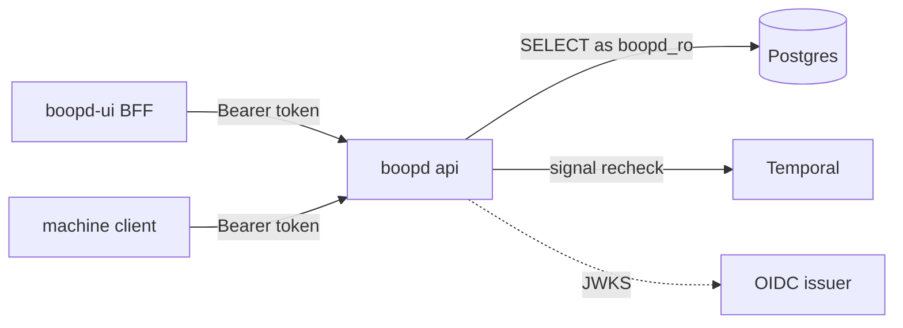

# API

`boopd api` serves boop's read API, its one action (a recheck) and
the public status summary, from the event store behind OIDC. The UI is
its main client, and machine clients (a correlator, scripts) use the
same contract. This guide covers turning it on, the identity setup, the
authz file and how to call it.

- The design is [DESIGN-0004](design/0004-boopd-api-and-management-ui-event-store-pr-inventory-and-estate.md).
- The contract is [`api/openapi.yaml`](../api/openapi.yaml), served at
  `/api/v1/openapi.yaml`.
- The config reference is [config.md](config.md#api), and the UI is
  covered in [ui.md](ui.md).

<!--toc:start-->
- [What you get](#what-you-get)
- [1. Set up the identity provider](#1-set-up-the-identity-provider)
- [2. Write the authz file](#2-write-the-authz-file)
- [3. Turn on the API in the chart](#3-turn-on-the-api-in-the-chart)
- [4. Verify](#4-verify)
- [Endpoints](#endpoints)
- [Paging](#paging)
- [Errors](#errors)
- [The correlator's entry points](#the-correlators-entry-points)
- [Rollback](#rollback)
<!--toc:end-->

## What you get



- **Read-only on the store.** The API connects as `boopd_ro`, the role
  with SELECT and nothing else.
- **One action.** `POST /repositories/{id}/recheck` signals the
  repository's workflow through Temporal. The run and its
  `action.recheck` event, which names the caller, follow
  asynchronously.
- **Stateless.** Tokens are verified against the issuer's JWKS, and the
  authz file is read once at start. Replicas need no coordination.

## 1. Set up the identity provider

The API accepts **access tokens** whose `aud` holds its audience, and
refuses ID tokens. With Keycloak:

1. **`boopd-api` client.** Create an OpenID Connect client with client
   authentication off and every flow off. It exists only to name the
   audience; nothing signs in as it.
2. **`boopd-ui` client.** Create a confidential client with the standard
   flow (authorization code), PKCE method `S256`, and the redirect URI
   `https://<ui host>/auth/callback`. The UI signs users in through it
   (see [ui.md](ui.md#1-set-up-the-identity-provider)).
3. **Audience mapper.** On `boopd-ui`'s dedicated client scope, add an
   *Audience* mapper with included client audience `boopd-api` and
   "Add to access token" on. Without it the UI's tokens are refused with
   401.
4. **Groups mapper.** Add a *Group Membership* mapper, token claim name
   `groups`, with "Full group path" off and "Add to access token" on.
   The authz file matches these names.
5. **Machine clients.** Give each one a confidential client with the
   service-accounts (client credentials) flow and the same audience
   mapper. The API identifies it by `azp`, which the authz file's
   `clients` maps to groups.

Then set `boopd.api.auth` in the chart:

```yaml
boopd:
  api:
    auth:
      issuer: https://keycloak.example/realms/fartlab
      audience: boopd-api
      # nameClaim: preferred_username   # what /me shows
      # groupsClaim: groups
```

Discovery of the issuer runs in the background. `/readyz` fails until
it succeeds, so a wrong issuer shows as an unready pod, not a crash.

## 2. Write the authz file

The authz file maps the token's groups to what the caller may see and
do:

```yaml
owners:              # group -> GitHub owners it may see ("*" = all)
  platform: ["*"]
  team-web: [acme-web, acme-design]
operators:           # groups allowed to POST actions
  - platform
clients:             # a machine client's azp -> groups
  correlator: [platform]
```

- **Owners** are installation account logins, compared
  case-insensitively. A caller's scope is the union over its groups, so
  a caller in no mapped group sees nothing, and the UI says so rather
  than showing empty pages.
- **A repository outside the scope answers 404**, the same as an
  unknown one. Its existence does not leak.
- **Actions need an operator group.** Without one, an action answers
  403.
- **`/deliveries` needs `"*"`.** Deliveries are installation-wide, so a
  narrower scope gets 403. The UI explains this instead of asking.
- **The file is strict.** Unknown keys fail the load. So does a client
  mapped to a group the file defines under neither `owners` nor
  `operators`.

In the chart the file is `api.authz`. It is rendered into a ConfigMap,
mounted at `/etc/boopd/authz.yaml`, and a change rolls the pods.

## 3. Turn on the API in the chart

The API needs the store ([config.md § store](config.md#store)):

```yaml
store:
  enabled: true
  existingSecret: boopd-store     # owner-dsn, worker-dsn, ingest-dsn, ro-dsn
api:
  enabled: true
  authz:
    owners: {platform: ["*"]}
    operators: [platform]
  # temporalOidc: {clientId: boopd-api, existingSecret: boopd-api-temporal}
boopd:
  api:
    auth: {issuer: https://keycloak.example/realms/fartlab, audience: boopd-api}
    statusPublic: true
```

- **The API pod mounts only `ro-dsn`.** It carries no App key, GitHub
  token or ServiceAccount token.
- **Temporal.** It reaches Temporal with the worker's settings. With
  Temporal OIDC, `api.temporalOidc` gives it its own client.
- **Exposure.** The UI reaches the API in-cluster. Expose `/api` only
  for machine clients, through `api.ingress` or `api.httpRoute`.
- **Network policy.** With `networkPolicies.enabled`, the API takes
  ingress from the UI pods and `api.networkPolicy.from`. It reaches
  only DNS, Postgres's read-only service (`store.networkPolicy.ro`),
  Temporal and the IdP.

## 4. Verify

```sh
kubectl -n boopd port-forward svc/boopd-api 8080 &
curl -s localhost:8080/api/v1/status | jq .          # public unless statusPublic: false
TOKEN=$(...)   # an access token for boopd-api, e.g. a client-credentials grant
curl -s -H "Authorization: Bearer $TOKEN" localhost:8080/api/v1/me | jq .
```

`/me` shows the caller's name, groups, visible owners and whether they
are an operator. An empty `owners` means the groups claim is missing or
unmapped.

## Endpoints

Every path is under `/api/v1`. All but one are GETs, and all but
`/status` and `/openapi.yaml` need a token. Lists answer
`{items, next_cursor}`.

| Path | What |
| - | - |
| `/me` | The caller: name, groups, visible owners, operator. |
| `/estate`, `/estate/series` | Fleet numbers (repositories, open PRs, waiting items, runs, spend) and their daily series over a range. |
| `/installations` | Installations with onboarded repositories and the latest spend. |
| `/repositories` | Repositories by slug: `q` (prefix), `state`, `profile`, `has_open_prs`. |
| `/repositories/{id}` | One repository's state, schedule and counts. |
| `/repositories/{id}/events`, `/runs`, `/dependencies` | Its timeline, runs and dependencies from the latest run. |
| `POST /repositories/{id}/recheck` | Ask for a run now (operators). 202 with the request ID; a repeat within a minute is 202 without a second signal; 409 `workflow_missing`; 503 when Temporal is down. |
| `/pull-requests` | Renovate's PRs, oldest first: `state`, `manager`, `update_type`, `older_than` (days), `automerge`, `label`. |
| `/pull-requests/{repo_id}/{number}` | One PR with its updates and timeline. |
| `/dashboard-items` | Dependency Dashboard items waiting on a human, by section. |
| `/packages` | Packages by purl, with how many repositories use each. |
| `/dependencies` | Dependencies across the visible repositories: `purl`, `manager`, `owner`. |
| `/updates` | Proposed updates from the latest runs: `purl`, `from`, `to`, `update_type`. |
| `/runs`, `/events` | Runs and events across the visible repositories. |
| `/deliveries` | Webhook deliveries with GitHub's status from the audit (owners `"*"` only). |
| `/status` | Public aggregate status: no owner or repository names. |
| `/openapi.yaml` | The contract. |

**Conventions:**

- JSON fields are snake_case, and times are RFC 3339 UTC.
- Enums documented as open may gain values within `/api/v1`. Treat an
  unknown value as opaque.

## Paging

Lists are keyset-paged with `?cursor=&limit=`:

- `limit` defaults to 50, and the most is 200.
- Pass back `next_cursor` until it is absent.
- A cursor is bound to the filters it was issued for. Reusing it with
  different filters is a 400; restart without it.

## Errors

Errors are [RFC 9457](https://www.rfc-editor.org/rfc/rfc9457) problem
details (`application/problem+json`) carrying `request_id`. Every
response also carries `X-Request-Id`, and the API's log lines carry
the same ID.

| Status | When |
| - | - |
| 400 | A bad parameter or a cursor reused with other filters. |
| 401 | No token, an ID token, the wrong audience or an expired token. |
| 403 | An action without an operator group, or `/deliveries` without `"*"`. |
| 404 | Unknown, or outside the caller's owners. |
| 409 | A recheck for a repository with no running workflow. |
| 503 | Temporal is unreachable (recheck), or the issuer has not been discovered yet. |

## The correlator's entry points

To answer "where is this package, and what does Renovate want to do
about it?", a client starts from a package URL
([purl](https://github.com/package-url/purl-spec)):

- **`GET /dependencies?purl=pkg:npm/react`** lists every visible
  repository that depends on the package, with the manager, file and
  current version.
- **`GET /updates?purl=pkg:npm/react@18.3.1`** lists the proposed
  updates from that version, with the target version, update type and
  branch. Without a version, it covers every version.

Purls come from Renovate's datasource and package name, so the same
package matches across repositories.

## Rollback

Set `api.enabled: false`. The API holds no state, and the store keeps
recording without it. The UI needs the API, so disable `ui.enabled`
with it.
