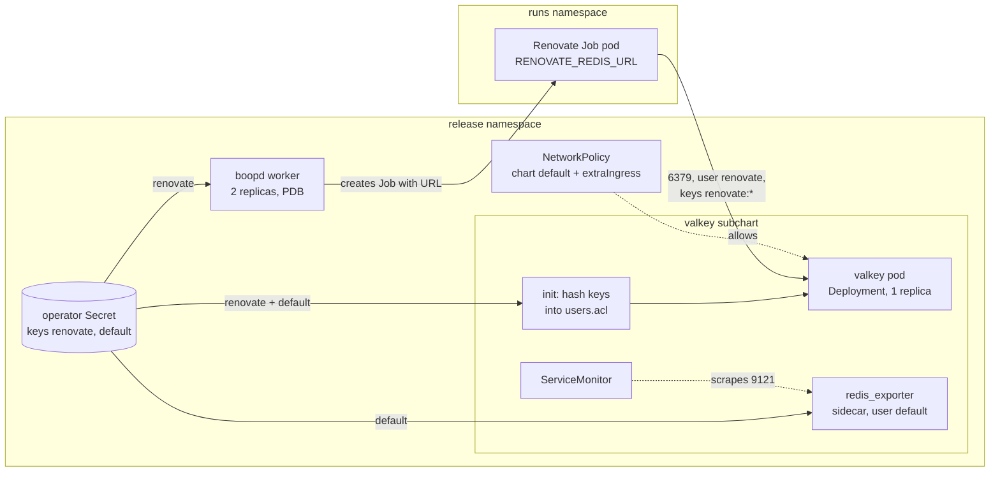
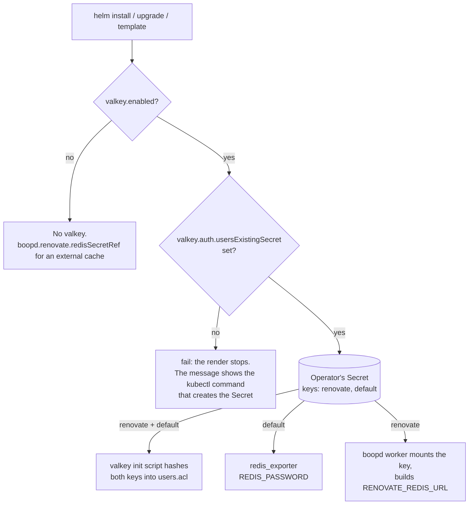

<!-- markdownlint-disable-file MD024 MD025 MD041 -->

# DESIGN-0002: Valkey as the bundled Renovate cache

<!--toc:start-->
- [Overview](#overview)
- [Goals and Non-Goals](#goals-and-non-goals)
  - [Goals](#goals)
  - [Non-Goals](#non-goals)
- [Background](#background)
  - [Today: the local redis subchart](#today-the-local-redis-subchart)
  - [The valkey-io chart](#the-valkey-io-chart)
- [Detailed Design](#detailed-design)
  - [Components](#components)
  - [The dependency](#the-dependency)
  - [The password Secret](#the-password-secret)
  - [ACL users](#acl-users)
  - [boopd's config](#boopds-config)
  - [Valkey configuration](#valkey-configuration)
  - [The Valkey passthrough](#the-valkey-passthrough)
  - [The Valkey NetworkPolicy](#the-valkey-networkpolicy)
  - [The worker's passthrough](#the-workers-passthrough)
  - [What else in the parent chart changes](#what-else-in-the-parent-chart-changes)
- [API / Interface Changes](#api--interface-changes)
  - [Values](#values)
  - [Removed values](#removed-values)
  - [Go and boopd.hcl](#go-and-boopdhcl)
- [Data Model](#data-model)
- [Testing Strategy](#testing-strategy)
- [Migration / Rollout Plan](#migration--rollout-plan)
- [Open Questions](#open-questions)
- [Resolved Questions](#resolved-questions)
- [References](#references)
<!--toc:end-->

## Overview

The chart bundles a cache for Renovate's datasource lookups. Today it is a
local `redis` subchart (`charts/boopd/charts/redis`). This design replaces
it with the official Valkey chart (`valkey-io/valkey-helm`), the one the
homelab already runs for its other apps.

The design keeps three things from today:

- the cache's behaviour: an LRU cache with no persistence, and an ACL user
  for Renovate limited to its key prefix;
- the GitOps story from IMPL-0002: the password comes from a Secret the
  operator manages;
- `boopd.hcl`'s contract: no Go change.

It changes or adds four things:

- **The chart never creates a password.** With Valkey on, the operator
  names a Secret. Until they do, the render fails with a message that
  says how to create one. A chart bump can therefore never rotate a
  password, under `helm upgrade` or Argo CD alike.
- **A documented Valkey passthrough** in `values.yaml`. It covers labels,
  annotations, the PDB, replica mode, ServiceMonitor, PodMonitor,
  PrometheusRule, scheduling, resources and images, so this Valkey is
  configured like any other homelab Valkey.
- **A NetworkPolicy for Valkey** with a chart default that the operator
  can extend or replace.
- **The worker gets the same passthrough:** `commonLabels`, a PDB,
  topology spread, a priority class and Service annotations.

## Goals and Non-Goals

### Goals

- Valkey from the official `valkey-io/valkey-helm` chart replaces the local
  redis subchart. It is on by default, as `valkey.enabled`.
- The password Secret is always the operator's
  (`valkey.auth.usersExistingSecret`). Leaving it unset fails the render
  with an actionable message.
- `renovate` and `default` have separate keys in that Secret.
- Valkey's metrics, with the exporter and a ServiceMonitor, work while the
  `default` user still can't read the cache.
- Every Valkey chart knob is reachable from boopd's values, and the
  commonly used ones are listed with defaults.
- The worker gains `commonLabels`, `commonAnnotations`, a PDB,
  `topologySpreadConstraints`, `priorityClassName` and
  `service.annotations`.
- Renovate's isolation is unchanged: the `renovate` user reaches only
  `renovate:*` keys and no dangerous commands.
- No change to `internal/` or to `boopd.hcl`'s schema.

### Non-Goals

- **Valkey replication or Sentinel failover for boopd.** It is a cache, and
  losing it costs one cold run. Replica mode stays reachable through the
  passthrough, but it is not tuned or tested.
- **An HPA**, for either workload:
  - The Valkey chart has none, and a cache with one writer does not scale
    out.
  - The worker runs a fixed, small replica count (ADR-0008 as amended by
    ADR-0009). Runs scale as Jobs.
- **A Valkey operator.** The homelab notes `valkey-io/valkey-operator` is
  not production-ready.
- **Changing the external-cache path.** `boopd.renovate.redisSecretRef` with
  `valkey.enabled: false` stays as it is.
- **Migrating cache contents.** The cache starts empty after the switch.

## Background

### Today: the local redis subchart

IMPL-0001 Phase 7 and IMPL-0002 Phase 3 built `charts/boopd/charts/redis`:

| Piece | Today |
| - | - |
| Workload | Deployment, 1 replica, `redis:8.2-alpine` pinned by digest, uid 999, read-only root |
| Cache | `--maxmemory 256mb --maxmemory-policy allkeys-lru --save "" --appendonly no`, `emptyDir` data |
| Auth | `--aclfile`: `user default off`, `user renovate on #<sha256> resetkeys ~renovate:* … -@dangerous` |
| Password | `lookup` of `<release>-redis-auth`, else `randAlphaNum 40`; or `redis.auth.existingSecret`, hashed by an init container |
| boopd wiring | `redis_secret_ref` (the chart Secret's `url` key), or `redis_url` with `redis_password_secret_ref` (existing Secret) |
| Extras | none: no labels, PDB, metrics or scheduling values |

### The valkey-io chart

The homelab deploys `valkey-io/valkey-helm` 0.9.4: standalone, ACL auth,
`auth.usersExistingSecret`, metrics with a ServiceMonitor
(`homelab/k8s/apps/fartlab/valkey/values.yaml`). The latest release is
**0.12.0 (Valkey 9.1.2)**. The parts this design relies on, read from the
chart source:

- **Auth:**
  - Each `auth.aclUsers.<name>` entry has `permissions` and either an
    inline `password` or a `passwordKey` into `auth.usersExistingSecret`.
  - **`passwordKey` defaults to the user's name.** A Secret with the keys
    `renovate` and `default` therefore needs no `passwordKey` at all.
  - The init script hashes each password with `sha256sum` and writes
    `user <name> on #<hash> <permissions>` into `/etc/valkey/users.acl`,
    on a memory `emptyDir`. If a key is missing, the script exits non-zero
    and the pod does not start.
  - **The chart never generates a password.** Inline passwords go into a
    chart Secret as given.
- **A `default` user is mandatory** when auth is on; the render fails
  without it. The `redis_exporter` sidecar logs in as `default`, with
  `REDIS_PASSWORD` from `default`'s `passwordKey` (default key name:
  `default`).
- **Passthrough knobs:**
  - labels and annotations: `commonLabels`, `podLabels`, `podAnnotations`,
    `workloadAnnotations`, `service.annotations`,
    `serviceAccount.annotations`;
  - scheduling: `nodeSelector`, `tolerations`, `affinity`,
    `topologySpreadConstraints`, `priorityClassName`, `runtimeClassName`;
  - `resources`, `podDisruptionBudget`;
  - `networkPolicy`: a verbatim `ingress`/`egress` spec for one policy
    named `<fullname>`;
  - metrics: `metrics.serviceMonitor`, `metrics.podMonitor` and
    `metrics.prometheusRule`;
  - topology: `replica.*` for a primary and replicas, `dataStorage.*` for
    a PVC.
- **No HPA, and a PDB only in replica mode.** Standalone is a
  one-replica Deployment. Replica mode is a StatefulSet with one primary,
  where pod 0 takes writes, and read-only replicas. There is no automatic
  failover.
- **Security defaults** fit the restricted Pod Security profile:
  - uid/gid 1000 and `runAsNonRoot`;
  - read-only root, `drop: [ALL]` and `seccompProfile: RuntimeDefault`;
  - `automountServiceAccountToken: false`.
- **Image:** `image.tag` is printed as `<registry>/<repository>:<tag>`, so
  a `9.1.2-alpine@sha256:…` tag pins by digest.

## Detailed Design

### Components



The worker never connects to Valkey. As today, it reads the password at
start, builds the URL and passes it to each Job as `RENOVATE_REDIS_URL`.

### The dependency

`Chart.yaml` replaces the local `redis` dependency:

```yaml
dependencies:
  - name: valkey
    version: 0.12.0
    repository: https://valkey-io.github.io/valkey-helm
    # redis.enabled first: Helm uses the first path that is set, so a
    # values file from v0.3.x still switches the cache (OQ6).
    condition: redis.enabled,valkey.enabled
```

**`Chart.lock` is committed. `charts/boopd/charts/*.tgz` is ignored by
git, and every place that renders or packages the chart runs `helm
dependency build charts/boopd` first.** This is Helm's documented layout,
and most published charts that have dependencies use it, Bitnami's
included. The places that run it:

- `helm.just`: `helm-lint`, `helm-unittest`, `helm-config-validate`,
  `helm-template-stable` and `helm-package`;
- `ci.yml`'s Lint and Helm Unit Tests jobs (`ct` builds dependencies
  itself);
- `release.yml`'s package step;
- `just e2e` and `just k3d-install`.

Renovate (the bot) bumps the version and `Chart.lock` through its `helmv3`
manager. `charts/boopd/charts/redis/` is deleted.

It works with every way the homelab consumes a chart:

| Consumer | How it gets the subchart |
| - | - |
| Argo CD, Kargo or kustomize `helmCharts` on the published OCI chart (the homelab's path) | `helm package` puts `charts/valkey-0.12.0.tgz` inside the boopd package. The consumer pulls one artefact and never contacts the valkey-io repository |
| Argo CD on the git path (`charts/boopd`) | Argo's repo-server runs `helm dependency build` when `Chart.yaml` lists dependencies, using `Chart.lock`. The repository is public, so no credentials are needed |
| Kargo promotion | promotes the boopd chart version; the subchart is pinned inside it |

A vendored `.tgz` would only help consumers that render the git path
with no network access, and boopd has none.

### The password Secret



The chart renders no password Secret. `valkey.auth.usersExistingSecret`
defaults to `""`, and while Valkey is enabled the guard
`boopd.validateValkey` fails the render when it is empty:

```text
valkey.auth.usersExistingSecret is required when valkey.enabled is true.
boopd does not generate the Valkey passwords. Create a Secret with the
keys "renovate" and "default", then set valkey.auth.usersExistingSecret
to its name:

  kubectl -n <namespace> create secret generic <release>-valkey-auth \
    --from-literal=renovate="$(openssl rand -hex 32)" \
    --from-literal=default="$(openssl rand -hex 32)"

  --set valkey.auth.usersExistingSecret=<release>-valkey-auth

In GitOps, manage the Secret with your secrets tool (1Password, External
Secrets, SOPS) next to the release. To use an external cache instead, set
valkey.enabled=false and boopd.renovate.redisSecretRef.
```

The same requirement is stated in four more places, so it is hard to
miss:

- the `# --` comment on the value, so it appears in the helm-docs table;
- the README's install section (it becomes step 1);
- the "GitOps installs" section;
- `docs/config.md`.

Because no Secret is chart-generated:

- **There is no `lookup`,** so `helm install`, `helm upgrade` and
  `helm template` (Argo CD, kustomize) behave the same. A bump never
  touches the password.
- **Rotation is the operator's job.** Update the Secret, then restart
  Valkey and the worker (`kubectl rollout restart`). Valkey reads its ACL
  file only at start, and the worker reads the password only at start.
  The README documents this order.
- **A missing key fails loudly.** The Valkey pod stays in `Init`, and the
  worker pod reports `CreateContainerConfigError` naming the key. The chart
  can't check keys at render time, because `lookup` is empty under
  `helm template`.
- **`auth.enabled: false` is rejected** by the same guard. An open cache
  would be reachable by anything the NetworkPolicy lets in.

### ACL users

Two users, set in the parent's `values.yaml` and passed through:

```yaml
valkey:
  auth:
    enabled: true
    # -- Required. Secret with keys `renovate` and `default`.
    usersExistingSecret: ""
    aclUsers:
      renovate:
        permissions: >-
          resetkeys ~renovate:* resetchannels -@all
          +@read +@write +@connection -@dangerous +client|setinfo
      default:
        permissions: >-
          resetkeys resetchannels -@all
          +ping +info +config|get +client|setname +client|setinfo
          +client|list +slowlog|get +slowlog|len
          +latency|latest +latency|histogram +dbsize
```

**`renovate`** has today's rules exactly, moved from the redis subchart's
`redis.aclRules` helper. Its `passwordKey` is unset, so it reads the key
`renovate`.

**`default`** is the exporter's identity, and gets a read-only command set
with no key pattern. Its `passwordKey` is unset, so it reads the key
`default`.

- `redis_exporter` gets every metric from `INFO`, `CONFIG GET`, `SLOWLOG`,
  `LATENCY`, `CLIENT` and `DBSIZE`. Keyspace sizes come from
  `INFO keyspace`. So metrics are complete.
- Valkey's `+@read` category is not used, because it grants reads of
  key data, and monitoring needs none.
- `default` has no `~pattern`, so `GET`, `KEYS` and `SCAN` against cache
  data all fail with `NOPERM`.
- The exporter's `--check-keys` options would need key reads. They stay
  off.
- The e2e test pins the set:
  - the exporter reports `redis_up 1`;
  - its log shows no `NOPERM`;
  - `default` can't read a `renovate:` key.

  If a later exporter version needs another command, the test fails and
  the command is added.

The prefix appears in two places: the `renovate` user's `~<prefix>*` and
Renovate's `redisPrefix`. The guard fails the render unless
`aclUsers.renovate.permissions` contains `~<valkey.keyPrefix>*`.
`boopd.renovateGlobal` keeps defaulting `redisPrefix` from
`valkey.keyPrefix`.

### boopd's config

The parent uses IMPL-0002's password-only form:

```hcl
renovate {
  redis_url = "redis://renovate@<valkey fullname>.<namespace>.svc:6379"

  redis_password_secret_ref {
    name = "<valkey.auth.usersExistingSecret>"
    key  = "<aclUsers.renovate.passwordKey, else renovate>"
  }
}
```

The worker mounts that key at `<secretsDir>/<name>/<key>` through
`boopd.configSecrets`, as today. An explicit `boopd.renovate.redisSecretRef`
still wins, and with it the chart renders neither `redis_url` nor the
password ref.

The Valkey fullname is `<release>-valkey` unless `valkey.fullnameOverride`
or `valkey.nameOverride` is set. The parent computes it with the same rule,
so overrides carry through.

### Valkey configuration

The cache behaviour moves into `valkeyConfig`:

```yaml
valkey:
  valkeyConfig: |
    maxmemory 256mb
    maxmemory-policy allkeys-lru
    save ""
    appendonly no
  dataStorage:
    enabled: false   # emptyDir: a cache, no PVC
  resources:
    requests: {cpu: 50m, memory: 300Mi}
    limits: {cpu: 500m, memory: 300Mi}
  image:
    tag: "9.1.2-alpine@sha256:<digest>"   # pinned; Renovate keeps it current
```

`deploymentStrategy` stays `RollingUpdate`. With an `emptyDir` there is no
volume to deadlock on, and a rollout briefly runs two pods, each an empty
cache.

### The Valkey passthrough

Everything under `valkey:` reaches the subchart unchanged. The parent's
`values.yaml` lists the commonly used knobs with their defaults and a
`# --` comment each, so helm-docs documents them. Any other subchart value
works too:

| Area | Keys (under `valkey:`) | boopd default |
| - | - | - |
| Labels and annotations | `commonLabels`, `podLabels`, `podAnnotations`, `workloadAnnotations`, `service.annotations`, `serviceAccount.annotations` | `{}` |
| Disruption | `podDisruptionBudget.{enabled,minAvailable,maxUnavailable,unhealthyPodEvictionPolicy}` | off. Renders only with `replica.enabled`; the README says so |
| Scaling | `replica.{enabled,replicas,…}` | off. Replicas are read-only; Renovate uses the primary only. Untested for boopd |
| Metrics | `metrics.enabled`, `metrics.exporter.resources`, `metrics.serviceMonitor.*`, `metrics.podMonitor.*`, `metrics.prometheusRule.*` | off; independent of boopd's own `serviceMonitor` |
| Scheduling | `nodeSelector`, `tolerations`, `affinity`, `topologySpreadConstraints`, `priorityClassName`, `runtimeClassName` | `{}` / `[]` / `""` |
| Resources and probes | `resources`, `initResources`, `startupProbe`, `livenessProbe`, `readinessProbe` | as above; the chart's probes |
| Network | `networkPolicy` | `{}`. See [the Valkey NetworkPolicy](#the-valkey-networkpolicy) |
| Images | `image.*`, `global.imageRegistry`, `global.imagePullSecrets`, `metrics.exporter.image.*` | pinned Valkey image; the chart's exporter image |
| Storage | `dataStorage.*` | off |
| Names | `nameOverride`, `fullnameOverride` | `""` |

The parent's `values.schema.json` declares `valkey` as an open object. It
types the keys the parent reads (`enabled`, `keyPrefix`,
`auth.usersExistingSecret`, `auth.aclUsers`) and leaves the rest to the
subchart's schema.

### The Valkey NetworkPolicy

Like the password Secret, the NetworkPolicy has a chart default, a way to
extend it, and a way to bring your own. NetworkPolicies are additive (a
pod admits the union of every policy that selects it), so the three
compose without conflict:

| Layer | Values | What renders |
| - | - | - |
| Chart default | `networkPolicies.enabled` and `networkPolicies.valkey.enabled` (default `true`) | `<release>-boopd-valkey`, selecting the Valkey pods: deny all ingress except 6379 from Renovate Job pods (`app.kubernetes.io/managed-by: boopd` and `app.kubernetes.io/component: renovate-run`, with a `namespaceSelector` when runs use another namespace) and 9121 from anywhere for scraping |
| Extend | `networkPolicies.valkey.extraIngress: []` | NetworkPolicyIngressRule entries appended to the default, e.g. a Prometheus namespace selector to narrow 9121, or a debug pod |
| Bring your own | `networkPolicies.valkey.enabled: false`, plus `valkey.networkPolicy` (passthrough) or `extraObjects` | the default is not rendered; the subchart renders its own `<release>-valkey` policy from the given spec |

The default's metrics rule is controlled by
`networkPolicies.valkey.metricsFrom`, a list of NetworkPolicyPeers. It
defaults to `[]`, meaning from anywhere, as the homelab scrapes. Setting
it narrows 9121 to those peers. The parent's policy and the subchart's are
named differently, so both can exist; the chart README explains the union
rule. Job egress (`templates/networkpolicy.yaml`) switches its Valkey
selector to `app.kubernetes.io/name: valkey`.

### The worker's passthrough

The worker already has `podLabels`, `podAnnotations`,
`serviceAccount.annotations`, `nodeSelector`, `tolerations`, `affinity`,
`serviceMonitor` and `prometheusRule`. This design adds:

| Value | Default | Applies to |
| - | - | - |
| `commonLabels` | `{}` | every resource the parent renders (not the subchart: set `valkey.commonLabels` too; the README shows one YAML anchor for both) |
| `commonAnnotations` | `{}` | every resource the parent renders |
| `podDisruptionBudget.enabled` | `true` | a PDB selecting the worker pods |
| `podDisruptionBudget.maxUnavailable` | `1` | |
| `podDisruptionBudget.minAvailable` | unset | mutually exclusive with `maxUnavailable`; the guard fails if both are set |
| `podDisruptionBudget.unhealthyPodEvictionPolicy` | `AlwaysAllow` | lets a drain evict a crash-looping worker |
| `topologySpreadConstraints` | `[]` | worker pod spec; `labelSelector` defaults to the worker's selector labels when omitted |
| `priorityClassName` | `""` | worker pod spec |
| `service.annotations` | `{}` | the worker Service |

A PDB with `maxUnavailable: 1` holds back a node drain only while the
other replica is down. A drain waits on the evicted pod's grace period
(above StartToClose, so up to an hour) either way. The PDB stops two
workers being evicted at once, which would stall every run's heartbeat
together.

The PDB is on by default (OQ10). What it (`maxUnavailable: 1`,
`unhealthyPodEvictionPolicy: AlwaysAllow`) does, case by case:

| Situation | With the PDB | Without it |
| - | - | - |
| One node drained, one worker on it | Evicted at once. The Deployment starts a replacement elsewhere while the old pod finishes its grace period | Same |
| Both workers' nodes drained together (a node-pool upgrade, Karpenter consolidation) | The second eviction waits until the first worker's replacement is Ready, usually seconds. The drain or consolidation is that much slower | Both evicted together. No worker polls the task queue until a replacement starts, so workflow tasks and new runs pause. Running Jobs carry on, but their `RunRenovate` heartbeats stop until a worker picks the activity up again |
| `replicaCount: 1` | One eviction is allowed, so a drain never blocks | Same |
| A worker crash-looping or not Ready | `AlwaysAllow` lets it be evicted anyway, so a broken pod never blocks a drain | Same |
| `kubectl delete pod`, a rollout, an OOM kill | Not affected: PDBs only gate the eviction API | Same |

The well-known PDB failure is a `minAvailable` equal to the replica
count, which blocks every drain forever. `maxUnavailable: 1` cannot do
that at any replica count. The costs are one extra object and slightly
slower parallel drains.

`boopd.labels` gains `commonLabels`, and every template's metadata gains
`commonAnnotations`. Selector labels are unchanged, so adding labels never
recreates a Deployment.

### What else in the parent chart changes

| File | Change |
| - | - |
| `templates/_config.tpl` | `boopd.redisSecretRef` is gone; `boopd.redisPasswordRef` reads `usersExistingSecret` and `renovate`'s `passwordKey`; the URL host is the Valkey fullname |
| `templates/_helpers.tpl` | `boopd.validateRedisAuth` is replaced by `boopd.validateValkey` (Secret required, auth on, prefix guard); `boopd.labels` adds `commonLabels`; the PDB guard |
| `templates/valkey-networkpolicy.yaml` | new: the default Valkey ingress policy |
| `templates/pdb.yaml` | new: the worker PDB |
| `templates/deployment.yaml` | `topologySpreadConstraints`, `priorityClassName` |
| `templates/service.yaml` | `service.annotations` |
| `templates/networkpolicy.yaml` | the Job egress selector becomes `app.kubernetes.io/name: valkey` |
| `templates/resourcequota.yaml` | counts Valkey pods when Valkey shares the runs namespace: 1, or `replica.replicas + 1` in replica mode |
| `ci/ci-values.yaml` | `ct install` gets a Secret through `extraObjects`, with fixed test passwords, and `usersExistingSecret` set to its name |
| `README.md.gotmpl` | the install section starts with the Secret; "GitOps installs" and the passthrough tables |

## API / Interface Changes

### Values

| New | Default | Purpose |
| - | - | - |
| `valkey.enabled` | `true` | run the subchart (was `redis.enabled`) |
| `valkey.keyPrefix` | `"renovate:"` | owned by the parent: `redisPrefix` and the ACL guard |
| `valkey.auth.usersExistingSecret` | `""`, required | the operator's Secret with keys `renovate` and `default` |
| `valkey.auth.aclUsers.{renovate,default}` | as above | users and permissions; `passwordKey` renames a key |
| `valkey.valkeyConfig` | the cache config above | maxmemory and eviction |
| `valkey.*` | subchart defaults | the passthrough |
| `networkPolicies.valkey.{enabled,extraIngress,metricsFrom}` | `true`, `[]`, `[]` | the default Valkey policy |
| `commonLabels`, `commonAnnotations` | `{}` | worker resources |
| `podDisruptionBudget.*` | on, `maxUnavailable: 1` | the worker PDB |
| `topologySpreadConstraints`, `priorityClassName`, `service.annotations` | empty | the worker pod and Service |

### Removed values

Every `redis.*` key goes from `values.yaml` and the schema. An install that
still sets one is translated where Helm allows it, and fails where it
can't (OQ6). Helm can't fully translate, because a subchart reads its own
values block (`.Values.valkey`) and no parent template can change it.

| Old key | Handling |
| - | - |
| `redis.enabled` | **translated.** The dependency condition is `redis.enabled,valkey.enabled`, and the parent's `boopd.valkeyEnabled` helper reads the same two paths in the same order |
| `redis.keyPrefix` | **translated.** The parent owns the prefix: `boopd.keyPrefix` is `redis.keyPrefix` when set, else `valkey.keyPrefix`. The ACL guard then checks `aclUsers.renovate.permissions` against it, so an old non-default prefix fails until the permissions match too |
| `redis.maxmemory` | **fails**: use `maxmemory` in `valkey.valkeyConfig` |
| `redis.resources` | **fails**: use `valkey.resources` |
| `redis.image` | **fails**: use `valkey.image` |
| `redis.auth.existingSecret` | **fails**: use `valkey.auth.usersExistingSecret`; the Secret now needs keys `renovate` and `default` |
| `redis.auth.existingSecretKey` | **fails**: use `valkey.auth.aclUsers.renovate.passwordKey` |

The failures come from `boopd.validateRemovedValues`, which already
handles `configPath` and `resourceQuota.enabled`, and each message names
the replacement. A translated key also prints a deprecation line in
`NOTES.txt` naming its `valkey.*` spelling. The README's upgrade section
carries the table and a `yq` snippet that rewrites a v0.3.x values file.

### Go and boopd.hcl

None. `redis_url` and `redis_password_secret_ref` (IMPL-0002) are the
interface. The word "redis" stays in `boopd.hcl` because Renovate's option
is `redisUrl` and Valkey speaks the protocol. `docs/config.md` notes that
the bundled cache is Valkey.

## Data Model

The cache's data is disposable. It holds Renovate's datasource lookups
under `renovate:`, has no persistence, and the switch starts it empty.

The one stored artefact is the operator's Secret:

| Key | Value | Readers |
| - | - | - |
| `renovate` | any string; boopd escapes it into the URL | Valkey's init script (the `renovate` hash), the boopd worker (mounted file), and through the URL each Job |
| `default` | any string | Valkey's init script (the `default` hash) and the exporter (`REDIS_PASSWORD`) |

Setting `passwordKey` on a user renames that user's key. Two users can
point at one key, but the chart's default is separate keys.

## Testing Strategy

E2E first (IMPL-0001 OQ3), then unit tests for the render branches.

- **E2E (k3d).** The suite creates the Secret before every chart install,
  as an operator would.
  - `TestChart_WorkerRunsUnderChartRBAC` keeps passing, now against
    Valkey.
  - `TestChart_RedisExistingSecret` becomes `TestChart_ValkeyAuth`, and
    covers both users:
    - a `renovate` password with URL-hostile characters;
    - `AUTH renovate` works, and a run's `RENOVATE_REDIS_URL`
      authenticates;
    - `default` can `INFO` but gets `NOPERM` on `GET renovate:x`.

    Its CLI pods run `valkey-cli` from the parent's pinned `valkey.image`.
  - **New:** `TestChart_ValkeyMetrics`, with `valkey.metrics.enabled`:
    - the exporter reports `redis_up 1`, read through the API server's
      service proxy;
    - its log has no `NOPERM`.
  - **New:** `TestChart_ValkeyNetworkPolicy`, when the cluster enforces
    NetworkPolicy (k3d's default kube-router does):
    - a Job-labelled pod in the runs namespace reaches 6379;
    - an unlabelled pod does not;
    - an `extraIngress` peer does.
- **helm-unittest:**
  - **Render guards:**
    - an empty `usersExistingSecret` fails with the message above;
    - `auth.enabled: false` fails;
    - the prefix guard fails;
    - both `minAvailable` and `maxUnavailable` fail.
  - **boopd.hcl:**
    - it has `redis_url` and `redis_password_secret_ref`, and the key
      follows `passwordKey`;
    - an explicit `redisSecretRef` wins.
  - **The Valkey NetworkPolicy:**
    - the default renders, `extraIngress` is appended, and `metricsFrom`
      narrows 9121;
    - `networkPolicies.valkey.enabled: false` drops it.
  - **The worker:**
    - the PDB renders, and is absent when disabled;
    - `commonLabels` and `commonAnnotations` are on every parent resource,
      and selector labels are unchanged;
    - topology spread defaults to the worker's selector.
  - **Quota:** counts 1, or `replicas + 1`, Valkey pods.
  - **Passthrough:** `valkey.podLabels` is on the Valkey pod, and
    `metrics.serviceMonitor.enabled` renders a ServiceMonitor.
  - **Old values:** `redis.enabled: false` disables Valkey and the
    config wiring; `redis.keyPrefix` reaches `redisPrefix` and the guard;
    each failing `redis.*` key names its replacement; the NOTES
    deprecation lines appear.
- **`helm-template-stable`** keeps diffing two renders, now with
  `usersExistingSecret` set.
- **`helm-config-validate`** keeps validating the rendered `boopd.hcl` for
  the CI, example and existing-Secret values.
- **`ct install`** runs with `ci-values.yaml`'s `extraObjects` Secret.

## Migration / Rollout Plan

One PR, `minor` label (pre-1.0, breaking values):

1. Add the dependency and `Chart.lock`, add `helm dependency build` to
   every recipe and workflow, and gitignore `charts/*.tgz`.
2. Parent templates, values, schema and guards; delete `charts/redis/`.
3. The worker passthrough (PDB, labels, spread, priority, Service
   annotations).
4. Tests: unit, e2e, stable render, `ct` values.
5. Docs: the chart README, `docs/config.md`, CLAUDE.md's layout and chart
   lines, and an amendment note in DESIGN-0001's cache mentions.

There are no production installs yet (IMPL-0001 7.10, the homelab deploy,
is still pending), so the upgrade path matters mostly for dev clusters.
On `helm upgrade` from v0.3.x:

| Step | What happens |
| - | - |
| Values | With no `usersExistingSecret`, the render fails with the create-a-Secret message. `redis.enabled` and `redis.keyPrefix` are translated, with a NOTES warning; every other `redis.*` key fails, naming its replacement |
| Resources | Helm prunes `<release>-redis`, its Service and `<release>-redis-auth`. It creates the Valkey Deployment, Service, ConfigMaps and the policies |
| Worker | Rolls on `checksum/config` (new `redis_url`) and reads the new password at start |
| Runs | A run in flight keeps its old URL and loses the cache when redis goes. Renovate logs the Redis error and carries on uncached; implementation checks this in e2e |
| Cache | Starts empty; the next run per repository is a cold lookup |

An install that used `redis.auth.existingSecret` adds a `default` key to
that Secret and renames (or `passwordKey`-maps) the old key.

Rollback is `helm rollback`. The old redis subchart regenerates its own
password through `lookup`. The worker rolls on the changed config and
reads the same Secret, so the two agree.

## Open Questions

None open. The answered questions are listed under
[Resolved Questions](#resolved-questions).

## Resolved Questions

Answered 2026-10-15. All questions are resolved; the body above is written to these decisions.

| OQ | Question | Decision |
| - | - | - |
| 1 | Which Valkey chart? | **a**: official `valkey-io/valkey-helm`, 0.12.0 |
| 2 | Vendor the subchart? | **a**: commit `Chart.lock`, gitignore the `.tgz`, `helm dependency build` everywhere. This is idiomatic Helm, and the packaged OCI chart embeds the subchart for Argo CD, Kargo and kustomize ([The dependency](#the-dependency)) |
| 3 | GitOps without an existing Secret? | **b, made stricter**: the chart never generates; the render fails until `usersExistingSecret` is set, with a message showing how |
| 4 | Keys in the Secret? | **b**: separate keys, `renovate` and `default` (the chart's default `passwordKey` names) |
| 5 | What can `default` do? | **a**: monitoring commands, no keys. The exporter's metrics work fully with it ([ACL users](#acl-users)) |
| 7 | Worker passthrough in this design? | **b**: yes, `commonLabels`, `commonAnnotations`, PDB, spread, priority class, Service annotations. No HPA (ADR-0008) |
| 8 | Valkey metrics follow boopd's? | **a**: independent, off by default |
| 6 | Existing `redis.*` values? | **b, plus guards and docs**: translate `redis.enabled` and `redis.keyPrefix`; fail every other key, naming its replacement; README table and `yq` snippet ([Removed values](#removed-values)) |
| 9 | Who restricts ingress to Valkey? | **both**: a chart default, `extraIngress` to extend, and `enabled: false` plus the subchart's `networkPolicy` to replace ([The Valkey NetworkPolicy](#the-valkey-networkpolicy)) |
| 10 | Worker PDB on by default? | **a**: on, `maxUnavailable: 1`, `unhealthyPodEvictionPolicy: AlwaysAllow` ([The worker's passthrough](#the-workers-passthrough)) |
| 11 | Parent `commonLabels` into Valkey? | **a**: two values, `commonLabels` and `valkey.commonLabels`; the README shows one YAML anchor for both |

## References

- IMPL-0001 Phase 7 (the redis subchart); IMPL-0002 Phase 3
  (`redis.auth.existingSecret`, `redis_url`, `redis_password_secret_ref`,
  `helm-template-stable`)
- DESIGN-0001 § Credentials and the Job pod
- ADR-0008 and ADR-0009 (fixed worker replicas, runs as Jobs)
- [valkey-io/valkey-helm](https://github.com/valkey-io/valkey-helm),
  chart 0.12.0 (`values.yaml`, `templates/init_config.yaml`,
  `templates/deploy_valkey.yaml`, `templates/netpolicy.yaml`,
  `templates/_helpers.tpl`)
- Homelab: `k8s/apps/fartlab/valkey/values.yaml` (valkey-io 0.9.4,
  standalone, ACL, ServiceMonitor), `k8s/BOOTSTRAP.md` (Phase 4 Valkey)
- [Valkey ACL](https://valkey.io/topics/acl/)
- [Helm chart dependencies](https://helm.sh/docs/helm/helm_dependency/)
  and [Argo CD Helm dependencies](https://argo-cd.readthedocs.io/en/stable/user-guide/helm/)
