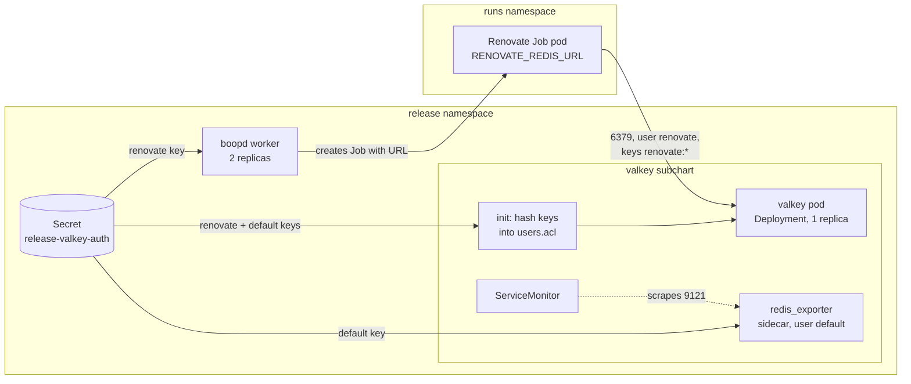
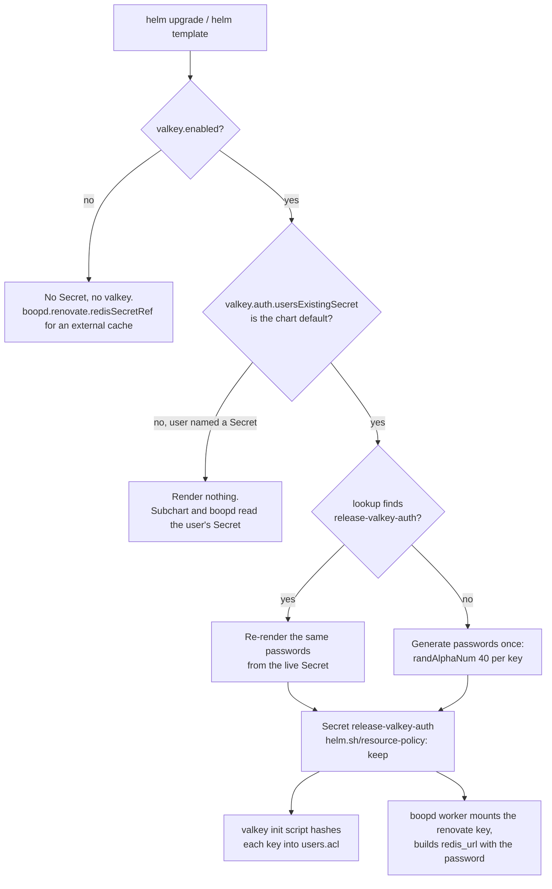

<!-- markdownlint-disable-file MD024 MD025 MD041 -->

# DESIGN-0002: Valkey as the bundled Renovate cache

<!--toc:start-->
- [Overview](#overview)
- [Goals and Non-Goals](#goals-and-non-goals)
  - [Goals](#goals)
  - [Non-Goals](#non-goals)
- [Background](#background)
  - [Today: the local redis subchart](#today-the-local-redis-subchart)
  - [The valkey-io chart](#the-valkey-io-chart)
- [Detailed Design](#detailed-design)
  - [Components](#components)
  - [The dependency](#the-dependency)
  - [The password Secret](#the-password-secret)
  - [ACL users](#acl-users)
  - [boopd's config](#boopds-config)
  - [Valkey configuration](#valkey-configuration)
  - [The passthrough section](#the-passthrough-section)
  - [What else in the parent chart changes](#what-else-in-the-parent-chart-changes)
- [API / Interface Changes](#api--interface-changes)
  - [Values](#values)
  - [Removed values](#removed-values)
  - [Go and boopd.hcl](#go-and-boopdhcl)
- [Data Model](#data-model)
- [Testing Strategy](#testing-strategy)
- [Migration / Rollout Plan](#migration--rollout-plan)
- [Open Questions](#open-questions)
  - [OQ1: Which Valkey chart?](#oq1-which-valkey-chart)
  - [OQ2: Is the subchart vendored?](#oq2-is-the-subchart-vendored)
  - [OQ3: What does a GitOps install get without an existing Secret?](#oq3-what-does-a-gitops-install-get-without-an-existing-secret)
  - [OQ4: How many keys does the password Secret hold?](#oq4-how-many-keys-does-the-password-secret-hold)
  - [OQ5: What can the default user do?](#oq5-what-can-the-default-user-do)
  - [OQ6: What happens to existing redis.* values?](#oq6-what-happens-to-existing-redis-values)
  - [OQ7: Does the passthrough cover the boopd worker too?](#oq7-does-the-passthrough-cover-the-boopd-worker-too)
  - [OQ8: Do Valkey's metrics follow boopd's?](#oq8-do-valkeys-metrics-follow-boopds)
  - [OQ9: Who restricts ingress to Valkey?](#oq9-who-restricts-ingress-to-valkey)
- [References](#references)
<!--toc:end-->

## Overview

The chart bundles a cache for Renovate's datasource lookups. Today it is a
local `redis` subchart (`charts/boopd/charts/redis`). This design replaces
it with the official Valkey chart (`valkey-io/valkey-helm`), the one the
homelab already runs for its other apps.

The design keeps three things from today:

- the cache's behaviour: an LRU cache with no persistence, one ACL user
  for Renovate limited to its key prefix;
- the GitOps story from IMPL-0002: a password from a Secret the operator
  manages;
- `boopd.hcl`'s contract: no Go change.

Two things are added:

- **A password the chart generates once and keeps.** It is reused on every
  upgrade whenever the operator has not supplied a Secret.
- **A documented passthrough section in `values.yaml`.** It covers labels,
  annotations, the PDB, replicas, ServiceMonitor, PodMonitor,
  PrometheusRule, scheduling and the NetworkPolicy, so Valkey is
  configured like any other homelab Valkey.

## Goals and Non-Goals

### Goals

- Valkey from the official `valkey-io/valkey-helm` chart replaces the local
  redis subchart, on by default, as `valkey.enabled`.
- An operator-supplied Secret (`valkey.auth.usersExistingSecret`) is always
  used when set, and the chart then renders no password Secret.
- Without one, the chart creates the password once, on install, and reuses
  it on every `helm upgrade`. A chart or app version bump never rotates it.
- Every Valkey chart knob is reachable from boopd's values, and the
  commonly used ones are listed with defaults.
- Renovate's isolation is unchanged: the `renovate` user reaches only
  `renovate:*` keys and no dangerous commands, and the `default` user can
  touch no keys.
- No change to `internal/` or to `boopd.hcl`'s schema.

### Non-Goals

- **Valkey replication or Sentinel failover for boopd.** It is a cache, and
  losing it costs one cold run. Replica mode stays reachable through the
  passthrough, but it is not tuned or tested.
- **A Valkey operator.** The homelab notes `valkey-io/valkey-operator` is
  not production-ready.
- **Changing the external-cache path.** `boopd.renovate.redisSecretRef` with
  `valkey.enabled: false` stays as it is.
- **Migrating cache contents.** The cache starts empty after the switch.

## Background

### Today: the local redis subchart

IMPL-0001 task 7.x and IMPL-0002 Phase 3 built `charts/boopd/charts/redis`:

| Piece | Today |
| - | - |
| Workload | Deployment, 1 replica, `redis:8.2-alpine` pinned by digest, uid 999, read-only root |
| Cache | `--maxmemory 256mb --maxmemory-policy allkeys-lru --save "" --appendonly no`, `emptyDir` data |
| Auth | `--aclfile`: `user default off`, `user renovate on #<sha256> resetkeys ~renovate:* … -@dangerous` |
| Password | `lookup` of `<release>-redis-auth`, else `randAlphaNum 40`; or `redis.auth.existingSecret`, hashed by an init container |
| boopd wiring | `redis_secret_ref` (chart Secret's `url` key), or `redis_url` with `redis_password_secret_ref` (existing Secret) |
| Extras | none: no labels, PDB, metrics or scheduling values |

### The valkey-io chart

The homelab deploys `valkey-io/valkey-helm` 0.9.4: standalone, ACL auth,
`auth.usersExistingSecret`, metrics with a ServiceMonitor
(`homelab/k8s/apps/fartlab/valkey/values.yaml`). The latest release is
**0.12.0 (Valkey 9.1.2)**. The parts this design relies on, read from
0.12.0:

- **Auth:**
  - `auth.aclUsers.<name>` has `permissions` and either an inline
    `password` or a `passwordKey` into `auth.usersExistingSecret`.
  - The chart's init script hashes each password with `sha256sum` and
    writes `user <name> on #<hash> <permissions>` into
    `/etc/valkey/users.acl`, on a memory `emptyDir`. This is the IMPL-0002
    init-container technique.
  - **The chart never generates a password.**
- **`auth.usersExistingSecret` goes through `tpl`.** A parent can default
  it to `{{ .Release.Name }}-valkey-auth`.
- **A `default` user is mandatory** when auth is on; the render fails
  without it. The `redis_exporter` sidecar authenticates as `default`, with
  `REDIS_PASSWORD` from `default`'s `passwordKey`.
- **Passthrough knobs:**
  - labels and annotations: `commonLabels`, `podLabels`, `podAnnotations`,
    `workloadAnnotations`, `service.annotations`,
    `serviceAccount.annotations`;
  - scheduling: `nodeSelector`, `tolerations`, `affinity`,
    `topologySpreadConstraints`, `priorityClassName`, `runtimeClassName`;
  - `resources`, `podDisruptionBudget`, `networkPolicy`;
  - metrics: `metrics.serviceMonitor`, `metrics.podMonitor` and
    `metrics.prometheusRule`;
  - topology: `replica.*` for a primary and replicas, `dataStorage.*` for
    a PVC.
- **No HPA, and the PDB only in replica mode.** Standalone is a
  one-replica Deployment. Replica mode is a StatefulSet with one primary,
  where pod 0 takes writes, and read-only replicas. There is no automatic
  failover.
- **Security defaults** fit the restricted Pod Security profile:
  - uid/gid 1000, `runAsNonRoot`;
  - read-only root, `drop: [ALL]`, `seccompProfile: RuntimeDefault`;
  - `automountServiceAccountToken: false`.
- **Image:** `image.tag` is printed as `<registry>/<repository>:<tag>`, so
  a `9.1.2-alpine@sha256:…` tag pins by digest.
- **The values schema allows extra keys,** so the parent can keep its own
  keys (`keyPrefix`) under `valkey:`.

## Detailed Design

### Components



The worker never connects to Valkey. It reads the password at start,
builds the URL and passes it to each Job as `RENOVATE_REDIS_URL`, as it
does today.

### The dependency

`Chart.yaml` replaces the local `redis` dependency:

```yaml
dependencies:
  - name: valkey
    version: 0.12.0
    repository: https://valkey-io.github.io/valkey-helm
    condition: valkey.enabled
```

`Chart.lock` is committed. Every place that renders or packages the chart
runs `helm dependency build charts/boopd` first (OQ2 a):

- `helm.just` (`helm-lint`, `helm-unittest`, `helm-config-validate`,
  `helm-template-stable`, `helm-package`);
- `ci.yml`'s Lint and Helm Unit Tests jobs (`ct` builds dependencies
  itself);
- `release.yml`'s package step;
- `just e2e` and `just k3d-install`.

`charts/boopd/charts/*.tgz` is ignored by git. Renovate (the bot) bumps
the dependency and `Chart.lock` through its `helmv3` manager.
`charts/boopd/charts/redis/` is deleted.

### The password Secret



One value names the Secret, and the subchart reads it directly:

```yaml
valkey:
  auth:
    usersExistingSecret: '{{ .Release.Name }}-valkey-auth'
```

The parent template `templates/valkey-auth-secret.yaml` renders the
Secret **only** when that value, after `tpl`, equals
`<release>-valkey-auth`, the chart's own name. An operator who sets any
other name owns the Secret, and the chart renders nothing.

When the chart owns it:

- **Stable password.** `lookup` reads the live Secret and re-renders its
  `password` byte for byte. Only when there is none (first install) is
  `randAlphaNum 40` called. Upgrades, chart bumps and `helm upgrade
  --reuse-values` all keep it.
- **Kept on uninstall.** `helm.sh/resource-policy: keep` keeps the Secret
  through an uninstall. A reinstall then finds it and keeps the password,
  so a reinstalled worker and Valkey agree without a restart order.
- **Restart when the password changes.** Valkey reads its ACL file only
  at start, and the subchart has no checksum of the Secret on its pod.
  The parent cannot add one, because subchart values are not templated.
  The password changes only on first install (nothing to restart) or when
  someone deletes the Secret. For that case the README says to restart
  Valkey and the worker. On upgrades the password does not change, so
  nothing needs to roll; the worker already rolls on `checksum/config`.
- **GitOps renders.** Argo CD and kustomize render with `helm template`,
  where `lookup` is empty. A chart-owned Secret would then rotate on
  every sync, and the worker and Valkey would disagree after their next
  restarts. GitOps installs must set `usersExistingSecret`. The chart
  makes this hard to miss (OQ3 a):
  - the README's "GitOps installs" section;
  - `NOTES.txt` warns when the Secret is chart-owned;
  - `helm-template-stable` renders with an existing Secret, as it does
    today.

### ACL users

Two users, set in the parent's `values.yaml` and passed through:

```yaml
valkey:
  auth:
    enabled: true
    usersExistingSecret: '{{ .Release.Name }}-valkey-auth'
    aclUsers:
      renovate:
        passwordKey: password
        permissions: "resetkeys ~renovate:* resetchannels -@all +@read +@write +@connection -@dangerous +client|setinfo"
      default:
        passwordKey: password
        permissions: "resetkeys resetchannels -@all +@connection +ping +info +config|get +client|list +slowlog|get +slowlog|len +latency|latest +dbsize"
```

- **`renovate`** has exactly today's rules, moved from the redis
  subchart's `redis.aclRules` helper.
- **`default`** is required by the chart. It gets the read-only command
  set `redis_exporter` needs and no keys (OQ5 a). Valkey applies ACL
  rules left to right, and the chart writes `on #<hash>` before them.
- **Both users read one key, `password`** (OQ4 a). An existing Secret
  needs one key, as with IMPL-0002's `redis.auth.existingSecret`. Pointing
  `default.passwordKey` at another key splits them.
- **Key prefix guard.** The prefix appears in two places: the `renovate`
  user's `~<prefix>*` and Renovate's `redisPrefix`. A parent guard fails
  the render unless `aclUsers.renovate.permissions` contains
  `~<valkey.keyPrefix>*`. `boopd.renovateGlobal` keeps defaulting
  `redisPrefix` from `valkey.keyPrefix`.

### boopd's config

The parent always uses IMPL-0002's password-only form, so the rendered
`boopd.hcl` is the same whether the Secret is chart-owned or not:

```hcl
renovate {
  redis_url = "redis://renovate@<release>-valkey.<namespace>.svc:6379"

  redis_password_secret_ref {
    name = "<usersExistingSecret, after tpl>"
    key  = "<aclUsers.renovate.passwordKey>"
  }
}
```

The worker mounts that key at `<secretsDir>/<name>/<key>` through
`boopd.configSecrets`, as today. An explicit `boopd.renovate.redisSecretRef`
still wins, and with it the chart renders neither `redis_url` nor the
password ref. The Service name is `valkey.fullname`, which is
`<release>-valkey` unless the operator overrides `valkey.fullnameOverride`.
The parent computes the same name with the same rule, so overrides carry
through.

### Valkey configuration

The cache behaviour moves into `valkeyConfig`:

```yaml
valkey:
  valkeyConfig: |
    maxmemory 256mb
    maxmemory-policy allkeys-lru
    save ""
    appendonly no
  dataStorage:
    enabled: false   # emptyDir: a cache, no PVC
  resources:
    requests: {cpu: 50m, memory: 300Mi}
    limits: {cpu: 500m, memory: 300Mi}
  image:
    tag: "9.1.2-alpine@sha256:<digest>"   # pinned; Renovate keeps it current
```

`deploymentStrategy` stays `RollingUpdate`. With an `emptyDir` there is no
volume to deadlock on, and a rollout briefly runs two pods, each an empty
cache. `maxmemory` moves from `redis.maxmemory` into this block.

### The passthrough section

Everything under `valkey:` reaches the subchart unchanged. The parent's
`values.yaml` lists the commonly used knobs with their defaults and a
`# --` comment each, so helm-docs documents them. Anything else in the
subchart's values works too:

| Area | Keys (under `valkey:`) | boopd default |
| - | - | - |
| Labels and annotations | `commonLabels`, `podLabels`, `podAnnotations`, `workloadAnnotations`, `service.annotations`, `serviceAccount.annotations` | `{}` |
| Disruption | `podDisruptionBudget.{enabled,minAvailable,maxUnavailable,unhealthyPodEvictionPolicy}` | off. Renders only with `replica.enabled`; the chart README says so |
| Scaling | `replica.{enabled,replicas,…}` | off. Replicas are read-only; Renovate uses the primary only |
| Metrics | `metrics.enabled`, `metrics.exporter.resources`, `metrics.serviceMonitor.*`, `metrics.podMonitor.*`, `metrics.prometheusRule.*` | off (OQ8 a) |
| Scheduling | `nodeSelector`, `tolerations`, `affinity`, `topologySpreadConstraints`, `priorityClassName`, `runtimeClassName` | `{}` / `[]` / `""` |
| Resources and probes | `resources`, `initResources`, `startupProbe`, `livenessProbe`, `readinessProbe` | as above; readiness on |
| Network | `networkPolicy` | `{}` (OQ9 a: the parent renders its own) |
| Images | `image.*`, `global.imageRegistry`, `global.imagePullSecrets`, `metrics.exporter.image.*` | pinned Valkey image; the chart's exporter image |
| Storage | `dataStorage.*` | off |
| Names | `nameOverride`, `fullnameOverride` | `""` |

There is no HPA: Valkey has none, and a cache with one writer does not
scale out. "Scaling" means replica mode. It is passed through and
documented as untested for boopd.

The parent's `values.schema.json` declares `valkey` as an open object with
the parent-owned keys typed (`enabled`, `keyPrefix`), and leaves the rest
to the subchart's schema. A typo inside `valkey:` is therefore not caught
by the parent. The subchart schema's types still apply.

### What else in the parent chart changes

| File | Change |
| - | - |
| `templates/_config.tpl` | `boopd.redisSecretRef` returns `{}` when `valkey.enabled`; `boopd.redisPasswordRef` reads `usersExistingSecret` (after `tpl`) and `aclUsers.renovate.passwordKey`; the URL host is the Valkey fullname |
| `templates/_helpers.tpl` | `boopd.validateRedisAuth` goes; new `boopd.validateValkey` (prefix guard); `boopd.configSecrets` unchanged in shape |
| `templates/valkey-auth-secret.yaml` | new: the chart-owned Secret (lookup, keep) |
| `templates/networkpolicy.yaml` | Job egress selector `app.kubernetes.io/name: valkey` |
| `templates/valkey-networkpolicy.yaml` | new: ingress to Valkey from run Job pods on 6379 (and the exporter port from anywhere) when `networkPolicies.enabled` (OQ9 a) |
| `templates/resourcequota.yaml` | count Valkey pods when it shares the runs namespace: 1, or `replica.replicas + 1` in replica mode |
| `templates/NOTES.txt` | the GitOps warning when the Secret is chart-owned |
| `README.md.gotmpl` | "GitOps installs" rewritten for `valkey.auth.usersExistingSecret`; the passthrough table |

## API / Interface Changes

### Values

| New | Default | Purpose |
| - | - | - |
| `valkey.enabled` | `true` | run the subchart (was `redis.enabled`) |
| `valkey.keyPrefix` | `"renovate:"` | parent-owned: `redisPrefix` and the ACL guard |
| `valkey.auth.usersExistingSecret` | `'{{ .Release.Name }}-valkey-auth'` | the password Secret; another name means the operator owns it |
| `valkey.auth.aclUsers.{renovate,default}` | as above | users, permissions, `passwordKey` |
| `valkey.valkeyConfig` | the cache config above | maxmemory and eviction |
| `valkey.*` | subchart defaults | the passthrough |

### Removed values

These fail the render through `boopd.validateRemovedValues` with the new
key (OQ6 a):

| Removed | Use instead |
| - | - |
| `redis.enabled` | `valkey.enabled` |
| `redis.maxmemory` | `maxmemory` in `valkey.valkeyConfig` |
| `redis.keyPrefix` | `valkey.keyPrefix` |
| `redis.resources` | `valkey.resources` |
| `redis.auth.existingSecret` | `valkey.auth.usersExistingSecret` |
| `redis.auth.existingSecretKey` | `valkey.auth.aclUsers.renovate.passwordKey` (and `default`'s) |
| `redis.image` | `valkey.image` |

### Go and boopd.hcl

None. `redis_url` and `redis_password_secret_ref` (IMPL-0002) are the
interface. The words "Redis" stay in `boopd.hcl` because Renovate's option
is `redisUrl` and Valkey speaks the protocol. `docs/config.md` notes that
the bundled cache is Valkey.

## Data Model

The cache's data is disposable. It holds Renovate's datasource lookups
under `renovate:`, has no persistence, and the switch starts it empty.

The one stored artefact is the Secret `<release>-valkey-auth`:

| Key | Value | Readers |
| - | - | - |
| `password` | 40 alphanumeric characters, generated once | Valkey's init script (both users' hashes), the exporter (`REDIS_PASSWORD`), the boopd worker (mounted file) |

An operator's Secret needs the same key, or whatever the `passwordKey`
values name, and any characters are allowed. boopd escapes the password
into the URL, and Valkey only sees its hash.

## Testing Strategy

E2E first (IMPL-0001 OQ3), then unit tests for the render branches.

- **E2E (k3d):**
  - `TestChart_WorkerRunsUnderChartRBAC` keeps passing on the chart's own
    Secret. It now also proves the generated-password path: a run gets
    its URL and authenticates.
  - `TestChart_RedisExistingSecret` becomes `TestChart_ValkeyExistingSecret`.
    It covers a password-only Secret with URL-hostile characters, `AUTH
    renovate` works, and a run's `RENOVATE_REDIS_URL` authenticates. The
    `default` user can `INFO` but not `GET renovate:x`. Its CLI pods run
    `valkey-cli` from the parent's pinned `valkey.image`.
  - **New:** `TestChart_ValkeyPasswordSurvivesUpgrade`. Install, read the
    Secret, run `helm upgrade` with a changed value (`valkey.podLabels`),
    and assert the Secret's `password` is unchanged and a run still
    authenticates.
  - **New, when metrics are on:** the exporter reports `redis_up 1` (read
    through the API server's service proxy), as the homelab checks.
- **helm-unittest:**
  - the Secret renders only for the default name;
  - `keep` is set;
  - `boopd.hcl` has `redis_url` and `redis_password_secret_ref` for both
    owned and user Secrets;
  - an explicit `redisSecretRef` wins;
  - each removed `redis.*` key fails with its replacement;
  - the prefix guard fails;
  - the quota counts 1 or `replicas + 1` Valkey pods;
  - the Valkey NetworkPolicy renders with `networkPolicies.enabled`;
  - the passthrough reaches the subchart (`valkey.podLabels` on the
    Valkey pod, a PDB in replica mode, a ServiceMonitor with
    `metrics.serviceMonitor.enabled`).
- **`helm-template-stable`** keeps rendering with an existing Secret and
  diffing two renders.
- **`helm-config-validate`** keeps validating the rendered `boopd.hcl` for
  the CI, example and existing-Secret values.

## Migration / Rollout Plan

One PR, `minor` label (pre-1.0, breaking values):

1. Add the dependency and `Chart.lock`, add `helm dependency build` to
   every recipe and workflow, and gitignore `charts/*.tgz`.
2. Parent templates, values, schema and guards; delete `charts/redis/`.
3. Tests: unit, e2e, stable render.
4. Docs: chart README, `docs/config.md`, CLAUDE.md layout line,
   DESIGN-0001's cache mentions as an amendment note.

On `helm upgrade` from v0.3.x:

| Step | What happens |
| - | - |
| Values | An install that set any `redis.*` value fails the render with the new key; the operator renames and retries (OQ6 a) |
| Resources | Helm prunes `<release>-redis`, its Service and `<release>-redis-auth`; it creates the Valkey Deployment, Service and ConfigMaps, and `<release>-valkey-auth` |
| Worker | Rolls on `checksum/config` (new `redis_url`), reads the new password at start |
| Runs | A run in flight keeps its old URL and loses the cache when redis goes; Renovate logs the Redis error and carries on uncached (to be checked in e2e during implementation) |
| Cache | Starts empty; the next run per repository is a cold lookup |

GitOps installs that used `redis.auth.existingSecret` point
`valkey.auth.usersExistingSecret` at the same Secret. If its key is not
`password`, they also set `passwordKey` for both users.

Rollback is `helm rollback`. The Valkey Secret stays (`keep`). The old
`<release>-redis-auth` was pruned, so the restored redis subchart's
`lookup` finds nothing and generates a new password. The worker rolls on
the changed config and reads that same new Secret at start, so the two
agree.

## Open Questions

### OQ1: Which Valkey chart?

- **a (recommended): the official `valkey-io/valkey-helm` chart, 0.12.0.**
  The homelab runs it. It has ACL users with `usersExistingSecret` (tpl'd),
  hashes passwords itself, has metrics, ServiceMonitor, PodMonitor and
  PrometheusRule, and its defaults fit Pod Security restricted.
- **b: Bitnami's `valkey` chart.** More knobs, including Sentinel. But
  Bitnami's images and charts moved behind a paid catalogue in 2025, and
  the homelab archived its Bitnami users.
- **c: keep the local subchart and swap the image to Valkey.** The smallest
  diff, but none of the passthrough knobs, and the chart differs from
  every other homelab Valkey.
- **other:**

### OQ2: Is the subchart vendored?

- **a (recommended): commit `Chart.lock`, not the `.tgz`; run `helm
  dependency build` in every recipe and workflow.** Diffs stay readable,
  and Renovate updates the lock. It costs a network fetch in CI and at
  release, from GitHub Pages.
- **b: commit `charts/valkey-0.12.0.tgz` too, with Renovate's
  `helmUpdateSubChartArchives`.** Offline and reproducible renders, but a
  binary blob in every bump PR.
- **other:**

### OQ3: What does a GitOps install get without an existing Secret?

`lookup` is empty under `helm template`, so a chart-owned password would
rotate on every Argo CD sync.

- **a (recommended): chart-owned Secret via `lookup` and `keep` for
  `helm install` and `upgrade`. GitOps must set `usersExistingSecret`,
  stated in the README, in `NOTES.txt` and in the values comment.** The
  default install still works with one command. This is IMPL-0002's
  stance.
- **b: no generated password without opt-in.** Fail the render unless
  `usersExistingSecret` names a user Secret or
  `valkey.auth.generatePassword: true`. GitOps cannot get it wrong, but
  every install needs one more value.
- **c: a `pre-install` hook Job that creates the Secret only if absent.**
  This works under Argo CD too, but needs a kubectl image, RBAC for the
  hook, and Argo maps `pre-install` to PreSync, so it runs on every sync.
- **other:**

### OQ4: How many keys does the password Secret hold?

- **a (recommended): one key, `password`, read by both `renovate` and
  `default`.** One value to manage, as IMPL-0002's existing Secret. The
  `default` user can only run monitoring commands, so sharing its password
  gives nothing away. Splitting is a values change (`passwordKey`).
- **b: two keys, `renovate` and `default`.** Separate credentials for the
  cache and the exporter, at the cost of two keys in every GitOps Secret.
- **other:**

### OQ5: What can the default user do?

The chart requires a `default` user, and its exporter logs in as it.

- **a (recommended): the exporter's read-only commands and no keys.** That
  is `-@all +@connection +ping +info +config|get +client|list +slowlog|get
  +slowlog|len +latency|latest +dbsize`. Metrics work and the user cannot
  read the cache. The exact set is confirmed in e2e (`redis_up 1`, no
  `NOPERM` in the exporter log).
- **b: `default` off (`off` in its permissions), plus a `monitor` user for
  the exporter through `metrics.exporter.extraEnvs.REDIS_USER`.** This
  matches today's `user default off`, but adds a third user. It also
  relies on the exporter reading the `default` user's `passwordKey` for a
  different user.
- **c: full access (`~* &* +@all`), as the homelab's shared instance.** No
  isolation between the cache and anything that can reach the Service.
- **other:**

### OQ6: What happens to existing redis.* values?

- **a (recommended): fail the render with the replacement key for each
  one** (`validateRemovedValues`), as `configPath` and
  `resourceQuota.enabled` did. This is explicit, and nothing is silently
  ignored.
- **b: translate them for one release.** Map `redis.*` onto `valkey.*` and
  warn in NOTES, then fail in the release after. Smoother upgrades, more
  template code, and two ways to say one thing for a release.
- **other:**

### OQ7: Does the passthrough cover the boopd worker too?

The worker has `podLabels` and `podAnnotations`, a ServiceMonitor and a
PrometheusRule, but no `commonLabels` and no PDB, with two replicas.

- **a (recommended): Valkey only in this design.** Add a worker PDB
  (`maxUnavailable: 1`) and `commonLabels` in a follow-up chart change.
  This keeps the PR about the cache.
- **b: include them here.** One chart PR for "labels, PDB, scaling and
  monitors everywhere". It is a bigger diff, with two unrelated reviews in
  one PR.
- **other:**

### OQ8: Do Valkey's metrics follow boopd's?

- **a (recommended): independent, and off by default.** Turn them on with
  `valkey.metrics.enabled` and `valkey.metrics.serviceMonitor.enabled`, as
  boopd's own `serviceMonitor.enabled` is off by default (it needs the
  Prometheus Operator CRDs). Each is set where it lives.
- **b: on whenever `serviceMonitor.enabled` is.** One switch for an
  install's monitoring. This needs a parent override of a subchart value,
  which Helm cannot template, so it would need a second parent-rendered
  ServiceMonitor.
- **other:**

### OQ9: Who restricts ingress to Valkey?

- **a (recommended): the parent renders a NetworkPolicy for the Valkey
  pod when `networkPolicies.enabled`.** It allows 6379 from run Job pods
  (by their labels, and namespace when runs live elsewhere) and 9121 for
  scraping. The parent knows the runs namespace and the Job labels; the
  subchart's `networkPolicy` value is static.
- **b: leave it to `valkey.networkPolicy` through the passthrough, with an
  example.** Less template code, but the operator writes the selectors by
  hand and keeps them in step.
- **other:**

## References

- IMPL-0001 Phase 7 (the redis subchart), IMPL-0002 Phase 3
  (`redis.auth.existingSecret`, `redis_url`, `redis_password_secret_ref`,
  `helm-template-stable`)
- DESIGN-0001 § Credentials and the Job pod
- [valkey-io/valkey-helm](https://github.com/valkey-io/valkey-helm),
  chart 0.12.0 (`values.yaml`, `templates/init_config.yaml`,
  `templates/deploy_valkey.yaml`, `templates/_helpers.tpl`)
- Homelab: `k8s/apps/fartlab/valkey/values.yaml` (valkey-io 0.9.4,
  standalone, ACL, ServiceMonitor), `k8s/BOOTSTRAP.md` (Phase 4 Valkey)
- [Valkey ACL](https://valkey.io/topics/acl/)
- [Helm `lookup`](https://helm.sh/docs/chart_template_guide/functions_and_pipelines/#using-the-lookup-function)
  and [resource policy `keep`](https://helm.sh/docs/howto/charts_tips_and_tricks/#tell-helm-not-to-uninstall-a-resource)
