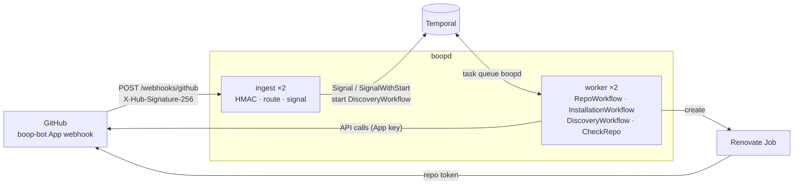
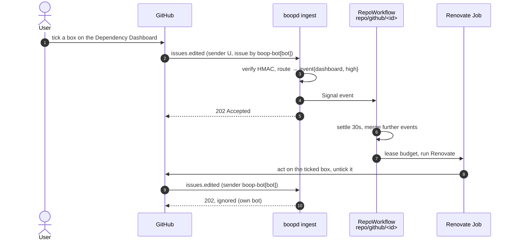
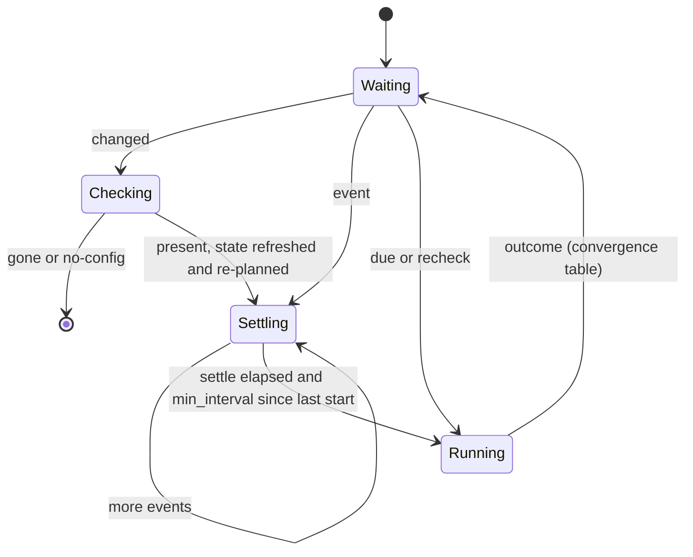

<!-- markdownlint-disable-file MD024 MD025 MD041 -->

# DESIGN-0003: Webhook ingest: GitHub events to RepoWorkflow signals

<!--toc:start-->
<!-- markdownlint-capture -->
<!-- markdownlint-disable MD013 -->
- [Overview](#overview)
- [Goals and Non-Goals](#goals-and-non-goals)
  - [Goals](#goals)
  - [Non-Goals](#non-goals)
- [Background](#background)
  - [Latency today](#latency-today)
  - [What the spike proved](#what-the-spike-proved)
  - [GitHub's delivery contract](#githubs-delivery-contract)
- [Detailed Design](#detailed-design)
  - [Components](#components)
  - [The ingest role](#the-ingest-role)
  - [Routing table](#routing-table)
  - [Our own events](#our-own-events)
  - [Recording deliveries](#recording-deliveries)
  - [RepoWorkflow: event and changed](#repoworkflow-event-and-changed)
  - [Settle and min_interval](#settle-and-min_interval)
  - [CheckRepo returns extends](#checkrepo-returns-extends)
  - [Targeted discovery](#targeted-discovery)
  - [Failure and lost deliveries](#failure-and-lost-deliveries)
  - [Delivery audit](#delivery-audit)
  - [Relationship to issue #16](#relationship-to-issue-16)
- [API / Interface Changes](#api--interface-changes)
  - [boopd.hcl](#boopdhcl)
  - [Command](#command)
  - [Workflow and activity types](#workflow-and-activity-types)
  - [Chart](#chart)
  - [Metrics](#metrics)
  - [GitHub App settings](#github-app-settings)
- [Data Model](#data-model)
- [Testing Strategy](#testing-strategy)
- [Migration / Rollout Plan](#migration--rollout-plan)
- [Open Questions](#open-questions)
- [Resolved Questions](#resolved-questions)
- [References](#references)
<!-- markdownlint-restore -->
<!--toc:end-->

## Overview

boopd learns about repositories only by polling: the discovery Schedule
and each repository's cadence. A tick on the Dependency Dashboard, a
newly added Renovate config or a removed repository waits for the next
poll, which is up to 24 hours on fartlab. This design adds an `ingest`
role that receives the `boop-bot` App's webhooks, verifies them, and
turns each event into a Temporal signal on the `RepoWorkflow` (or
`InstallationWorkflow`) that already owns the repository. Polling stays
as the backstop.

## Goals and Non-Goals

### Goals

- A ticked Dependency Dashboard or PR checkbox runs Renovate for that
  repository within about a minute, without an operator sending
  `recheck` by hand.
- A push to the default branch that adds a Renovate config onboards the
  repository within about a minute (ADR-0005, INV-0001 OQ8). A push that
  removes it offboards the repository, and a push that changes it
  refreshes the profile.
- Installation and repository lifecycle events (repositories added or
  removed, suspend, rename, transfer, archive, delete) reach the owning
  workflow instead of waiting for the sweep and the absence check.
- Ingest holds no GitHub credentials and no Kubernetes RBAC: only the
  webhook secret and a Temporal identity. Every GitHub call stays in the
  worker, behind the installation budget (ADR-0008).
- Bursts of events cost at most one extra run per repository, and boopd
  never reacts to its own writes.
- Every delivery is recorded, including ignored ones, boopd's own and
  those GitHub failed to deliver. The record feeds the audit log and the
  PR inventory in DESIGN-0004.
- With the App webhook switched off, boopd behaves exactly as it does
  today.

### Non-Goals

- Replacing discovery. The Schedule and the absence check stay. Webhooks
  shorten latency; they are not the source of truth.
- Reruns for automerge. `platformAutomerge` defaults to `true`, so
  GitHub merges a Renovate PR itself once its required checks pass; no
  `check_suite` or `status` handling is needed.
- Rerunning on every push to the default branch (OQ3).
- A durable queue in front of Temporal, or automatic redelivery (OQ5).
  Missed deliveries are recorded ([Delivery audit](#delivery-audit)) but
  not replayed.
- The store, the API and the UI that read the records. They are
  DESIGN-0004. This design defines what is recorded and when.
- Repository or organisation webhooks. Only the App's own webhook is
  handled.
- Static Temporal API keys (Temporal Cloud style). Ingest shares the
  worker's `temporal.*` settings, which already cover TLS, mTLS and OIDC
  client credentials against any IdP (Keycloak today; Okta through
  `TEMPORAL_OIDC_AUDIENCE`). API keys are a later change to
  `internal/temporal` for both roles (OQ6).
- Forgejo. GitHub only, as for the rest of boop.

## Background

### Latency today

| What happens on GitHub | What boopd does today | When |
| --- | --- | --- |
| A box is ticked on the Dependency Dashboard or a Renovate PR | Renovate reads it on the repository's next run | `NextDue`, up to `cadence` (24h on fartlab); sooner only if someone sends `recheck` |
| A push adds a Renovate config | The next discovery pass probes it and `SignalWithStart`s the workflow | up to `discovery.every` (6h) |
| A push changes `extends` | The next discovery pass sends `discovered` with the new extends; the profile is re-planned on the next run | up to `discovery.every` |
| A push removes the config, or the repository is deleted, archived or removed from the installation | The absence check runs `CheckRepo` after `LastSeen + 3 × discovery.every` | 18h or more |
| A repository is renamed or transferred | The next discovery pass refreshes the slug | up to `discovery.every` |
| An installation is suspended | The next discovery pass sends `suspend` | up to `discovery.every` |
| An installation is deleted | `CheckRepo` cannot mint a token, fails, and retries every discovery interval | never offboarded |

The last row is a gap in its own right. With the token mint answering
404, the absence check keeps retrying because "an outage never looks
like an offboarding" (`internal/workflows/repo.go`). This design closes
it ([CheckRepo returns extends](#checkrepo-returns-extends), OQ9).

### What the spike proved

INV-0001 OQ8 deferred ingest "once the per-repository loop is proven".
It now is. On 2026-10-17 a `recheck` on `repo/github/1276938298`
(proxmox-go-sdk) ran Renovate at high priority, through the budget
and capacity leases, and acted on the dashboard: 11 PRs, then the pin
PR after the `renovate-config` fix. The signal path works. What is
missing is a way for GitHub to send it.

ADR-0002 chose one entity workflow per repository with a stable ID so
that "webhooks, manual rechecks and discovery all converge on one ID".
Ingest relies on that: it never needs to look anything up. The repository
ID in the payload is the workflow ID.

### GitHub's delivery contract

From GitHub's webhook documentation:

- GitHub expects a 2xx response within 10 seconds.
- GitHub does not automatically redeliver failed deliveries. They can be
  redelivered by hand or through the REST API for 3 days (App JWT:
  `GET /app/hook/deliveries`, `POST /app/hook/deliveries/{id}/attempts`).
- Payloads are capped at 25 MB; larger ones are not delivered.
- `X-Hub-Signature-256` is the HMAC-SHA256 of the body with the webhook
  secret. `X-GitHub-Delivery` is a GUID per event and is kept on
  redelivery. `X-GitHub-Event` names the event, and
  `X-GitHub-Hook-Installation-Target-ID` carries the App ID.
- Every App receives `installation` and `installation_repositories`
  without subscribing. Other events need a subscription and the matching
  permission, which `boop-bot` already holds for Renovate (contents,
  issues, pull requests, metadata).
- A push payload lists up to 2,048 commits, each with `added`,
  `modified` and `removed` paths.

## Detailed Design

### Components



Ingest is the third role from INV-0001's diagram: the same image, run as
`boopd ingest`. It talks only to Temporal. The worker does not change
shape; it gains two signal handlers and a targeted discovery input.

### The ingest role

One request is handled like this:

1. Reject a body over 25 MiB (413) and anything other than `POST` on
   `ingest.path` (404/405).
2. Pick the App block by `X-GitHub-Hook-Installation-Target-ID`
   (matching `app_id`). An unknown App is 400.
3. Verify `X-Hub-Signature-256` against that App's webhook secret with a
   constant-time compare. Missing or wrong is 401, logged at warn
   without the body.
4. Answer `ping` with 200.
5. Decode only the fields the [routing table](#routing-table) reads, and
   route. The result is zero or more actions: `Signal`,
   `SignalWithStart`, or start a `DiscoveryWorkflow`.
6. Run the actions against Temporal with a 5 s deadline, inside GitHub's
   10 s. If they all succeed, or there was nothing to do, answer 202.
   If a Temporal call fails, answer 503 ([Failure](#failure-and-lost-deliveries)).
   A `Signal` to a workflow that does not exist (`NotFound`) counts as
   ignored: the repository is not onboarded.
7. Record the delivery and its outcome ([Recording](#recording-deliveries)),
   whatever the outcome, including 401s and boopd's own events.

Ingest is stateless and keeps no queue. It runs two replicas behind a
Service, holds the webhook secret and the Temporal client credentials,
and has no ServiceAccount token, no App key and no egress to GitHub.
It shares the worker's `temporal.*` settings, with its own client
(`boopd-ingest` in Keycloak). The store credential arrives with
DESIGN-0004.
Its `/healthz` is the HTTP server; `/readyz` adds a successful Temporal
dial. Both are on the listen port, as for the worker.

### Routing table

`repo` is `repo/github/<repository.id>`; "bot" is the App's own bot
login ([Our own events](#our-own-events)). Rows run top to bottom, and the
first match wins.

| Event | Action / condition | Temporal action | Reason |
| --- | --- | --- | --- |
| `ping` | — | none, 200 | — |
| any | `sender` is the bot | none, 202 | own write |
| `issues` | `edited`, `issue.user` is the bot | `Signal(repo, event{dashboard, high})` | dashboard checkbox |
| `pull_request` | `edited`, `pull_request.user` is the bot | `Signal(repo, event{pr-checkbox, high})` | rebase/retry checkbox |
| `pull_request` | `closed`, `pull_request.user` is the bot | `Signal(repo, event{pr-closed, normal})` | merged or closed by a human |
| `push` | `ref` is the default branch, and a commit adds, modifies or removes a `renovate.config_paths` entry, or the commit list is at GitHub's cap | `SignalWithStart(repo, changed{config})` | config added, changed or removed |
| `push` | otherwise | none | OQ3 |
| `repository` | `renamed`, `transferred`, `archived`, `unarchived`, `deleted`, `edited` with `changes.default_branch` | `Signal(repo, changed{repository})` | slug, branch or lifecycle |
| `installation_repositories` | `added` | start `DiscoveryWorkflow{installations: [id]}` | new repositories |
| `installation_repositories` | `removed` | `Signal(repo, changed{removed})` for each of `repositories_removed` | offboard |
| `installation` | `created`, `new_permissions_accepted` | start `DiscoveryWorkflow{installations: [id]}` | new installation |
| `installation` | `suspend` / `unsuspend` | `Signal(installation/<id>, suspend{true/false})`; `unsuspend` also starts targeted discovery | budget entity |
| `installation` | `deleted` | `Signal(repo, changed{installation-deleted})` for each listed repository | offboard |
| anything else | — | none, 202 | not subscribed or not needed |

Routing is a pure function from the event name and the decoded payload
to a list of actions, so the table is testable without Temporal or HTTP.

Two rows need care:

- **Pushes.** Ingest cannot read the tree, so it decides from the commit
  file lists. A push at GitHub's commit cap might hide a config change,
  so it is treated as one. `SignalWithStart` is used only here: a config
  added to a repository with no workflow starts one. That workflow
  verifies before it runs ([below](#repoworkflow-event-and-changed)), so
  a false positive costs one `CheckRepo`.
- **Installation deleted.** For an "all repositories" installation the
  payload may not list them. Those workflows are offboarded by the
  absence check, which now treats a 404 on token minting as gone
  ([CheckRepo](#checkrepo-returns-extends)).

### Our own events

Renovate edits the dashboard on every run and edits, closes and
automerges its PRs. If ingest reacted to those writes, every run would
cause another. The rule is that **an event whose `sender` is the App's
bot is never routed.** The bot login is `webhook.bot` in the App block,
defaulting to `<app label>[bot]` (`boop-bot[bot]`) (OQ10).

The `issue.user` and `pull_request.user` checks then select the issues
and PRs Renovate owns, without matching titles or branch prefixes, which
users can configure.



### Recording deliveries

Routing decides what boopd does. Recording keeps what GitHub said, for
the audit log, the PR inventory and the delivery view (DESIGN-0004).
They are separate on purpose: an event boopd ignores, such as its own
bot opening a PR or editing the dashboard, is exactly what the inventory
needs.

Each delivery becomes one record:

| Field | From |
| --- | --- |
| `delivery_id` | `X-GitHub-Delivery` (stable across redeliveries) |
| `app`, `installation_id`, `repo_id`, `repo_slug` | App block, payload |
| `event`, `action` | `X-GitHub-Event`, `action` |
| `sender_login`, `sender_type`, `own` | `sender`; `own` when it is the App's bot |
| `subject` | the issue or PR number, the ref for a push |
| `received_at` | ingest's clock |
| `outcome` | `routed`, `ignored`, `own`, `rejected`, `failed` |
| `actions` | the Temporal actions taken, with their errors |
| `payload` | the decoded subset the record keeps (DESIGN-0004 decides how much) |

A rejected delivery (bad signature) keeps only the headers: an
unverified body is never stored.

Recording never blocks the answer to GitHub. Ingest hands the record to
a sink after routing. Until DESIGN-0004's store exists, the sink is a
structured log line at info plus `boopd_ingest_deliveries_total`.
DESIGN-0004 replaces the sink with the store.

### RepoWorkflow: event and changed

`RepoWorkflow` gains two signals next to `discovered` and `recheck`:

- **`event`** (`Event{Reason, Priority}`): something on GitHub wants
  a run. It never runs immediately. It schedules a run at the
  [settle time](#settle-and-min_interval), and later events merge into
  that schedule.
- **`changed`** (`Changed{Reason}`): the repository itself may have
  changed (config, slug, branch, lifecycle). The workflow runs
  `CheckRepo` first. `gone` or `no-config` ends the workflow, as the
  absence check does today. `present` applies the slug, branch and
  extends, re-plans the profile, then treats the signal as an `event` at
  normal priority (a config change deserves a run).

`recheck` keeps its meaning: an operator's "run now", high priority,
with no settle and no `min_interval`.

Each decision is a repository event, keyed by the delivery that caused
it:

- `onboarded{via: webhook|discovery}`;
- `offboarded{reason: gone|no-config|removed|installation-deleted}`;
- `refreshed{slug, default_branch, extends}`;
- `run-scheduled{reason, priority, at}`.

Together with the delivery records, they answer "why did this
repository run, or stop running?" without reading Temporal history.
The workflow records them through DESIGN-0004's `RecordEvents`
activity. Until that exists, they are workflow log lines and the
`boopd_repo_event_runs_total` metric.



Rules in `wait()`:

- A pending `changed` is handled before the due timer. A workflow started
  by `SignalWithStart(changed)` therefore runs `CheckRepo` before its
  first run, even if its jittered `NextDue` is already past. Its initial
  state comes from the payload (`RepoID`, `Slug`, `DefaultBranch`,
  `InstallationID`) with `LastSeen` set, so a later absence check behaves
  as for a discovered repository.
- An `event` sets `eventDue = max(now + settle, lastStart + min_interval)`.
  High-priority events (`dashboard`, `pr-checkbox`) skip the
  `min_interval` term. The run happens at `min(NextDue, eventDue)`, so
  an event only ever brings a run forward. Further events keep the
  earlier `eventDue`; the priority is the highest seen.
- Events received during a run are buffered, as `recheck` is today. After
  the run they produce one more run, after the settle time. That run is
  needed: Renovate may have read the dashboard before the tick.
- `continueAsNew` carries a pending `eventDue` and its priority, as it
  carries a buffered `recheck` today.

Replay: existing histories hold no `event` or `changed` signals, and the
new branches run only when one arrives. The IMPL adds a replay test over
a recorded pre-change history to confirm no new command appears. If one
does, the new code goes behind `workflow.GetVersion`, as
`capacityLeaseChange` is today.

### Settle and min_interval

- **`settle`** (default `30s`) gathers bursts into one run: several boxes
  ticked in turn, or a PR merged, which closes it and pushes at once.
- **`min_interval`** (default `5m`, measured from the last run's start)
  keeps a repository with many merges from running Renovate on every one.
  Human checkbox events skip it, because someone is waiting.

Both live in a new `ingest` block of `boopd.hcl`. The worker reads them
through `PlanRun`, as it reads the cadence. Config never travels in a
signal payload.

Every run still takes an installation budget lease and a capacity lease.
Webhooks can make runs more frequent, but never more concurrent than
ADR-0008 allows.

### CheckRepo returns extends

`changed{config}` has to refresh `extends` so the profile follows the new
config. `CheckRepo` today asks only whether a config exists
(`HasRenovateConfig`). It changes in two ways:

1. **It probes the config** with the existing one-repository REST probe
   (`ProbeConfigREST`) and returns `Extends` (and `ParseErr` as a warn log,
   as discovery does). The cost is the same REST calls `HasRenovateConfig`
   already makes, plus one content read when the config exists.
2. **A 404 on minting the installation token is `gone`.** It means the
   installation was deleted, not that GitHub is down. Every other mint
   error stays an activity error and is retried, as today (OQ9).

Discovery and the absence check use the same `CheckRepo`, so the absence
check also refreshes `extends` from now on.

### Targeted discovery

`DiscoveryInput` gains `Installations []int64`. Empty keeps today's
behaviour (every installation of the App). Ingest starts
`DiscoveryWorkflow` with one installation and the ID
`discovery/<app>/installation/<id>`, using
`WorkflowIDConflictPolicy: UseExisting`, so a burst of `added` events
for one installation shares one pass. A pass probes every repository in
the installation, which is the existing paged GraphQL probe: one point
per 10 repositories at the default paths (IMPL-0003).

### Failure and lost deliveries

- **Temporal unreachable or slow:** 503. GitHub records the failed
  delivery under the App's "Advanced → Recent deliveries" and keeps it
  for 3 days for redelivery. boopd counts it (`outcome="failed"`).
- **Lost entirely:** ingest never saw it, so only GitHub knows. The
  [delivery audit](#delivery-audit) finds and records it. Nothing is
  replayed automatically (OQ5). The Schedule and the cadence still cover
  everything: a missed dashboard tick runs at `NextDue`, a missed config
  push onboards on the next pass. That is today's latency, never worse.
- **Duplicates and replays:** a redelivery repeats `X-GitHub-Delivery`.
  `event` merges into one pending run and `changed` is idempotent, so
  duplicates cost nothing (OQ11). A replayed delivery needs a valid
  signature, and at most causes a run that `min_interval` and the budget
  bound.
- **Ingest down:** the same as lost deliveries. Two replicas and a PDB
  keep it up during node drains.

### Delivery audit

A `DeliveryAuditWorkflow` runs on a Temporal Schedule (default every
15 minutes) per App with a webhook. Its `ListHookDeliveries` activity
pages `GET /app/hook/deliveries` with the App JWT, newest first, until
it reaches the cursor it kept from the last pass. App-JWT calls do not
spend installation budgets. For each delivery it records:

- **`failed`**: GitHub's `status_code` is not 2xx. Ingest answered 503,
  or GitHub could not connect or timed out. If ingest also recorded the
  delivery, the records join on `delivery_id`.
- **`missed`**: GitHub has the delivery and ingest has no record of it.
  The request never arrived, or ingest died before recording.
- **`redelivered`**: a later attempt of the same `delivery_id` succeeded,
  whether replayed by hand or by a future reconciler.

It updates `boopd_ingest_deliveries_missed_total{app, event}` and
`boopd_ingest_deliveries_failed_total{app, event}`. An alert fires when
either increases. Redelivering is a later decision: the record is
enough to show what was lost, and a "redeliver" action in the UI can
call `POST /app/hook/deliveries/{id}/attempts` (DESIGN-0004).

The cursor (the newest delivery ID seen) is the workflow's
ContinueAsNew state. A lost cursor re-reads GitHub's 3-day window, and
recording is idempotent on `(delivery_id, attempt)`.

### Relationship to issue #16

Webhooks do not replace #16 (discovery honouring a secondary-limit
`Retry-After`). They make it more pressing: targeted discovery runs on
every `installation_repositories.added`, so discovery passes become more
frequent and more bursty. #16 is a small, separate change to
`DiscoverInstallation`'s error. It lands first, in its own PR (OQ12).

#16 is fixed: `DiscoverInstallation` and `ListInstallations` return a
`github-rate-limited` error whose `NextRetryDelay` is GitHub's wait, so a
retried pass waits as long as GitHub asks and no longer.

## API / Interface Changes

### boopd.hcl

```hcl
ingest {
  path         = "/webhooks/github" # default
  settle       = "30s"              # default
  min_interval = "5m"               # default
}

app "boop-bot" {
  # ... existing settings ...

  webhook {
    bot = "boop-bot[bot]" # default: "<app label>[bot]"

    secret_ref {
      name = "boop-bot-webhook"
      key  = "secret"
    }
  }
}
```

- The `ingest` block is optional. The worker reads `settle` and
  `min_interval` from it even when no ingest runs, so the defaults
  apply.
- `webhook` is optional per App. `boopd ingest` fails at start if no App
  has one. A secret of 32 bytes or more is recommended (validated as
  non-empty).
- `docs/config.md` gains the new rows. Its completeness test enforces
  that.

### Command

`boopd ingest --config <file>` serves on `LISTEN_ADDR` (webhook path,
`/healthz`, `/readyz`) and `METRICS_ADDR`. It shares `TEMPORAL_*` with
the worker. It stops on SIGTERM after in-flight requests finish, within
the pod's grace period.

### Workflow and activity types

| Change | Where |
| --- | --- |
| `EventSignal = "event"`, `ChangedSignal = "changed"` | `internal/workflows/names.go` |
| `Event{Reason string; Priority Priority}`, `Changed{Reason string}` | `internal/workflows/run_types.go` |
| `RunPlan` gains `Settle`, `MinInterval` | `PlanRun` |
| `CheckRepoResult` gains `Extends []string` | `CheckRepo` |
| `DiscoveryInput` gains `Installations []int64` | `DiscoveryWorkflow` |
| `RepoState` gains `EventDue time.Time`, `EventPriority Priority` | ContinueAsNew state |
| new package `internal/ingest`: HTTP handler, signature check, `Route(event, payload, app) []Action`, a `Sink` for delivery records | ingest role |
| `DeliveryAuditWorkflow` and the `ListHookDeliveries` activity, one Schedule per App with a webhook | worker |

### Chart

All new values are under `ingest:`. Ingest is off by default, so
upgrading the chart changes nothing.

```yaml
ingest:
  enabled: false
  replicaCount: 2
  resources: {}
  pdb: { enabled: true, maxUnavailable: 1 }
  service: { type: ClusterIP, port: 8080 }
  ingress:
    enabled: false
    className: ""
    annotations: {}
    hosts: []        # [{host: boop-hooks.example.com, paths: [/webhooks/github]}]
    tls: []
  httpRoute:         # Gateway API, instead of or next to the Ingress
    enabled: false
    parentRefs: []   # [{name: public-gateway, namespace: gateway-system, sectionName: https}]
    hostnames: []
    annotations: {}
  networkPolicy:
    from: []         # peers allowed to reach the webhook port (the ingress controller)
```

- **Deployment `<release>-ingest`** runs `boopd ingest --config
  /etc/boopd/boopd.hcl`. It mounts the rendered config, the webhook
  Secret named by `webhook.secret_ref` and the Temporal credentials, but
  not the App key.
- **Its ServiceAccount** has `automountServiceAccountToken: false` and
  no Role.
- **The NetworkPolicy** (when `networkPolicy` is on) allows ingress on
  the webhook port from `ingest.networkPolicy.from` plus Prometheus on
  the metrics port. Egress is DNS and Temporal only, with no GitHub.
- **`boopd.webhook`** values render into each App's `webhook` block.
  `validateEnvCollisions` and the `boopd config validate` render check
  cover the new Deployment.
- **Exposure** to GitHub is the operator's. The chart offers an
  Ingress (the homelab's Tailscale ingress class) and a Gateway API
  `HTTPRoute`; both route only `ingest.path`, never `/healthz`, `/readyz`
  or metrics (OQ2). The `HTTPRoute` template renders only when the
  `gateway.networking.k8s.io/v1` API is available or
  `ingest.httpRoute.enabled` is set explicitly.

### Metrics

| Metric | Labels | Meaning |
| --- | --- | --- |
| `boopd_ingest_deliveries_total` | `app`, `event`, `outcome` (`routed`, `ignored`, `own`, `rejected`, `failed`) | one per request |
| `boopd_ingest_temporal_seconds` | `action` | time spent in Temporal calls |
| `boopd_repo_event_runs_total` | `reason` | runs started by `event` or `changed` (workflow metric) |
| `boopd_ingest_deliveries_failed_total` | `app`, `event` | non-2xx deliveries GitHub reports (delivery audit) |
| `boopd_ingest_deliveries_missed_total` | `app`, `event` | deliveries GitHub has and ingest never recorded (delivery audit) |

The PrometheusRule gains two alerts:

- `BoopdIngestFailing`: `rate(boopd_ingest_deliveries_total{outcome="failed"}[15m]) > 0`;
- `BoopdDeliveriesLost`: `increase(boopd_ingest_deliveries_missed_total[1h]) + increase(boopd_ingest_deliveries_failed_total[1h]) > 0`.

### GitHub App settings

For `boop-bot`: Webhook **Active**, URL `https://<host>/webhooks/github`,
secret from the Secret. Subscribe to **Issues**, **Pull request**,
**Push** and **Repository**. `installation` and
`installation_repositories` are always sent. No new permissions are
needed. Unticking **Active** rolls back.

## Data Model

Temporal state:

- Workflow state gains `EventDue` and `EventPriority`, carried through
  ContinueAsNew.
- Two new signal payloads, `Event` and `Changed`, are recorded in history
  like `discovered` and `recheck`.
- `DeliveryAuditWorkflow` keeps its cursor as ContinueAsNew state.

Product records (the delivery records, the delivery-audit results and
the repository events) are defined in
[Recording deliveries](#recording-deliveries) and stored by DESIGN-0004.
Until then they are log lines and metrics.

## Testing Strategy

The main path runs end to end. Unit tests cover what e2e reaches only at
some cost:

- **Routing (unit, table):** recorded payloads in `internal/ingest/testdata`,
  trimmed from GitHub's documented examples, one case per table row
  plus the bot-sender, unknown-App and commit-cap cases.
- **Signature (unit):** a valid signature, a wrong secret, a missing
  header, `sha1=` only, and a body changed after signing.
- **RepoWorkflow (testsuite):**
  - an event settles and merges;
  - `min_interval` applies to normal events but not to high ones;
  - an event during a run gives one more run;
  - `changed` → `CheckRepo` `gone` ends the workflow, and `present`
    re-plans;
  - `SignalWithStart(changed)` checks before its first run;
  - ContinueAsNew carries `EventDue`;
  - the replay test over a pre-change history.
- **CheckRepo (activity, fakegithub):** extends returned, and a 404 on
  minting is `gone`.
- **Delivery audit (activity and workflow, fakegithub):** `fakegithub`
  serves `/app/hook/deliveries` from the deliveries it was asked to
  record. Cases:
  - failed, missed and redelivered are classified;
  - the cursor stops paging;
  - a lost cursor re-reads idempotently.
- **Chart (helm-unittest):** the ingest Deployment has no App key mount
  and no ServiceAccount token; the Ingress and the `HTTPRoute` each route
  only the webhook path; the NetworkPolicy has no GitHub egress.
- **e2e (k3d, `just e2e` and CI):** the chart with `ingest.enabled=true`
  and stub Renovate. `test/fakegithub` gains `Deliver(t, url, event,
  payload, secret)`, which signs and POSTs a delivery. Cases:
  - a dashboard edit by a user leads to a RepoWorkflow run;
  - the same edit with the bot as sender is ignored;
  - a push adding `renovate.json5` to an unknown repository onboards it,
    and a push removing it offboards;
  - `installation_repositories.added` triggers targeted discovery;
  - a bad signature gets 401;
  - Temporal stopped gets 503.
- **Homelab (deferred to a human):** expose ingest, set the App webhook,
  confirm `ping` in Recent deliveries, then tick a dashboard box on
  proxmox-go-sdk and time the run.

## Migration / Rollout Plan

1. **#16** lands on its own (OQ12).
2. **Worker changes, released:**
   - the `event` and `changed` signals;
   - `PlanRun` settle and `min_interval`;
   - `CheckRepo` extends and the mint 404;
   - targeted discovery;
   - the delivery audit Schedule (it only reads, so it is safe before
     ingest exists).

   They are inert without ingest, apart from the absence check now
   refreshing extends and offboarding deleted installations.
3. **Ingest and the chart, released** with `ingest.enabled: false`.
4. **Homelab:**
   - create the webhook Secret;
   - enable ingest and its Ingress;
   - set the App webhook and its subscriptions;
   - verify with `ping` and a dashboard tick.
   Record the results in the IMPL.
5. **Later:** with webhooks handling onboarding, `discovery.every` can be
   relaxed (6h → 24h) to save probe budget. The sweep stays.

Rollback at any step: untick **Active** on the App webhook, or set
`ingest.enabled: false`. Workflows then behave as today, and any pending
`EventDue` simply fires.

## Open Questions

None open. The answered questions are listed under
[Resolved Questions](#resolved-questions).

## Resolved Questions

Answered 2026-10-18. The body above is written to these decisions.

| OQ | Question | Decision |
| - | - | - |
| 1 | Where does ingest run? | **a**: its own Deployment, `boopd ingest`, same image |
| 2 | How is the endpoint reached? | **a, with both routes**: a Service plus an optional Ingress (the homelab's Tailscale ingress) and an optional Gateway API `HTTPRoute`, both limited to the webhook path ([Chart](#chart)) |
| 3 | Which pushes trigger work? | **a**: only default-branch pushes that touch a config path, as `changed{config}` |
| 4 | Settle and min_interval defaults? | **a**: `30s` and `5m`; dashboard and PR-checkbox events skip `min_interval` |
| 5 | Lost deliveries? | **a, plus tracking**: no automatic redelivery, but the [delivery audit](#delivery-audit) records every failed and missed delivery, with metrics and alerts |
| 6 | Temporal identity? | **a**: its own Keycloak client, `boopd-ingest`, through the shared `temporal.*` settings (which also cover mTLS and other OIDC IdPs such as Okta). Static API keys deferred ([Non-Goals](#non-goals)) |
| 7 | Config push to an unknown repository? | **a**: `SignalWithStart(changed{config})`; `CheckRepo` runs first |
| 8 | Installation events? | **a**: targeted `DiscoveryWorkflow`, `suspend` to `InstallationWorkflow`, `changed` to removed repositories |
| 9 | A 404 on token minting means gone? | **a, recorded**: yes, and every offboarding is a repository event with its reason ([RepoWorkflow](#repoworkflow-event-and-changed)) |
| 10 | Whose events are ignored? | **a for routing, recorded anyway**: only the App's own bot is not routed, and its events are still recorded. They feed DESIGN-0004's PR inventory and dashboard history ([Recording deliveries](#recording-deliveries)) |
| 11 | Deduplicate on `X-GitHub-Delivery`? | **a**: no. Records are idempotent on `delivery_id` |
| 12 | Order with #16? | **a**: #16 lands first as its own `patch` PR |

## References

- INV-0001 OQ8 (ingest deferred); its roles diagram
- ADR-0002 (one entity workflow per repository; webhooks converge on its ID)
- ADR-0005 (onboard on config file; the config push is the first webhook worth handling)
- ADR-0008 (budget and capacity leases bound every run)
- DESIGN-0001 § RepoWorkflow, § Convergence and stall (non-goal: webhook ingest)
- ADR-0006 (Postgres product store) and DESIGN-0004 (store, API and UI that read the records)
- IMPL-0003 (probe cost per installation)
- Issue #16 (discovery honours secondary-limit Retry-After)
- [Best practices for using webhooks](https://docs.github.com/en/webhooks/using-webhooks/best-practices-for-using-webhooks)
- [Redelivering webhooks](https://docs.github.com/en/webhooks/testing-and-troubleshooting-webhooks/redelivering-webhooks)
- [Webhook events and payloads](https://docs.github.com/en/webhooks/webhook-events-and-payloads)
- [Validating webhook deliveries](https://docs.github.com/en/webhooks/using-webhooks/validating-webhook-deliveries)
- [Renovate `platformAutomerge`](https://docs.renovatebot.com/configuration-options/#platformautomerge)
