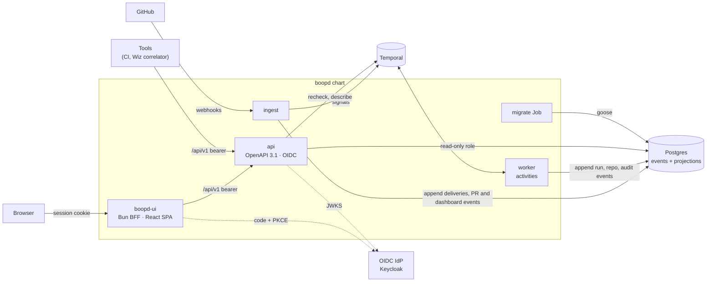
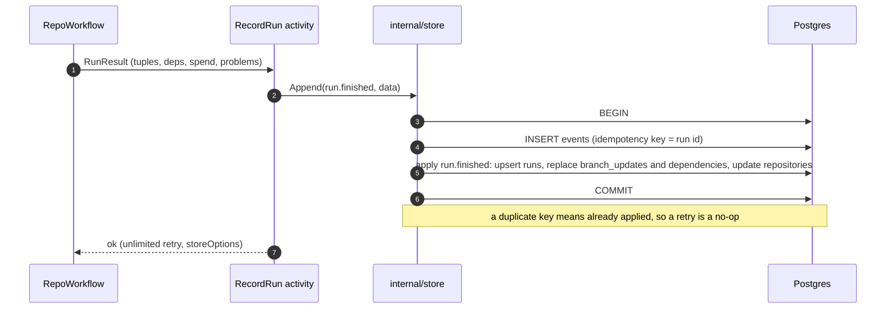
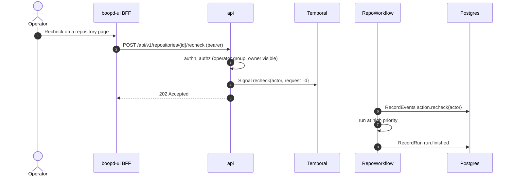
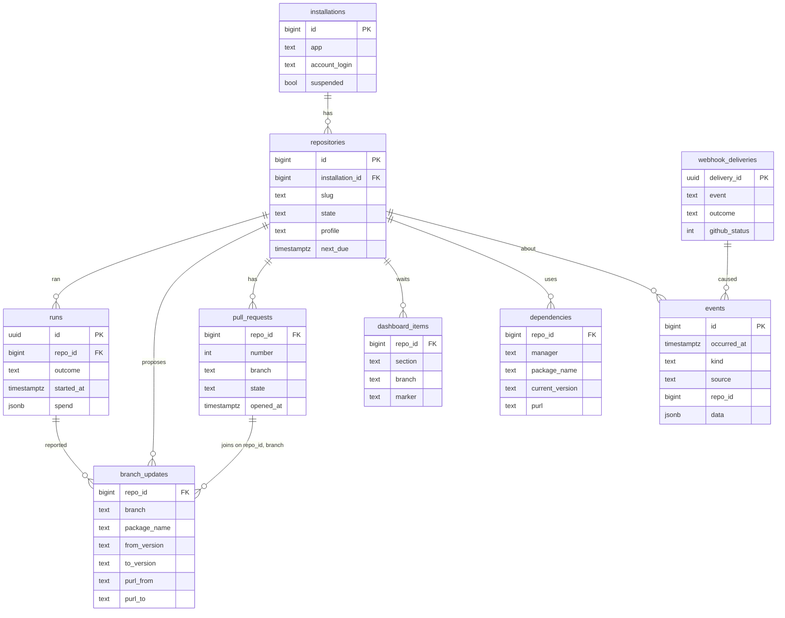

<!-- markdownlint-disable-file MD024 MD025 MD041 -->

# DESIGN-0004: boopd API and management UI: event store, PR inventory and estate view

<!--toc:start-->
- [Overview](#overview)
- [Goals and Non-Goals](#goals-and-non-goals)
  - [Goals](#goals)
  - [Non-Goals](#non-goals)
- [Background](#background)
  - [What boopd knows today](#what-boopd-knows-today)
  - [What the UI has to answer](#what-the-ui-has-to-answer)
  - [repo-guardian v2 as the template](#repo-guardian-v2-as-the-template)
- [Detailed Design](#detailed-design)
  - [Components](#components)
  - [The event log](#the-event-log)
  - [Event catalogue](#event-catalogue)
  - [Append and apply](#append-and-apply)
  - [Who writes](#who-writes)
  - [Sources of PR, dashboard and dependency data](#sources-of-pr-dashboard-and-dependency-data)
  - [Package identity and the security join](#package-identity-and-the-security-join)
  - [Live state from Temporal](#live-state-from-temporal)
  - [The API](#the-api)
  - [Authentication and authorisation](#authentication-and-authorisation)
  - [The UI](#the-ui)
  - [Independence from repo-guardian](#independence-from-repo-guardian)
  - [Visual design](#visual-design)
  - [Pages](#pages)
  - [Estate view and status page](#estate-view-and-status-page)
  - [Retention](#retention)
- [API / Interface Changes](#api--interface-changes)
  - [Endpoints](#endpoints)
  - [Commands and roles](#commands-and-roles)
  - [boopd.hcl](#boopdhcl)
  - [Chart](#chart)
  - [Workflow and activity changes](#workflow-and-activity-changes)
  - [Metrics](#metrics)
- [Data Model](#data-model)
  - [Tables](#tables)
  - [Database roles](#database-roles)
- [Testing Strategy](#testing-strategy)
- [Migration / Rollout Plan](#migration--rollout-plan)
- [Open Questions](#open-questions)
- [Resolved Questions](#resolved-questions)
- [References](#references)
<!--toc:end-->

## Overview

boopd runs Renovate for every onboarded repository, but what happened
stays in Temporal history, worker logs and GitHub. There is no answer to
questions like "which Renovate PRs are open across the fleet and how
old are they", "what is waiting on a dashboard", "why did this repository
run at 03:12" or "which bumps fix a vulnerability".

This design adds three pieces:

- a Postgres **event log**, the audit record of everything boopd and
  GitHub did to each repository, with the **projections** the UI reads
  (repositories, runs, PRs, waiting updates, dependencies);
- a versioned **HTTP API** over it (`/api/v1`, OpenAPI 3.1), which the UI
  and other tools use;
- a **management UI** with an estate view, a PR inventory, waiting
  updates, repository timelines and a status page. Its look, stack and
  API conventions follow the pattern repo-guardian v2 established, with
  its code copied, never depended on.

It realises ADR-0006 (Postgres product store written by activities). The
foundation is meant to carry later features without a rewrite:
correlating security findings (Wiz, OSV) with pending bumps, eval
results, and approving from the UI.

## Goals and Non-Goals

### Goals

- **One audit log per repository.** Every webhook delivery, run,
  decision and human action is an event with a time, a source, an actor
  and the cause that links it to other events (DESIGN-0003 records
  deliveries and decisions; this design stores them).
- **Projections built from events.** Each event kind has exactly one
  apply function, so the projections can be rebuilt by replaying the log.
  This is ADR-0006's "single owner per kind of data" made mechanical.
- **A PR inventory:** every open Renovate PR, with age, update type,
  packages, automerge, and its timeline; the oldest PRs and PRs by
  ecosystem.
- **Waiting updates** from the Dependency Dashboard (awaiting schedule,
  pending approval, rate-limited, errored), with when each started
  waiting and who ticked what.
- **An estate view** (counts, trends, ecosystems, budget) and a public,
  aggregate-only **status page**.
- **A dependency inventory with package URLs (purl):** current and
  proposed versions per repository. This is the join key a later Wiz or
  OSV correlator needs to say "merging #123 resolves these findings".
- **A versioned, additive API** that the UI, CI and future correlators
  share: OpenAPI 3.1, open enums, keyset cursors, RFC 9457 errors and
  OIDC bearer tokens.
- **repo-guardian v2's pattern, copied:** the same tokens, fonts,
  primitives, layout and BFF structure, so the two apps follow one
  pattern. boop copies what it reuses into this repository and has no
  build, runtime or link dependency on repo-guardian
  ([Independence from repo-guardian](#independence-from-repo-guardian)).
- **No extra GitHub API spend for the inventory** beyond one cheap
  reconcile per discovery pass (OQ5). Webhooks and Renovate's report
  carry the data.

### Non-Goals

- **Writing to GitHub from the UI** (approving a dashboard item,
  merging, redelivering) in v1. The one action is **recheck** (OQ14),
  and the UI deep-links to GitHub for the rest.
- **The security correlator itself.** This design fixes the keys and API
  shape it needs ([Package identity](#package-identity-and-the-security-join));
  ingesting Wiz findings is a later design.
- **Evals and automerge confidence** (INV-0001 § Beyond v1). The PR
  record they attach to exists from v1.
- **Replacing Grafana for operators.** The status page and estate view
  are product views built from first-party state, as in repo-guardian
  (INV-0018 there). Prometheus stays the operator surface.
- **Scheduling from the store.** Temporal owns execution state, and the
  store owns results (ADR-0006). Nothing in the store drives a run.
- **Any dependency on repo-guardian:** no imported package, shared
  module, git submodule, cross-link or app switcher. Copying is the only
  form of reuse.
- **A shared design system.** One will exist later, as its own project,
  and both apps will consume its components instead of copying each
  other. It is not designed here.
- **A combined UI.** Running boop and repo-guardian in one UI would be a
  third app, built on the shared design system. The two are designed
  alike so that it stays possible, but each runs independently and
  nothing here prepares for that app.
- **A light theme.** It is dark only for now, as in repo-guardian
  (DESIGN-0036 OQ1 there); the tokens make light a later swap.
- **Multi-tenant SaaS concerns** (billing, per-tenant databases).

## Background

### What boopd knows today

| Data | Where it lives now | Lost when |
| --- | --- | --- |
| Run outcome, duration, Renovate version, problems | `RunResult` in Temporal history; `boopd_*` metrics | history retention; ContinueAsNew drops old runs |
| Proposed updates (`UpdateTuple`: branch, PR number, manager, datasource, package, from/to, update type) | `RunResult.Tuples` | the same |
| Budget spend per run | `RunResult.RateBefore` / `RateAfter` | the same |
| Repository state (slug, profile, cadence, `NextDue`, phase) | `RepoState`, search attributes | while the workflow lives |
| PR state (open, merged, closed, age) | GitHub only | — |
| Dashboard waiting lists | the dashboard issue body on GitHub | rewritten every run |
| Current dependency versions | the dashboard's "Detected dependencies" and the Renovate report's `packageFiles` (boopd reads only the keys) | — |
| Webhook deliveries and decisions | DESIGN-0003 log lines and metrics | log retention |

### What the UI has to answer

From the requests that led to this design:

- every outstanding Renovate PR, the oldest ones, and those waiting on
  CI or review;
- the updates waiting on a dashboard, and which dashboards someone
  changed;
- one repository's full history, as an audit log: why it ran, what it
  proposed, what merged, what was ticked and by whom;
- an estate view with metrics, and a status page;
- an API the UI shares with other tools, such as a correlator that tells
  a repository owner "merge #123 to bump X; it resolves 3 Wiz issues".

### repo-guardian v2 as the template

repo-guardian v2 already ships the same kind of product: a read-only
API and a business UI over Postgres (its DESIGN-0027), refreshed by
DESIGN-0036 (Approved 2026-10-16). This design reuses its decisions
unless boop needs something different:

| Concern | repo-guardian v2 | boop |
| --- | --- | --- |
| API | `api` role of the same binary, OpenAPI 3.1 hand-written, oapi-codegen v2 strict std-http, kin-openapi contract tests, vacuum lint | same |
| Wire format | snake_case JSON, open enums, `/api/v1` additive only | same |
| Pagination, errors | keyset cursors bound to filters; RFC 9457 with `request_id` | same |
| Auth | go-oidc bearer access tokens (ID tokens refused); BFF with code + PKCE, encrypted `__Host-` cookie | same |
| AuthZ | groups to orgs, filtered in SQL, 404 when not visible | same, plus an `operators` list for actions (OQ8) |
| Store | Postgres (CNPG), pgx/v5, goose migrations in a `migrate` Job, sqlc, read-only role for the API | same, plus append-only writer roles |
| UI | Bun + Hono BFF serving a React 19 SPA, separate image; Tailwind v4, Radix/shadcn-style primitives, TanStack Router/Query, Recharts, inline SVG icons | same (OQ1, OQ2) |
| Live data | polling, a 30 s status cache, no SSE | same (OQ10) |
| Status page | public, aggregate-only, privacy-guard test | same (OQ9) |
| Event tables | per-kind tables (`repository_events`, `result_events`), no retention | one append-only `events` log with projections and retention (OQ3, OQ6) |

In every row, "same" means the pattern and, where useful, code copied
into this repository. It never means an import or a reference to
repo-guardian's code.

The difference that matters is the event model. boop's UI is mostly
built from events (PR lifecycles, dashboard edits, runs), so the log is
the source and the tables are derived from it.

## Detailed Design

### Components



There are five roles, two images and one chart:

- `worker` and `ingest` exist already (DESIGN-0003 adds `ingest`).
- `api` and `migrate` are new roles of the `boopd` binary.
- `boopd-ui` is a new image, built and released with the same tag
  (lockstep, as for the chart).

### The event log

`events` is append-only. A row is never updated or deleted, except by
dropping whole partitions for retention.

| Column | Meaning |
| --- | --- |
| `id` | `bigint` identity: order of insertion, for cursors |
| `key` | idempotency key, unique, e.g. `delivery:<guid>`, `run:<run id>:finished`, `wf:<workflow id>:<event seq>` |
| `occurred_at` | when it happened at the source (GitHub's timestamp, the activity's clock) |
| `recorded_at` | when boopd stored it |
| `kind` | dotted open enum, e.g. `pr.merged`, `run.finished` ([catalogue](#event-catalogue)) |
| `source` | `webhook`, `worker`, `audit`, `api` |
| `installation_id`, `repo_id`, `pr_number` | subject; nullable where it does not apply |
| `actor_login`, `actor_type` | who: a GitHub user or bot, a boopd role, or an OIDC subject for API actions |
| `cause_key` | the `key` of the event that caused this one: a delivery causes `run-scheduled`, which causes `run.finished` |
| `summary` | one human line, as shown in timelines |
| `data` | `jsonb`, the kind's typed payload (versioned by `data.v`) |

The table is partitioned by month on `occurred_at`, with indexes on
`(repo_id, occurred_at desc)`, `(kind, occurred_at desc)` and
`(cause_key)`.

`cause_key` is what turns a pile of events into an audit log. Following
it backwards answers "why did this run happen": a run, the
`run-scheduled` before it, then the delivery of a dashboard tick by
`@someone`.

### Event catalogue

Kinds are an open enum: the API documents them and clients must
tolerate new ones. The table lists v1; each row names the single
projection the kind updates.

| Kind | Source | Projection it updates |
| --- | --- | --- |
| `delivery.received` (every delivery, any outcome) | ingest | `webhook_deliveries` |
| `delivery.failed`, `delivery.missed`, `delivery.redelivered` | delivery audit | `webhook_deliveries.github_status` |
| `pr.opened`, `pr.edited`, `pr.closed`, `pr.merged`, `pr.reopened`, `pr.synchronized` | ingest (`pull_request` events whose PR author is the bot, including the bot's own) | `pull_requests` |
| `pr.synced` | worker (reconcile, OQ5) | `pull_requests` |
| `dashboard.updated` (the bot rewrote the dashboard) | ingest | `dashboard_items` (replace for the repository) |
| `dashboard.ticked` (a human ticked an item) | ingest | `dashboard_items.ticked_*` |
| `pr.checkbox` (a human ticked rebase/retry on a PR) | ingest | — (timeline only) |
| `repo.onboarded`, `repo.offboarded`, `repo.refreshed` | worker (DESIGN-0003 decisions, discovery) | `repositories` |
| `repo.run-scheduled` | worker | `repositories.next_due` |
| `run.started`, `run.finished` | worker (`RecordRun`) | `runs`, `branch_updates`, `dependencies`, `repositories` |
| `run.stalled`, `run.capacity-denied`, `run.budget-wait` | worker | `repositories.state` |
| `installation.added`, `installation.suspended`, `installation.unsuspended`, `installation.removed` | ingest, discovery | `installations` |
| `discovery.finished` | worker (`DiscoveryWorkflow` result) | `discovery_passes` |
| `action.recheck` | worker, recording the actor carried in the signal | — (timeline only) |

### Append and apply

Every writer goes through `internal/store`'s `Append(ctx, events...)`.
In one transaction it inserts the events and runs each kind's apply
function on the projections.



The rules:

- **Idempotent.** A duplicate `key` skips the whole event, apply
  included. Retries, redeliveries and replays are safe.
- **Order-tolerant.** Applies that update a row compare the source
  timestamp first (`occurred_at`, or GitHub's `updated_at` for PRs) and
  ignore older data. A late `pr.edited` never undoes a `pr.merged`.
- **Rebuildable.** `boopd store rebuild` truncates the projections and
  replays `events` in `occurred_at` order through the same apply
  functions. A projection change ships with a migration and a rebuild,
  not a backfill script.
- **Synchronous.** Projections are current when `Append` returns, and
  there is no projector process to lag or fail (OQ3).

### Who writes

| Writer | Database role | Writes | How |
| --- | --- | --- | --- |
| ingest | `boopd_ingest`: INSERT on `events`; write on `webhook_deliveries`, `pull_requests`, `dashboard_items`, `installations` | deliveries, PR and dashboard events | `Append` after routing; failures logged and counted, never blocking GitHub's answer (OQ4) |
| worker | `boopd_worker`: INSERT on `events`; write on the worker-owned projections | runs, decisions, discovery, reconcile, delivery audit | `RecordRun`, `RecordEvents` activities with `storeOptions` (unlimited retry, ADR-0006) |
| api | `boopd_ro`: SELECT only, `default_transaction_read_only`, 5 s statement timeout | nothing | actions go through Temporal; the workflow records them |
| migrate | `boopd_owner` | schema | goose, advisory lock, then exits |

Two writers share `pull_requests`: ingest from webhooks, and the worker
from reconciles. They write through the same apply functions with the
`updated_at` guard, so the projection still has one owner, the code,
even with two processes.

The API stays read-only. A recheck from the UI carries the actor in the
signal (`recheck{actor, request_id}`), and the workflow records
`action.recheck` through `RecordEvents`. The audit entry therefore exists
only if the signal really arrived.



### Sources of PR, dashboard and dependency data

None of these need new GitHub calls during a run:

- **PRs: webhooks first.** `pull_request` events whose PR author is the
  bot give the opened, merged and closed times, title, labels, head
  branch and `updated_at`. DESIGN-0003 records the bot's own events for
  exactly this. Without ingest, or after lost deliveries, a reconcile in
  each discovery pass lists open bot PRs per installation with one
  GraphQL search (`is:pr is:open author:app/<slug>`, 100 per page) and
  appends `pr.synced`. PRs that left the open set are fetched once to
  learn whether they merged or closed (OQ5).
- **Branch to PR to updates.** `RunResult.Tuples` already has branch, PR
  number, manager, datasource, package, from/to and update type.
  `run.finished` replaces the repository's `branch_updates` with the
  report's set, when the report is present (`ReportMissing` keeps the
  previous set). `pull_requests` joins on `(repo_id, branch)`, so a PR
  keeps its identity across rebases (ADR-0006's requirement).
- **Waiting updates: the dashboard body.** Each run rewrites the
  dashboard, and the `issues.edited` delivery carries the full body.
  Renovate marks every checkbox with a machine marker, for example
  `<!-- approve-branch=… -->`, `<!-- unschedule-branch=… -->`,
  `<!-- unlimit-branch=… -->`, `<!-- retry-branch=… -->` and
  `<!-- rebase-branch=… -->`, under section headings such as "Awaiting
  Schedule", "Pending Approval", "Rate-Limited", "Errored" and "Open".
  - **The parser** (`internal/renovate/dashboard`) keys items on the
    marker, not the heading text, and records unknown markers as
    `other`.
  - **`dashboard.updated`** replaces the repository's items and keeps
    `first_seen_at` for items that persist. That gives "waiting since".
  - **A human edit** (`changes.body.from` versus the new body) becomes
    `dashboard.ticked{marker, branch}`. That gives "who ticked what" and
    "which dashboards changed".
- **Current dependencies: the Renovate report.** boopd already reads the
  report's `packageFiles` keys for managers. `run.finished` also stores
  `packageFiles[].deps[]`: manager, file, dependency, datasource,
  package, current value and version. This is the inventory of what each
  repository uses today, not just what Renovate proposes (OQ12).

### Package identity and the security join

A correlator (Wiz, OSV, GitHub advisories) speaks package URLs, not
Renovate datasources. Every `branch_updates` and `dependencies` row
carries `purl` values computed at write time from datasource and package
name (OQ13):

| Renovate datasource | purl type | Example |
| --- | --- | --- |
| `go` | `golang` | `pkg:golang/golang.org/x/crypto@v0.57.0` |
| `npm` | `npm` | `pkg:npm/%40types/node@22.1.0` |
| `pypi` | `pypi` | `pkg:pypi/requests@2.32.3` |
| `docker` | `docker` (or `oci` for digests) | `pkg:docker/library/golang@1.27.2` |
| `github-tags`, `github-releases`, `github-actions` | `github` | `pkg:github/actions/checkout@v6` |
| `maven` | `maven` | `pkg:maven/org.slf4j/slf4j-api@2.0.13` |
| `crate` | `cargo` | `pkg:cargo/serde@1.0.210` |
| `rubygems` | `gem` | `pkg:gem/rails@7.2.1` |
| `nuget` | `nuget` | `pkg:nuget/Newtonsoft.Json@13.0.3` |
| others | `null` | the row keeps datasource and package |

A later correlator writes `findings(source, external_id, purl,
affected_range, fixed_in, severity, repo_id?)` through its own role and
API, and joins on `purl` without its version. "This PR resolves these
findings" is then a query over `branch_updates` (from in range, to at or
above fixed) joined to `pull_requests`. The v1 API already filters
updates and dependencies by `purl`, so the correlator needs no schema
change to boop's tables.

### Live state from Temporal

The store is history; Temporal is now. Following ADR-0006, the API calls
Temporal only to signal and describe:

- Lists read the store. `repositories.state` and `next_due` are kept
  current by `run.*` and `repo.run-scheduled` events.
- A repository page adds one Temporal Query, `state`, for the live
  phase, the current run's progress and the budget wait. If Temporal is
  unreachable, the page shows the stored state with a "live state
  unavailable" note.
- The status page reads its worker and queue health through
  `DescribeTaskQueue` on `boopd`, cached for 30 s.

### The API

The API follows repo-guardian's DESIGN-0027 conventions exactly:

- `api/openapi.yaml` (OpenAPI 3.1) is the source of truth, linted by
  vacuum and served at `/api/v1/openapi.yaml`.
- oapi-codegen v2 generates a strict std-http server into
  `internal/api/gen` (committed, drift-gated). openapi-typescript
  generates `ui/web/src/api/schema.gen.ts` (drift-gated).
- JSON is snake_case. Enums are open strings, and changes are additive
  only. A breaking change means `/api/v2`, with both served for one
  release.
- Lists use keyset cursors (`?cursor=&limit=`, default 50, max 200;
  `{items, next_cursor}`). Each cursor is bound to its filters, and a
  mismatch is 400.
- Errors are RFC 9457 `application/problem+json` with `request_id`.
- Middleware runs in this order: otelhttp, request ID and access log,
  recover, authn, authz.
- Every response is validated against the spec in contract tests
  (kin-openapi).

[Endpoints](#endpoints) lists v1.

### Authentication and authorisation

Authentication is repo-guardian's model, unchanged:

- The API validates OIDC access tokens with go-oidc (RS256/ES256,
  `iss`, `aud` = `boopd-api`) and refuses ID tokens.
- Machine clients (CI, a correlator) use client-credentials tokens with
  the same audience.
- Browsers never hold a token. The BFF runs authorization code + PKCE as
  a confidential client, `boopd-ui`, and keeps the session in an
  encrypted `__Host-boop_session` cookie.
- Keycloak is the tested IdP. Okta and Entra work as generic OIDC.

Authorisation (OQ8) maps groups to GitHub owners, which are installation
account logins, and to actions:

```yaml
owners:                      # group -> visible owners ("*" = all)
  platform-engineering: ["*"]
  team-web: ["acme-web"]
operators:                   # groups allowed to POST actions
  - platform-engineering
clients:                     # azp -> groups, for machine clients
  wiz-correlator: ["platform-engineering"]
```

- Visibility is filtered in SQL (`owner = ANY($visible)`). A repository
  the caller cannot see is 404.
- Actions need both visibility and an `operators` group; otherwise 403.
- `/status`, `/openapi.yaml` and `/me` are public or need only a token.

### The UI

The stack is repo-guardian v2's (OQ1), in `ui/` of this repository:

- **`ui/server/`:** the Bun + Hono BFF. It handles OIDC, sessions,
  `/api/*` proxying to the `api` Service only (GET and HEAD, plus the
  action POSTs with an Origin check), static files and health. The CSP
  is `'self'` only.
- **`ui/web/`:** Vite + React 19 + TypeScript.
  - TanStack Router (code-based routes) and TanStack Query (30 s
    `staleTime`, retry on 5xx only).
  - openapi-fetch on the generated types.
  - Tailwind v4 `@theme` tokens, Radix-based primitives in the shadcn
    style, Recharts, inline SVG icons.
- **Tests:**
  - `bun test` with happy-dom and Testing Library;
  - Playwright against a mock OIDC issuer and a seeded Postgres with the
    real API;
  - axe accessibility checks and pinned screenshot tests.
- **Image:** `ghcr.io/donaldgifford/boopd-ui`, distroless Bun, three
  bake targets (`ui-dev`, `ui-ci`, `ui-release`), with the same tag as
  `boopd`.

### Independence from repo-guardian

boop's UI and API are a separate app. repo-guardian v2 is a source to
copy from, so boop does not start from scratch and the two follow one
pattern for design, layout and structure. The rules:

- **Copy, never depend.** Code that boop reuses is copied into `ui/` or
  `internal/` and owned here from then on. That covers the BFF's OIDC
  and session code, the primitives, the shell, the tokens, the API
  problem and cursor helpers, and the test harness. The import note
  names the source path and repo-guardian commit, as CLAUDE.md does for
  `internal/platform` (copied from renovate-operator `0183661`).
- **No dependency of any kind:**
  - no npm or Go module from repo-guardian;
  - no git submodule;
  - no generated client of its API;
  - no shared image or chart;
  - no runtime calls between the two;
  - no links between them in the UI.
- **Copies diverge freely.** A fix in one app is copied to the other by
  hand when it applies. Nothing keeps them in sync automatically.
- **Later, a design system.** When a shared design system exists, boop
  replaces its copied primitives and tokens with the design system's
  components. It never switches to repo-guardian's. That is a later
  project, not part of this design.

### Visual design

The tokens are identical to repo-guardian v2 (`ui/web/src/index.css`
`@theme` there):

| Token | Value | Used for |
| --- | --- | --- |
| `background` | `#17191d` | page, insets |
| `panel` | `#1f2227` | cards, top bar, sidebar, drawer |
| `panel-2` | `#262a30` | current nav item, selected tab, row hover, meter track |
| `border` | `#31363d` | every 1px hairline |
| `foreground` | `#e8eaed` | text |
| `muted-foreground` | `#9aa1ab` | secondary text, axes |
| `accent` | `#5fa8f5` | links, brand mark, primary series, focus ring |
| `ok` | `#3fb950` | merged, succeeded, operational |
| `warn` | `#d9a020` | waiting, degraded, stalled |
| `bad` | `#f2554d` | errored, failed, down, lost delivery |
| `info` | `#7aa7ff` | open PR, running |
| `avatar` | `#3a4c6d` | avatar square |

- **Fonts:** IBM Plex Sans (400/500/600) and JetBrains Mono (400/500),
  bundled through `@fontsource`, Latin subsets, with no CDN. Mono is
  semantic: repository slugs, PR numbers, branch names, package names
  and versions, purls, event kinds and timestamps.
- **Scale:**
  - root 14px; tables 13px; page titles 20/600;
  - KPI values 22/600 with tabular numbers;
  - mono 12px badges; mono 11px chart axes.
- **Shape:** 3px radius everywhere, no shadows except the drawer edge,
  and no gradients except chart area fills. Outline is the default
  button variant.
- **Badges:** the same recipe as repo-guardian, tone at 18% background and text
  mixed 65% with white. boop's tone table:
  - `merged`, `succeeded`, `operational`: ok;
  - `open`, `running`: info;
  - `waiting`, `pending-approval`, `rate-limited`, `stalled`,
    `degraded`: warn;
  - `errored`, `failed`, `missed`, `down`: bad;
  - `closed`, `ignored`: mute.

  Unknown values get mute, because enums are open.
- **Charts:** magnitude is drawn in `accent`; status uses the four
  status tones and nothing else. There is no categorical palette, and
  bar lists of at most 8 rows replace donuts.
- **Shell:**
  - a 40px top bar with the brand (a boop mark in `accent`, then
    "boop", then a muted "renovate · fleet"), the Local/UTC toggle and
    an avatar menu;
  - a 220px sidebar driven by a `NAV` array, which becomes a drawer
    below 900px;
  - a main column at most 1400px wide.
- **Page anatomy:** breadcrumbs, a title with a badge, a muted subtitle
  naming the endpoint in mono, and controls on the right: an owner scope
  popover and a range control (`1d|7d|30d|90d`). Scope and range live in
  the URL. Detail opens in a 470px right drawer deep-linked by `?open=`.
- **Reference mockup:** `ui/design/boop-mockup.html` is the reference,
  kept in step with the UI. It starts as a copy of repo-guardian's
  mockup, restyled for boop's pages.

### Pages

```text
┌──────────────────────────────────────────────────────────────────────────────┐
│ ● boop  renovate · fleet                                 Local|UTC   [DG]    │
├────────────┬─────────────────────────────────────────────────────────────────┤
│ FLEET      │ Estate                                    owner ▾  1d 7d 30d 90d │
│ ▌Estate    │ /api/v1/estate                                                   │
│  Pull reqs │ ┌────────┐┌────────┐┌────────┐┌────────┐┌────────┐┌────────┐     │
│  Waiting   │ │repos   ││open PRs││waiting ││oldest  ││runs 24h││lost    │     │
│  Packages  │ │  142   ││  318   ││   57   ││ 41 d   ││ 98.6 % ││ dlvr 0 │     │
│  Repos     │ └────────┘└────────┘└────────┘└────────┘└────────┘└────────┘     │
│ ACTIVITY   │ ┌ open PRs, 30d ─────────────────┐┌ PR age ───────────────────┐  │
│  Runs      │ │ ▁▂▃▃▄▅▅▆▆▇▇▆▆▅▅▆▆▇ (accent)    ││ <1d ███  1-7d █████ ...   │  │
│  Events    │ └────────────────────────────────┘└───────────────────────────┘  │
│  Delivers  │ ┌ runs by outcome ───────────────┐┌ top pending packages ─────┐  │
│ SYSTEM     │ │ ok/warn/bad stacked bars       ││ pkg:npm/react   23 repos  │  │
│  Status    │ └────────────────────────────────┘└───────────────────────────┘  │
└────────────┴─────────────────────────────────────────────────────────────────┘
```

| Page | Route | Shows | Main endpoint |
| --- | --- | --- | --- |
| Estate | `/` | KPI strip: repositories, open PRs, waiting items, oldest open PR, runs in 24h and success rate, lost deliveries. Charts: open PRs over the range, PR age buckets, runs by outcome, top pending packages, PRs by ecosystem. An installations table with budget use | `/estate`, `/estate/series` |
| Pull requests | `/pulls` | All Renovate PRs. Filters: `state`, `owner`, `repo`, `manager`, `update_type`, `age>`, `automerge`, `label`. Sorted oldest first by default. Drawer: updates (package, from → to, purl), timeline, link to GitHub | `/pull-requests` |
| Waiting | `/waiting` | Dashboard items by section, with "waiting since" and the oldest first. Ticked items show who ticked them and when. Each links to the dashboard issue | `/dashboard-items` |
| Packages | `/packages`, `/packages/$purl` | Pending bumps grouped by package: how many repositories are behind and the spread of versions. Detail: every repository's current and proposed version. The correlator's findings land here later | `/packages`, `/dependencies?purl=` |
| Repositories | `/repositories` | Slug, owner, profile, state, last run outcome, next due, open PRs, waiting items | `/repositories` |
| Repository | `/repositories/$id` | Header: profile, cadence, live phase, next due, **Recheck** (operators). Tabs: Timeline (audit log with causes), Runs, Pull requests, Waiting, Dependencies, Config (extends, profile) | `/repositories/{id}`, `/repositories/{id}/events`, … |
| Runs | `/runs` | Fleet runs: outcome, duration, pod start, budget spend, Renovate version, and the cause (schedule, webhook, recheck) | `/runs` |
| Events | `/events` | The global audit log. Filters: `kind`, `source`, `actor`, `owner`, `repo`, range. Polled every 15 s while open | `/events` |
| Deliveries | `/deliveries` | Webhook deliveries with outcome, GitHub status, and failed/missed flags. Drawer: actions taken and the events caused | `/deliveries` |
| Status | `/status` | Public, outside the shell (below) | `/status` |

### Estate view and status page

- **Estate numbers are computed on read** from the projections and
  cached in-process for 60 s per scope and range (OQ11). Series such as
  "open PRs over time" come from `pull_requests` opened and closed
  times, so they need no rollup table at homelab scale. A daily rollup
  Schedule is the fallback when a query passes 500 ms at p95.
- **The status page** is public and aggregate-only (OQ9). Like
  repo-guardian's, it is computed every 30 s into a cache, so requests
  never hit the database. A privacy-guard test fails if its schema gains
  a free-text field. It shows:
  - a state banner (operational, degraded or down);
  - components:
    - api;
    - ingest (age of the last delivery, failed rate);
    - workers (task-queue pollers);
    - Temporal;
    - Postgres;
    - discovery (age of the last pass, failures);
    - deliveries (missed and failed in 24h);
    - GitHub budget (the share of installations below their reserve);
  - fleet numbers: repositories, open PRs, runs in 24h;
  - the deployment version.

### Retention

The defaults below are set in `store.retention` (OQ6):

- **`events`** are kept 400 days, dropped a month-partition at a time by
  a daily `StoreMaintenanceWorkflow`.
- **Delivery payload subsets** (`webhook_deliveries.payload`) are nulled
  after 30 days; the delivery row and its events stay.
- **Projections** for an offboarded repository are deleted 90 days after
  `repo.offboarded`. Its events stay until their partition drops.
- **`runs`** keep 400 days, like events.

## API / Interface Changes

### Endpoints

All are under `/api/v1`. Lists take `cursor`, `limit` and typed filters.

| Method | Path | Notes |
| --- | --- | --- |
| GET | `/me` | subject, name, groups, visible owners, `operator` flag |
| GET | `/estate` | KPI numbers for a scope (`owner`) and `range` |
| GET | `/estate/series` | `metric` = `open_prs`, `runs`, `waiting`, `merged`; daily or hourly buckets |
| GET | `/installations` | with budget readings from the latest runs |
| GET | `/repositories` | `owner`, `q` (slug prefix), `state`, `profile`, `has_open_prs` |
| GET | `/repositories/{id}` | projection plus the live `state` Query when reachable |
| GET | `/repositories/{id}/events` | the timeline; `kind`, `since` |
| GET | `/repositories/{id}/runs` | |
| GET | `/repositories/{id}/dependencies` | current dependencies with purls |
| POST | `/repositories/{id}/recheck` | operators only. 202; 409 `workflow_missing`; 503 when Temporal is unreachable; deduplicated to one per repository per minute |
| GET | `/pull-requests` | `state`, `owner`, `repo`, `manager`, `update_type`, `older_than`, `automerge`, `label`, `purl` |
| GET | `/pull-requests/{repo_id}/{number}` | with updates and timeline |
| GET | `/dashboard-items` | `section`, `owner`, `repo`, `waiting_longer_than` |
| GET | `/packages` | pending bumps grouped by purl without version |
| GET | `/dependencies` | fleet-wide; `purl` (with or without version), `manager`, `owner` |
| GET | `/updates` | proposed updates; `purl`, `from`, `to`, `update_type` (the correlator's entry point) |
| GET | `/runs` | `outcome`, `owner`, `cause`, range |
| GET | `/events` | `kind` (prefix match, e.g. `pr.`), `source`, `actor`, `owner`, `repo`, `cause_key`, range |
| GET | `/deliveries` | `event`, `outcome`, `github_status`, `missed` |
| GET | `/status` | public |
| GET | `/openapi.yaml` | public |

### Commands and roles

- `boopd api --config <file>`: serves `/api/v1` on `LISTEN_ADDR` and
  metrics on `METRICS_ADDR`. It uses the read-only DSN and a Temporal
  client for recheck, describe and the `state` Query.
- `boopd migrate --config <file>`: runs goose up under an advisory lock,
  then exits. The other roles refuse to start below the schema version
  they need.
- `boopd store rebuild --config <file>`: replays `events` into the
  projections (operator tool, run as a one-off Job).
- `boopd worker` and `boopd ingest` gain the store when
  `store.enabled = true`.

### boopd.hcl

```hcl
store {
  enabled = true

  # One DSN per role; each role reads only its own.
  owner_dsn_secret_ref { name = "boopd-store" key = "owner-dsn" } # migrate, rebuild
  dsn_secret_ref { name = "boopd-store" key = "worker-dsn" }  # worker
  ingest_dsn_secret_ref { name = "boopd-store" key = "ingest-dsn" }
  ro_dsn_secret_ref { name = "boopd-store" key = "ro-dsn" }   # api

  retention {
    events            = "9600h" # 400 days
    delivery_payloads = "720h"  # 30 days
    offboarded        = "2160h" # 90 days
  }
}

api {
  auth {
    issuer        = "https://keycloak.fartlab.dev/realms/fartlab"
    audience      = "boopd-api"
    name_claim    = "preferred_username"
    groups_claim  = "groups"
  }
  authz_file    = "/etc/boopd/authz.yaml"
  status_public = true
}
```

`docs/config.md` gains every row, and its completeness test enforces
that.

### Chart

All new values are off by default:

- **`store`**: `enabled`, `existingSecret` with the four DSN keys, and
  `migrate` (a Job run as a Helm `pre-install`/`pre-upgrade` hook, or as
  an Argo CD `PreSync` hook with `hookAnnotations`). The chart does not
  run Postgres (OQ15); the homelab provides a CNPG `Cluster` with `-rw`
  and `-ro` Services.
- **`api`**: a Deployment (2 replicas, PDB), a ClusterIP Service, the
  authz ConfigMap with a checksum annotation, and a Temporal client. It
  has no Ingress; the UI proxies to it, and machine clients reach it
  through `api.ingress` or `api.httpRoute` when they are enabled.
- **`ui`**: a Deployment of `boopd-ui` (tag defaults to `appVersion`),
  Service, PDB, `existingSecret` (`oidc-client-secret`, `session-keys`),
  `PUBLIC_URL`, and `ui.ingress` or `ui.httpRoute` for the whole host,
  as in DESIGN-0003. The render fails if `ui.enabled` is set without
  `api.enabled` and `api.auth`.
- **NetworkPolicies:**
  - ui → api;
  - api → Postgres `-ro`, Temporal;
  - ingest and worker → Postgres `-rw`;
  - nothing → Postgres from the ui.

### Workflow and activity changes

| Change | Where |
| --- | --- |
| `RecordRun` (after `RunRenovate`) and `RecordEvents` activities with `storeOptions` | `internal/activities` |
| `RunResult` gains `Dependencies` (from `packageFiles[].deps[]`) | `internal/renovate`, `RunRenovate` |
| `recheck` takes an optional `Recheck{Actor, RequestID}` payload; no payload stays valid for the CLI | `RepoWorkflow` |
| DESIGN-0003's decisions (onboarded, offboarded, run-scheduled) call `RecordEvents` | `RepoWorkflow` |
| `DiscoveryWorkflow` records `discovery.finished`; each pass runs `ReconcilePullRequests` per installation | `internal/workflows`, `internal/activities` |
| `StoreMaintenanceWorkflow` on a daily Schedule (partitions, payload nulling, offboarded projections) | `internal/workflows` |
| DESIGN-0003's ingest `Sink` gets a store implementation | `internal/ingest` |
| new packages: `internal/store` (pgx, goose, sqlc, `Append`, applies), `internal/api`, `internal/renovate/dashboard`, `internal/purl` | — |

Every new store call is an activity, and recording sits on no workflow's
critical path. The run's outcome decision happens before `RecordRun`, so
a store outage delays recording but never a run.

### Metrics

| Metric | Labels |
| --- | --- |
| `boopd_store_append_total` | `role`, `kind`, `outcome` (`applied`, `duplicate`, `error`) |
| `boopd_store_append_seconds` | `role` |
| `boopd_api_requests_total`, `boopd_api_request_seconds` | `route`, `code` |
| `boopd_api_auth_failures_total` | `reason` |
| `boopd_dashboard_parse_total` | `outcome` (`ok`, `unknown_marker`, `error`) |

## Data Model



### Tables

The diagram shows the keys; the full columns are in the migrations. The
choices that matter:

- **`repositories`** is keyed by GitHub's repository ID (which survives
  renames), plus `owner` (the installation account login) for authz.
- **`pull_requests`** is keyed `(repo_id, number)`, with `branch`,
  `state`, `title`, `labels`, `automerge`, `opened_at`, `merged_at`,
  `closed_at` and `gh_updated_at` (the order guard).
- **`branch_updates`** is keyed `(repo_id, branch, package_file,
  package_name)`, with `run_id`, `manager`, `datasource`,
  `update_type`, `from_version`, `to_version`, `purl_from` and
  `purl_to`. The set is replaced per run.
- **`dependencies`** is keyed `(repo_id, manager, package_file,
  package_name)`, with `current_value`, `current_version`, `datasource`
  and `purl`. The set is replaced per run.
- **`dashboard_items`** is keyed `(repo_id, marker, branch)`, with
  `section`, `title`, `deps`, `first_seen_at`, `last_seen_at`,
  `ticked_at` and `ticked_by`.
- **`runs`** carries `id` (the Temporal run ID plus the attempt),
  `cause_key`, `outcome`, `repository_result`, the durations,
  `renovate_version`, `spend` (core and graphql before and after) and
  `problems`.
- **`webhook_deliveries`** is keyed `(delivery_id, attempt)`, with
  `app`, `event`, `action`, `outcome`, `github_status`, `missed`,
  `received_at` and `payload` (the decoded subset, OQ7).
- **`discovery_passes`** holds `app`, `started_at`, `seen`,
  `onboarded`, `failed` and `probe_cost`.

### Database roles

| Role | Grants |
| --- | --- |
| `boopd_owner` | owns the schema; used by `migrate` only |
| `boopd_worker` | INSERT on `events`; INSERT/UPDATE/DELETE on `runs`, `branch_updates`, `dependencies`, `repositories`, `installations`, `discovery_passes`, `pull_requests`, `webhook_deliveries`; partition maintenance through a SECURITY DEFINER function |
| `boopd_ingest` | INSERT on `events`; INSERT/UPDATE on `webhook_deliveries`, `pull_requests`, `dashboard_items`, `installations` |
| `boopd_ro` | SELECT on everything; `default_transaction_read_only = on` |

No role can UPDATE or DELETE `events`.

## Testing Strategy

Following the repository's rule, the main path is end to end, and unit
tests cover what e2e reaches only at some cost.

- **Applies (unit, Postgres in a container):** for each kind:
  - apply a fixture event;
  - apply it again (no-op);
  - apply an older one (ignored).

  A rebuild test replays a recorded log and compares the projections
  with the incremental result.
- **Dashboard parser (unit):** real dashboard bodies in testdata
  (proxmox-go-sdk#34 before and after the pin fix), every marker, an
  unknown marker, and a human tick versus a bot rewrite.
- **purl (unit, table):** every datasource row and the `null` fallback.
- **API (contract):** every response is validated against
  `openapi.yaml`. Other cases:
  - cursor binding;
  - 404 for an invisible owner, 403 for a non-operator recheck;
  - ID tokens refused.
- **UI:**
  - `bun test` for components and the BFF;
  - Playwright against the mock issuer and a seeded store with the real
    API;
  - axe on every page;
  - screenshots in the pinned Playwright image.
- **e2e (k3d):** the chart with `store`, `api`, `ui` and `ingest`
  enabled, a CNPG-less Postgres pod, stub Renovate and `test/fakegithub`.
  Cases:
  - a run produces `run.finished`, `branch_updates` and `dependencies`;
  - a signed `pull_request.opened` from the bot produces a PR row;
  - a dashboard edit produces waiting items;
  - a UI recheck produces `action.recheck` with the actor;
  - `/status` stays aggregate-only.
- **Homelab (deferred to a human):** CNPG cluster and roles, Keycloak
  clients `boopd-api` and `boopd-ui`, the Tailscale ingress for the UI,
  and a walk through each page against the real fleet.

## Migration / Rollout Plan

The IMPL splits this into phases. In order:

1. **Store foundation:**
   - `internal/store`, migrations and roles;
   - `boopd migrate`;
   - the worker's `RecordRun` and `RecordEvents`, and the purl mapping;
   - the chart's `store` values.

   With ingest off, it already records runs, updates, dependencies and
   decisions.
2. **Ingest into the store.** DESIGN-0003's sink swaps from log to
   store, giving PR and dashboard projections. The delivery audit writes
   too.
3. **Reconcile:** `ReconcilePullRequests` in discovery, for fleets or
   periods without webhooks.
4. **API:** the read endpoints, recheck, authz and the contract tests.
5. **UI:**
   - the BFF, shell and tokens copied into `ui/` from repo-guardian v2
     (no dependency on it);
   - Estate, Pull requests, Waiting and Repository first;
   - then Packages, Runs, Events, Deliveries and Status.
6. **Retention:** `StoreMaintenanceWorkflow`.
7. **Later designs:** the security correlator (findings by purl),
   redeliver and approve actions, evals.

Each phase is released on its own and is off by default. Rollback is
`store.enabled = false`: the roles stop writing, the workflows behave as
today, and the data stays.

DESIGN-0003 ships first with its log sink. Phase 2 here is what turns its
records into rows (OQ16).

## Open Questions

None open. The answered questions are listed under
[Resolved Questions](#resolved-questions).

## Resolved Questions

Answered 2026-10-18: option a for every question, and OQ2 decided as
"copy, never depend". The body above is written to these decisions.

| OQ | Question | Decision |
| - | - | - |
| 1 | Which UI architecture? | **a**: a Bun + Hono BFF serving a React 19 SPA, as its own `boopd-ui` image (pattern copied from repo-guardian v2) |
| 2 | How is UI code shared with repo-guardian? | **Copy, never depend** (decided 2026-10-18): code is copied in and owned here; a future design system is a separate project; a combined UI is a third app ([Independence](#independence-from-repo-guardian)) |
| 3 | Event model? | **a**: append-only `events`, projections applied in the same transaction, one apply per kind, rebuildable by replay |
| 4 | Who writes? | **a**: ingest appends directly as `boopd_ingest`; the worker appends through activities; the API is read-only and its actions are recorded by the workflow |
| 5 | PR state without webhooks? | **a**: webhooks first, plus `ReconcilePullRequests` in every discovery pass |
| 6 | Retention? | **a**: events and runs 400 days, delivery payload subsets 30 days, offboarded projections 90 days, all configurable |
| 7 | How much payload is stored? | **a**: a decoded subset per event kind |
| 8 | Authorisation model? | **a**: groups to visible owners, filtered in SQL, 404 when invisible, plus an `operators` group list for actions |
| 9 | Status page? | **a**: public, aggregate-only, cached for 30 s, with a privacy-guard test |
| 10 | Live data? | **a**: polling (30 s lists, 15 s Events, 5 s on a running repository) |
| 11 | Estate numbers? | **a**: computed on read, cached 60 s; a rollup only past 500 ms at p95 |
| 12 | Current dependencies? | **a**: stored from the report's `packageFiles[].deps[]`, replaced per run |
| 13 | When is the purl computed? | **a**: at write time from `internal/purl`'s mapping; `null` without a purl type |
| 14 | UI actions in v1? | **a**: recheck only, operators only, audited through the workflow |
| 15 | Who provisions Postgres? | **a**: the operator (CNPG in the homelab); the chart takes the DSN Secret and runs the migrate Job |
| 16 | Order with DESIGN-0003? | **a**: DESIGN-0003 first with its log sink, then the store, then the sink swaps to the store |
| 17 | Brand? | **a**: the same token values (copied), a "boop" wordmark with an accent mark, "renovate · fleet" |
| 18 | Live phase in lists? | **a**: lists read the stored `state`; only the repository page queries Temporal |

## References

- ADR-0006 (Postgres product store written by activities)
- ADR-0007 (share code through `x` after the spike)
- DESIGN-0001 § RepoWorkflow (state, phases, `RunResult`)
- DESIGN-0003 (webhook ingest; delivery records, delivery audit, repository events)
- INV-0001 § Beyond v1 (evals, security findings)
- repo-guardian v2:
  - DESIGN-0027 (read-only API, business UI and status page)
  - DESIGN-0036 (frontend design refresh: tokens, type, shell, charts)
  - IMPL-0031
  - `ui/design/repo-guardian-mockup.html`
  - INV-0009 and INV-0018
- [Package URL (purl) specification](https://github.com/package-url/purl-spec)
- [RFC 9457: Problem Details for HTTP APIs](https://www.rfc-editor.org/rfc/rfc9457)
- [Renovate Dependency Dashboard](https://docs.renovatebot.com/key-concepts/dashboard/)
