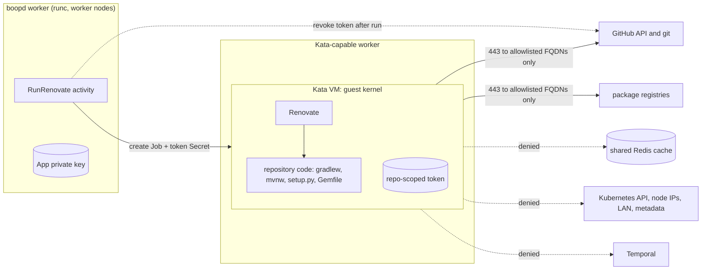
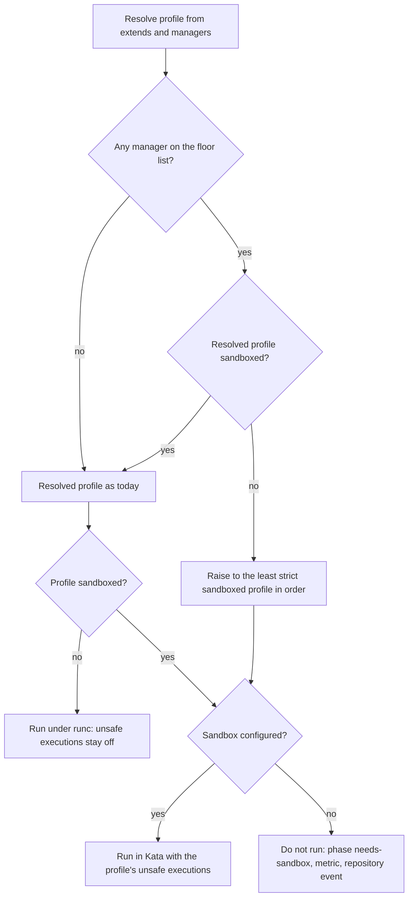
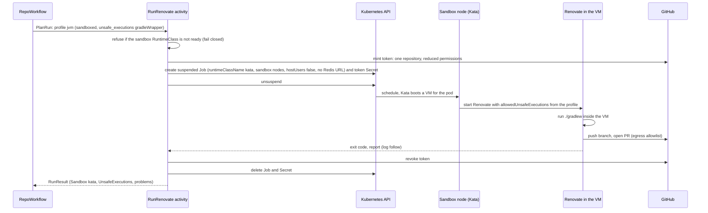

<!-- markdownlint-disable-file MD025 MD041 -->

# DESIGN-0005: Sandboxed execution of repository code in Renovate runs

<!--toc:start-->
<!-- markdownlint-capture -->
<!-- markdownlint-disable MD013 -->
- [Overview](#overview)
- [Goals and Non-Goals](#goals-and-non-goals)
  - [Goals](#goals)
  - [Non-Goals](#non-goals)
- [Background](#background)
  - [What runs repository code](#what-runs-repository-code)
  - [What the homelab showed](#what-the-homelab-showed)
  - [What protects a run today](#what-protects-a-run-today)
  - [What the homelab can run](#what-the-homelab-can-run)
- [Detailed Design](#detailed-design)
  - [Threat model](#threat-model)
  - [Two tiers](#two-tiers)
  - [Choosing the tier](#choosing-the-tier)
  - [Learning the managers safely](#learning-the-managers-safely)
  - [The runtime: Kata](#the-runtime-kata)
  - [Placement](#placement)
  - [Pod posture](#pod-posture)
  - [Network](#network)
  - [Cache](#cache)
  - [The token](#the-token)
  - [A sandboxed run](#a-sandboxed-run)
  - [Failing closed](#failing-closed)
  - [Keeping up with Renovate](#keeping-up-with-renovate)
  - [Observability](#observability)
- [API / Interface Changes](#api--interface-changes)
  - [boopd.hcl](#boopdhcl)
  - [Chart](#chart)
  - [Job builder](#job-builder)
  - [Workflow types and metrics](#workflow-types-and-metrics)
- [Data Model](#data-model)
- [Testing Strategy](#testing-strategy)
- [Migration / Rollout Plan](#migration--rollout-plan)
- [Open Questions](#open-questions)
- [Resolved Questions](#resolved-questions)
- [References](#references)
<!-- markdownlint-restore -->
<!--toc:end-->

<!--docz:overview:start-->
## Overview

Some Renovate managers run code from the repository, or from its
dependencies, while they update lockfiles. Examples are the Gradle and
Maven wrappers, `setup.py` during a Python lock, a Gemfile or a Podfile.
Today boopd blocks Renovate's own switch for these (`allowedUnsafeExecutions`)
and relies on per-ecosystem environment flags for the rest. The homelab
showed that this is not enough: a Python fixture ran its dependency's
`setup.py` in an ordinary Job.

This design adds a **sandboxed tier**. A run that may execute
repository code runs as a Kata Containers VM on a Kata-capable worker,
with a hardened pod posture, an egress allowlist, no shared cache and a
narrowed token. Only in that tier does boopd turn on Renovate's unsafe
executions. A repository that needs the sandbox never runs outside it.
<!--docz:overview:end-->

## Goals and Non-Goals

<!--docz:goals:start-->
### Goals

- **Run the updates that need repository code** (the Gradle wrapper,
  `go generate`, sdist builds, Bundler, and so on) instead of failing
  them or running them unprotected.
- **Contain what that code can reach.** A sandboxed run cannot reach the
  node, other pods, the Kubernetes API, the worker or its App key, the
  shared Renovate cache, Temporal, the homelab LAN, or any internet host
  outside its allowlist.
- **Operator decides, never the repository.** Whether a run is
  sandboxed, and which unsafe executions it may use, comes from
  `boopd.hcl`. Nothing in a repository's Renovate config can raise it.
- **Fail closed.** If the sandbox is not available, a run that needs it
  does not happen. It never falls back to an ordinary Job.
- **Visible.** Every run records whether it was sandboxed and which
  unsafe executions it allowed, for the logs, metrics, Temporal history
  and DESIGN-0004's store and UI.
<!--docz:goals:end-->

<!--docz:non-goals:start-->
### Non-Goals

- **Hiding the run's own GitHub token from code in the same run.** The
  token is bounded instead ([The token](#the-token)); splitting the
  execution from the token is OQ4 option b.
- **Judging the content of the PRs Renovate opens.** Code that runs can
  change files in the commit. Review and CI on the repository are the
  control for that.
- **Confidential computing** (attestation, encrypted guest memory).
- **A sandbox for the boopd worker, ingest or API.** They run no
  repository code.
- **Clusters without hardware virtualisation** beyond failing closed
  (OQ1 covers gVisor as an alternative runtime).
<!--docz:non-goals:end-->

<!--docz:background:start-->
## Background

### What runs repository code

From the Renovate 44.179.2 image (`dist/modules/manager`, read
2026-10-24). "Gated" means Renovate refuses unless the global
`allowedUnsafeExecutions` list names it. That list is `globalOnly`,
empty by default, and accepts `bazelModDeps`, `goGenerate`,
`gradleWrapper`, `mise` and `pixi`.

| Manager | What Renovate runs | Code it executes | Renovate gate | boopd today |
| - | - | - | - | - |
| `gradle-wrapper`, `gradle` | `./gradlew` | the wrapper script, build scripts, plugins | `gradleWrapper` | blocked (gate refused, #33) |
| `gomod` | `go generate` (when `postUpdateOptions` asks) | generators | `goGenerate` | blocked |
| `bazel-module` | `bazel mod deps` | module extensions | `bazelModDeps` | blocked |
| `mise` | `mise lock` | mise config and plugins | `mise` | blocked |
| `pixi` | `pixi lock` | build backends | `pixi` | blocked |
| `maven-wrapper` | `./mvnw wrapper:wrapper` | the wrapper script | **none** | **runs** |
| `pip-compile`, `pipenv`, `poetry`, `pep621` | the resolver (`pip-compile`, `pipenv lock`, `poetry update --lock`, `pdm`, `uv`) | `setup.py` and build backends of sdists and `git+` requirements | **none** | **runs**; the python profile's `PIP_ONLY_BINARY` and `UV_NO_BUILD` cover part of it |
| `bundler` | `bundler lock --update` | Gemfile and gemspecs (Ruby) | **none** | **runs** |
| `cocoapods` | `pod install` | Podfile (Ruby) | **none** | **runs** |
| `mix` | `mix deps.get`, `mix deps.update` | `mix.exs` (Elixir) | **none** | **runs** |
| `nuget` | `dotnet restore --force-evaluate` | MSBuild project evaluation | **none** | **runs** |
| `conan` | `conan lock create` | `conanfile.py` | **none** | **runs** |
| `npm`, `bun`, `composer` | install with scripts off | lifecycle scripts, plugins | `ignoreScripts` by default | blocked (`allowScripts` refused) |

The bold rows are the gap. Renovate's own gate covers five executions,
and boopd's refusal of `allowedUnsafeExecutions` (#33) keeps them shut.
Nothing gates the rest, and they run in every boopd Job today.

### What the homelab showed

The IMPL-0001 Phase 8 fixtures ran on 2026-10-23:

- **`boop-fixture-isolation`** and **`-isolation-probe`**: Renovate
  updated `gradle-wrapper.properties` and refused to run `gradlew`
  ("`gradleWrapper` is not permitted in the allowedUnsafeExecutions").
  The probes never ran.
- **`boop-fixture-python-sdist`**: pip-compile regenerated
  `requirements.txt`, so it built the `git+` dependency from source, and
  that dependency's `setup.py` ran in the Job. The fixture resolved to
  `baseline`, because the homelab's `boopd.hcl` has profiles but no
  `profile_rule` blocks, so the python profile's flags never applied.
  Whether `PIP_ONLY_BINARY=:all:` stops a `git+` build is still
  untested.

Environment flags depend on the right rule matching, and they are
specific to each tool. A posture that does not depend on either is the
point of this design.

### What protects a run today

DESIGN-0001 and ADR-0009 already give each run:

- its own Job and pod, deleted after the run;
- one installation token scoped to the repository and the shared-preset
  repository, revoked when the run ends;
- a restricted pod: non-root, read-only root filesystem, all
  capabilities dropped, `RuntimeDefault` seccomp, no ServiceAccount
  token, no service links, `emptyDir` work and `/tmp`, an
  `activeDeadlineSeconds`;
- a namespace with Pod Security `restricted` enforced (homelab);
- egress NetworkPolicies selected by the profile's `boopd.dev/egress`
  label;
- profiles that can set `runtime_class_name`, `node_selector` and
  tolerations.

What is shared: the node's kernel (runc), the node itself (worker,
ingest and other workloads may be co-scheduled), and the Redis cache
that every run reads and writes. The token carries every permission the
App has.

### What the homelab can run

Read from the cluster on 2026-10-24:

| Component | Version or state |
| - | - |
| Nodes | Talos v1.13.11, Kubernetes v1.36.5, containerd 2.2.9; 3 control plane, 5 workers (Proxmox VMs) |
| Kata | Talos extension `kata-containers` 3.32.0 on all five workers; RuntimeClass `kata` (handler `kata`, overhead 250m CPU and 130Mi, node selector on the extension label) |
| gVisor | not installed |
| CNI | Cilium v1.20.1: kube-proxy replacement, L7 proxy, Hubble, VXLAN tunnel; `CiliumNetworkPolicy` and `CiliumClusterwideNetworkPolicy` CRDs present |
| User namespaces | `UserNamespacesSupport` enabled |
| `boopd` namespace | Pod Security `restricted` enforced and warned |

Kata in Proxmox VMs runs on nested virtualisation, so the workers need
the host CPU type and `/dev/kvm`. The extension is installed and the
RuntimeClass exists; a pod using it has not been run yet.
<!--docz:background:end-->

<!--docz:detailed-design:start-->
## Detailed Design

The body is written to option **a** of every open question.

### Threat model

The attacker controls code that a run executes. The realistic case is
not the repository's own maintainers but a dependency: a `git+`
requirement, an sdist, a Gradle plugin, a gem, a compromised wrapper
distribution. That code runs when Renovate updates a lockfile, before
any human sees the change.

| Asset | Reachable today (runc) | In the sandboxed tier |
| - | - | - |
| Node kernel, kubelet credentials, other pods | a container escape away | a VM escape away (any Kata-capable worker by default; dedicated nodes optional) |
| Kubernetes API | not by token (none mounted); network reachable | denied by egress policy |
| Worker, App private key, Temporal | network reachable unless policies say otherwise | denied |
| Shared Redis cache (poisoning other repositories' lookups) | read and write | not configured |
| Homelab LAN, Proxmox, metadata addresses | network reachable unless policies say otherwise | denied |
| Internet | per profile egress policy | allowlisted FQDNs on 443 only |
| The run's token | readable (same container) | readable, but narrowed and revoked at the end |
| CPU, memory, disk | limits | limits plus the VM's own |

The token is the residual risk. A stolen token can push branches and
open PRs on that one repository until it is revoked. On a repository
whose CI runs on push with secrets, that is a path to those secrets.
[The token](#the-token) narrows it; OQ4 and OQ5 decide how far.



### Two tiers

- **Ordinary** (today's Jobs, runc): `allowedUnsafeExecutions` stays
  empty, `allowScripts` stays refused, and no repository that needs
  execution runs here.
- **Sandboxed**: a profile with `sandboxed = true`. Its Jobs get the
  sandbox's runtime class, nodes, posture, network policy and cache
  rules, and its `unsafe_executions` become Renovate's
  `allowedUnsafeExecutions`. Python profiles in the sandbox drop
  `PIP_ONLY_BINARY` and `UV_NO_BUILD`, since building sdists is what the
  sandbox is for (OQ9).

`allowedUnsafeExecutions` stays a forbidden raw option. The builder sets
it only from a sandboxed profile's `unsafe_executions`, so there is one
path to it and config validation can check it.

### Choosing the tier

The profile resolver gains a **floor**: a list of managers that execute
repository code with no Renovate gate (the bold rows above). A
repository with any of them resolves to a sandboxed profile, whatever
its rules say. Rules can still raise a repository into the sandbox (for
example the JVM profile, to let the Gradle wrapper run); nothing can
lower one with a floor manager out of it.

The floor list ships with boopd and moves with the Renovate version
([Keeping up with Renovate](#keeping-up-with-renovate)). Config can add
managers to it, not remove them (OQ10).



### Learning the managers safely

The resolver sees a repository's managers only in its last run's
report. Before the first run they are unknown, and a commit can add a
floor manager (a new `requirements.txt`) between two ordinary runs. An
ordinary run must therefore never execute a floor manager, even one it
did not expect (OQ14):

- **Ordinary runs force artifact updates off for floor managers.** The
  builder adds `force: { "<manager>": { skipArtifactsUpdate: true } }`
  for every floor manager to the global config. `force` is
  `globalOnly` and overrides repository config, so a repository cannot
  turn it back on.
- **A floor manager in an ordinary run's report re-resolves the
  repository** to a sandboxed profile and schedules an immediate run.
  That run regenerates the lockfiles, so a branch the ordinary run left
  with only its manifest updated is corrected within minutes.
- **A repository with no report yet** resolves as if it had a floor
  manager when the sandbox is configured, so its first run is sandboxed.
  Without a sandbox, its first run is ordinary and the forced skip
  protects it.

### The runtime: Kata

Kata Containers runs each pod in a lightweight VM with its own guest
kernel, through a RuntimeClass. Code that escapes the container lands in
the guest, not on the node. The homelab already has Kata 3.32.0 on every
worker and a `kata` RuntimeClass, so the sandbox is
`runtime_class = "kata"` (OQ1).

- The RuntimeClass `overhead` (250m, 130Mi) is added to the pod's
  requests by the scheduler; the sandbox's resource defaults account for
  it.
- The container's `securityContext` applies inside the guest. The guest
  kernel is the first boundary and the container posture the second.
- `emptyDir` volumes are shared into the guest; their `sizeLimit` still
  applies.
- On nested virtualisation the VM boot adds seconds per run. IMPL-0001
  8.3's overhead measurement covers sandboxed runs too.

### Placement

By default sandboxed Jobs run on **any Kata-capable worker** (OQ8). The
VM is the isolation boundary, so reserving nodes would spend capacity
on a second boundary the design does not depend on. boopd adds no node
selector: the RuntimeClass's own `scheduling.nodeSelector` (in the
homelab, the `extensions.talos.dev/kata-containers` label) keeps the
pods on nodes that can run them. In the homelab that is all five
workers.

**Dedicated nodes are supported** for operators who want a VM escape to
land on a node that runs nothing else: the sandbox block takes an
optional `node_selector` and `toleration`, for example a label
`boopd.dev/sandbox=true` and a taint `boopd.dev/sandbox=true:NoSchedule`
that only sandboxed Jobs tolerate. Profiles cannot override the
sandbox's placement.

### Pod posture

Everything a Job has today, plus:

| Setting | Value | Why |
| - | - | - |
| `runtimeClassName` | the sandbox's (`kata`) | guest kernel boundary |
| `hostUsers` | `false` | container root is not node root, inside the guest too |
| node selector, toleration | none by default (the RuntimeClass schedules); the sandbox's when set | Kata-capable nodes, or dedicated ones by choice |
| ServiceAccount | `boopd-sandbox`, no RBAC, token not mounted | nothing to steal from the API |
| `dnsPolicy` | `ClusterFirst`, with DNS answers filtered by the network policy | only allowlisted names resolve to reachable addresses |
| `RENOVATE_REDIS_URL` | unset | no shared cache ([Cache](#cache)) |
| `ephemeral-storage` | request and limit | a disk-filling dependency stops at the pod |
| `activeDeadlineSeconds` | the profile's, default 55 min | runaway or mining code stops |

Renovate with `binarySource=install` writes tools under its home and
`/tmp`, which are `emptyDir`s today; the Testing section verifies that
holds with the read-only root filesystem under Kata.

### Network

The chart renders an egress policy per sandboxed profile, selecting the
sandbox pods, for the cluster's network provider (OQ6):
`networkPolicies.provider` is `cilium`, `kubernetes` or `vpc-cni`.

**`cilium`** (the homelab; the only provider with name-based filtering):
a `CiliumNetworkPolicy`.

- **Ingress:** none.
- **Egress:**
  - DNS to `kube-dns` only, through Cilium's DNS proxy, which answers
    only for allowlisted names;
  - TCP 443 to `toFQDNs` from the sandbox allowlist plus the profile's
    additions: GitHub (`github.com`, `api.github.com`,
    `codeload.github.com`, `objects.githubusercontent.com`,
    `release-assets.githubusercontent.com`, `ghcr.io`), containerbase's
    tool downloads, and the ecosystem's registries (`repo1.maven.org`,
    `services.gradle.org`, `plugins.gradle.org`, `pypi.org`,
    `files.pythonhosted.org`, `rubygems.org`, `registry.npmjs.org`,
    `proxy.golang.org`, `sum.golang.org`, `api.nuget.org`, ...);
  - nothing else: no cluster or service CIDRs, no node addresses, no
    LAN, no link-local or metadata addresses, no other ports.

**`kubernetes`** (any CNI that enforces standard NetworkPolicy): a
`NetworkPolicy` with no ingress and egress only to DNS on `kube-dns` and
TCP 443 to `0.0.0.0/0` except the private, link-local, CGNAT and
metadata ranges and the cluster's pod and service CIDRs
(`sandbox.egress.denyCIDRs`, defaulted). `sandbox.egress.allowCIDRs`
narrows 443 further, for example to GitHub's published ranges. Without
names, any public host on 443 is reachable; `NOTES.txt` says so.

**`vpc-cni`** (EKS): the Amazon VPC CNI enforces the same standard
`NetworkPolicy` when its network policy agent is enabled, so the chart
renders the `kubernetes` objects and adds the instance metadata address
(`169.254.169.254/32`) and the VPC CIDR to the deny list explicitly.
Name-based filtering on EKS needs an egress proxy or a firewall outside
the cluster; the design leaves that to the operator (the proxy is a
later option, not built here).

GitHub stays reachable because Renovate needs it. Exfiltration through
GitHub needs credentials, and the only ones in the pod are the run's
narrowed token, whose writes are limited to the repository itself.

With Cilium, Hubble records every denied flow, and the chart's alert
rules gain `BoopdSandboxEgressDenied` so a dependency that phones home
is visible. Other providers have no equivalent signal in the chart.

### Cache

Sandboxed runs get **no shared cache** (OQ7). `RENOVATE_REDIS_URL` is
not set, and `cacheDir` is the per-run `emptyDir`. Code in one
repository's run cannot poison lookups that another repository's run
trusts.

The cost is more registry and GitHub lookups per sandboxed run, which
spends more of the installation budget. `boopd_rate_spend_per_run`
already measures it per run, and the budget entity adapts.

None is the default, not a permanent answer. Large estates, several
organisations or many sandboxed repositories may need a cache again;
the likely shape is a per-repository Redis ACL user and key prefix, so a
run shares cache only with its own repository's earlier runs (OQ7 b).
The `sandbox` block leaves room for a `cache` setting when that is
needed.

### The token

The run's token is in the pod: Renovate needs it to clone, push and
open PRs. Renovate does not pass it to child processes
(`exposeAllEnv` is refused), but code running as the same user in the
same container can read Renovate's environment through `/proc`. The
design bounds it rather than hides it (OQ4):

- **Narrowed on mint** (OQ5): sandboxed runs request explicit
  permissions instead of everything the App has:
  `contents: write`, `pull_requests: write`, `issues: write`,
  `checks: read`, `statuses: read`, `metadata: read`, and **no
  `workflows`**. A stolen token cannot add or change workflow files. A
  sandboxed repository's GitHub Actions updates then fail with a clear
  artifact problem; the operator can route those to an ordinary profile
  by splitting the repository's Renovate config, or accept it.
- **Scoped** to the repository and the shared-preset repository, as
  today.
- **Short-lived:** revoked when `RunRenovate` returns, as today; GitHub
  caps it at one hour regardless.
- **Default branch protected:** boopd's docs require branch protection
  or a ruleset on the default branch of sandboxed repositories, so a
  stolen token cannot push there. The design does not enforce it; a
  later check can read the repository's rules and refuse.

### A sandboxed run



### Failing closed

A run that needs the sandbox does not run when:

- no `sandbox` block is configured;
- the RuntimeClass named by the sandbox does not exist;
- no node carries the sandbox label (the Job would stay pending).

The worker checks the first two at start and every discovery pass, and
reports them on `/readyz` detail and a gauge. `RunRenovate` checks
again before creating the Job and returns a non-retryable
`NeedsSandbox` error. `RepoWorkflow` records the phase `needs-sandbox`,
waits for the next cadence, and emits a repository event. A Job that
stays unschedulable past a timeout is deleted and classified the same
way (OQ3).

### Keeping up with Renovate

The floor list and the gated list change with Renovate. A test reads the
pinned Renovate image's `allowedUnsafeExecutions.allowedValues` and the
managers whose artifact code calls `exec`, and fails when either differs
from what boopd knows. Renovate upgrades in the chart then force a
decision on any new execution path.

boopd keeps the floor and **tracks** upstream rather than driving it
(OQ12): no issues are filed for boopd. The drift test and this table
are where a change shows up; when Renovate gates a floor manager, it
moves from the floor to `unsafe_executions`.

| Execution | Upstream state (2026-10-25) | boopd |
| - | - | - |
| `gradleWrapper`, `goGenerate`, `bazelModDeps`, `mise`, `pixi` | gated by `allowedUnsafeExecutions` (renovatebot/renovate#39458; empty default #39459) | refused in raw config; a sandboxed profile's `unsafe_executions` |
| blocked execution reported as an artifact error | open: renovatebot/renovate#44232 | today a dashboard WARN only; picked up by the run's problems |
| `maven-wrapper` (`./mvnw`) | not gated; no upstream issue found | floor |
| sdist builds (pip-compile, pipenv, poetry, pdm, uv) | not gated | floor |
| Bundler, CocoaPods, Mix, NuGet, Conan | not gated | floor |

### Observability

- `RunResult` gains `Sandbox` (the runtime class, empty for ordinary)
  and `UnsafeExecutions`.
- Search attribute `Sandboxed` (Bool) for listing sandboxed
  repositories in Temporal.
- `boopd_runs_total` and the run duration histograms gain a `sandboxed`
  label; `boopd_sandbox_ready` (gauge) and
  `boopd_runs_needs_sandbox_total` are new.
- The run's log fields include `sandbox` and `unsafe_executions`.
- DESIGN-0004's `runs` projection stores both fields and the UI shows
  them on the Runs page and the repository header. Branch-level artifact
  problems (proposed for DESIGN-0004 separately) make a blocked or failed
  execution visible per PR.
<!--docz:detailed-design:end-->

<!--docz:api-changes:start-->
## API / Interface Changes

### boopd.hcl

```hcl
# One sandbox per cluster. Without it, sandboxed profiles and floor
# managers make runs fail closed.
sandbox {
  runtime_class   = "kata" # placement comes from the RuntimeClass
  service_account = "boopd-sandbox"

  # Optional: dedicated nodes for sandboxed Jobs only.
  # node_selector = { "boopd.dev/sandbox" = "true" }
  # toleration {
  #   key    = "boopd.dev/sandbox"
  #   value  = "true"
  #   effect = "NoSchedule"
  # }

  egress_allow = [
    "github.com", "api.github.com", "codeload.github.com",
    "objects.githubusercontent.com", "release-assets.githubusercontent.com",
    "ghcr.io",
  ]
  floor_add = [] # managers to sandbox in addition to the built-in floor
}

profile "jvm" {
  inherit           = "baseline"
  sandboxed         = true
  unsafe_executions = ["gradleWrapper"]
  egress_allow      = ["repo1.maven.org", "services.gradle.org", "plugins.gradle.org"]
}

profile "python" {
  inherit      = "baseline"
  sandboxed    = true
  egress_allow = ["pypi.org", "files.pythonhosted.org"]
}
```

Validation:

- `unsafe_executions` only on a profile with `sandboxed = true`, values
  from Renovate's `allowedValues`;
- `sandboxed = true` with a profile `pod.runtime_class_name` is an
  error: the sandbox owns the runtime class and placement;
- a sandboxed profile must not be stricter-ordered below an ordinary
  one it inherits from (`order` stays the strictness order);
- `allowedUnsafeExecutions` in any `renovate` block stays forbidden.

### Chart

- `sandbox.enabled`, `sandbox.runtimeClass`, `sandbox.egressAllow`, and
  the optional `sandbox.nodeSelector` and `sandbox.tolerations`,
  rendered into the `sandbox` block.
- A `boopd-sandbox` ServiceAccount with no bindings.
- `networkPolicies.provider`: `cilium` (`CiliumNetworkPolicy` with
  `toFQDNs`), `kubernetes` or `vpc-cni` (standard `NetworkPolicy` with
  `sandbox.egress.denyCIDRs` and `allowCIDRs`); see [Network](#network).
  The non-Cilium providers get a `NOTES.txt` warning that host names
  are not filtered.
- The runs quota counts sandbox pods with the Kata overhead.
- `PrometheusRule`: `BoopdSandboxNotReady`, `BoopdRunsNeedSandbox`,
  `BoopdSandboxEgressDenied` (the last from Hubble metrics, when
  enabled).

### Job builder

`jobspec.BuildInput` gains a `Sandbox` (nil for ordinary runs). With it,
the builder sets the runtime class, the node selector and toleration
when the sandbox has them, the ServiceAccount, `hostUsers: false`, ephemeral storage, the
`boopd.dev/sandbox` label, drops `RENOVATE_REDIS_URL`, and writes
`allowedUnsafeExecutions` into the global config from the profile.
Without it, `unsafe_executions` is an error (`ErrNeedsSandbox`).

`platform.Minter.Mint` gains optional permissions; sandboxed runs pass
the narrowed set.

### Workflow types and metrics

- `RunResult.Sandbox string`, `RunResult.UnsafeExecutions []string`.
- `PlanRunResult.Sandboxed bool`.
- Phase `needs-sandbox`; error type `NeedsSandbox` (non-retryable).
- Search attribute `Sandboxed` (Bool), registered by `boopd worker`.
- Metrics listed under [Observability](#observability).
<!--docz:api-changes:end-->

<!--docz:data-model:start-->
## Data Model

No store yet. `RunResult` grows two fields in Temporal history (a
replay-safe addition; old histories decode with zero values).

When DESIGN-0004's store lands, `runs` gains `sandbox text` and
`unsafe_executions text[]`, and `repositories` gains `sandboxed bool`
from the resolved profile.
<!--docz:data-model:end-->

<!--docz:testing:start-->
## Testing Strategy

- **Unit:** the resolver's floor (a floor manager always lands in a
  sandboxed profile; rules raise but never lower; no report yet means
  sandboxed when configured); config validation for every rule above;
  the builder's sandboxed pod spec and global config; the forced
  `skipArtifactsUpdate` for floor managers in ordinary runs;
  `ErrNeedsSandbox`; the narrowed mint request body.
- **Renovate behaviour:** a homelab run over `boop-fixture-python-sdist`
  as an ordinary run must show Renovate honouring the forced
  `skipArtifactsUpdate` (manifest updated, `requirements.txt` not
  regenerated, no `setup.py` marker), then the sandboxed rerun fixing
  the branch.
- **Renovate drift test:** over the pinned image, compare
  `allowedUnsafeExecutions.allowedValues` and the managers that call
  `exec` with boopd's gated and floor lists ([Keeping up with
  Renovate](#keeping-up-with-renovate)).
- **e2e (k3d):** k3d has no Kata, so the e2e registers a RuntimeClass
  `kata` with handler `runc` and, for the dedicated-node mode, a
  labelled and tainted node. It proves the plumbing: placement in both
  modes, posture, no Redis URL, the global config, fail
  closed when the RuntimeClass is deleted, `needs-sandbox` recorded.
- **Homelab (the isolation proof),** reusing the IMPL-0001 8.1
  fixtures under a sandboxed profile with `gradleWrapper` allowed:
  - `uname -r` in the probe differs from the node's kernel (guest
    kernel);
  - markers in `/tmp`, `cacheDir` and `baseDir` are absent in the next
    run (`isolation-probe`), and no `sleep` survives the VM;
  - Redis, Temporal, the Kubernetes API, node addresses, the LAN and
    `169.254.169.254` are unreachable; a non-allowlisted FQDN fails;
    Hubble shows the denials;
  - the token is present in Renovate's environment (expected), carries
    only the narrowed permissions (a workflow-file push fails), and
    answers 401 after the run;
  - `python-sdist`: the lock update succeeds inside the sandbox and the
    marker is confined to that VM;
  - the readonly root filesystem holds with `binarySource=install`.
- **Overhead:** IMPL-0001 8.3's measurement split by `sandboxed`.
<!--docz:testing:end-->

<!--docz:rollout:start-->
## Migration / Rollout Plan

1. **Now, done or in review:** refuse `allowedUnsafeExecutions` (#33).
2. **Now, homelab config:** add the `profile_rule` blocks the example
   config has, so the python profile's flags apply until the sandbox
   exists.
3. **IMPL:** the resolver floor, config, builder, minter permissions,
   fail-closed checks, metrics, chart, e2e and drift test. Enforcing the
   floor without a `sandbox` block stops every floor repository, so the
   first release ships `floor_mode = "report"` (log, metric and
   repository event; runs proceed as today) and a later release
   defaults to `enforce` (OQ13).
4. **Homelab:** enable the sandbox on the existing `kata` RuntimeClass
   (all five workers) with `networkPolicies.provider = "cilium"`, move
   `python` and a new `jvm` profile into it, switch `floor_mode` to
   `enforce`.
5. **Prove it:** run the homelab checks in Testing; record them in the
   spike results investigation under IMPL-0001 8.8, which is re-scoped
   to containment (OQ11).
6. **Upstream:** keep the [tracking table](#keeping-up-with-renovate)
   current on each Renovate upgrade; no issues filed (OQ12).
7. **Later:** INV-0003 (Kata VMM choice, OQ1 c).
<!--docz:rollout:end-->

<!--docz:open-questions:start-->
## Open Questions

None open. The answered questions are listed under
[Resolved Questions](#resolved-questions).

## Resolved Questions

Answered 2026-10-25. The body above is written to these decisions.

| OQ | Question | Decision |
| - | - | - |
| 1 | Which sandbox runtime? | **a**: Kata through the existing `kata` RuntimeClass. An explicit VMM (Cloud Hypervisor or Firecracker, option c) is for later: [INV-0003](../investigation/0003-kata-vmm-choice-for-sandboxed-runs-cloud-hypervisor-or.md), not started |
| 2 | Which runs are sandboxed? | **a**: repositories with a floor manager, plus profiles marked `sandboxed` |
| 3 | Sandbox needed but unavailable? | **a**: the run does not happen; `needs-sandbox`, metric, alert, repository event |
| 4 | How far is the token protected from code in the same run? | **a**: bounded (narrowed, one repository, revoked at the end, default branch protected), measured in the homelab |
| 5 | Sandboxed token permissions? | **a**: explicit set without `workflows` |
| 6 | Egress control? | **a, with providers**: `cilium` (`toFQDNs`), `kubernetes` (standard NetworkPolicy by CIDR) and `vpc-cni` (EKS, the same objects plus metadata and VPC denies) ([Network](#network)) |
| 7 | Cache for sandboxed runs? | **a**: none shared by default; a per-repository cache (b) may be needed later for large or multi-organisation estates ([Cache](#cache)) |
| 8 | Where do sandboxed Jobs run? | **b as the default, a supported**: any Kata-capable worker, since the VM is the isolation; dedicated tainted nodes are optional ([Placement](#placement)) |
| 9 | `PIP_ONLY_BINARY` inside the sandbox? | **a**: no; sdists may build there |
| 10 | Who owns the floor list? | **a**: boopd, tied to the pinned Renovate by the drift test; config can add, not remove |
| 11 | What does IMPL-0001 8.8 test? | **a**: containment, against the sandboxed tier; the runc result is the baseline finding |
| 12 | The ungated `maven-wrapper`? | **b, tracked**: keep it on the floor; track upstream in the [tracking table](#keeping-up-with-renovate) without filing issues |
| 13 | When does the floor enforce? | **a**: one release in `report` mode, then `enforce` |
| 14 | Unknown floor managers in ordinary runs? | **a**: forced `skipArtifactsUpdate`, re-resolve on the report, immediate sandboxed rerun; a never-run repository starts sandboxed when a sandbox exists |
<!--docz:open-questions:end-->

<!--docz:references:start-->
## References

- DESIGN-0001 § Process builder (forbidden options, profiles) and
  § Testing Strategy (isolation and profile enforcement)
- ADR-0009 (each run is a Kubernetes Job)
- IMPL-0001 Phase 8: 8.1 fixtures, 8.3 overhead, 8.8 isolation
- DESIGN-0004 (runs projection and UI)
- [INV-0003](../investigation/0003-kata-vmm-choice-for-sandboxed-runs-cloud-hypervisor-or.md)
  (Kata VMM choice; not started)
- #33 (refuse `allowedUnsafeExecutions`)
- Renovate 44.179.2: `allowedUnsafeExecutions` option definition;
  `dist/modules/manager/*/artifacts.js`; renovatebot/renovate#39458,
  #39459, #44232
- Kata Containers: RuntimeClass and pod overhead; Talos
  `siderolabs/kata-containers` extension
- Cilium: DNS-based (`toFQDNs`) egress policy, Hubble
- Amazon VPC CNI: Kubernetes network policy support
- Kubernetes: user namespaces (`hostUsers: false`), RuntimeClass
  scheduling and overhead, Pod Security Standards
- GitHub: installation access tokens (`repository_ids`, `permissions`)
<!--docz:references:end-->
