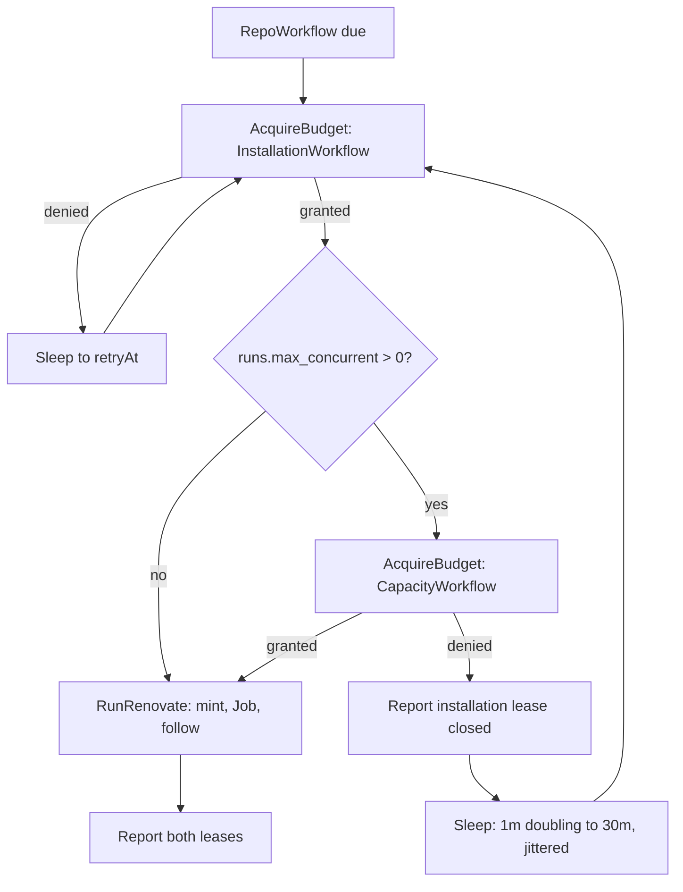

<!-- markdownlint-disable-file MD024 MD025 MD041 -->

# IMPL-0002: Release signing, chart tag, GitOps Redis secret and the run cap (issues 8-11)

<!--toc:start-->
- [Objective](#objective)
- [Scope](#scope)
  - [In Scope](#in-scope)
  - [Out of Scope](#out-of-scope)
- [Findings (2026-10-12)](#findings-2026-10-12)
- [Implementation Phases](#implementation-phases)
  - [Phase 1: Image digest, signature and provenance (#8)](#phase-1-image-digest-signature-and-provenance-8)
    - [Tasks](#tasks)
    - [Success Criteria](#success-criteria)
  - [Phase 2: The chart's default image tag (#9)](#phase-2-the-charts-default-image-tag-9)
    - [Tasks](#tasks-1)
    - [Success Criteria](#success-criteria-1)
  - [Phase 3: A Redis password that survives helm template (#10)](#phase-3-a-redis-password-that-survives-helm-template-10)
    - [Tasks](#tasks-2)
    - [Success Criteria](#success-criteria-2)
  - [Phase 4: runs.max_concurrent as a Temporal lease (#11)](#phase-4-runsmax_concurrent-as-a-temporal-lease-11)
    - [Tasks](#tasks-3)
    - [Success Criteria](#success-criteria-3)
  - [Phase 5: One PR, the release and closing the issues](#phase-5-one-pr-the-release-and-closing-the-issues)
    - [Tasks](#tasks-4)
    - [Success Criteria](#success-criteria-4)
- [File Changes](#file-changes)
- [Testing Plan](#testing-plan)
- [Dependencies](#dependencies)
- [Open Questions](#open-questions)
  - [OQ1: What happens to the unsigned 0.2.x images?](#oq1-what-happens-to-the-unsigned-02x-images)
  - [OQ2: Does the Temporal build ID keep the v?](#oq2-does-the-temporal-build-id-keep-the-v)
  - [OQ3: Where does the ACL hash come from with an existing Secret?](#oq3-where-does-the-acl-hash-come-from-with-an-existing-secret)
  - [OQ4: What must the existing Secret carry?](#oq4-what-must-the-existing-secret-carry)
  - [OQ5: How is max_concurrent enforced?](#oq5-how-is-max_concurrent-enforced)
  - [OQ6: How long does a run wait when the cap is full?](#oq6-how-long-does-a-run-wait-when-the-cap-is-full)
  - [OQ7: Does the chart turn the ResourceQuota on by default?](#oq7-does-the-chart-turn-the-resourcequota-on-by-default)
- [References](#references)
<!--toc:end-->

## Objective

Fix the four issues filed after v0.2.0 on one branch (`fix/issues-8-11`)
and one PR:

- [#8](https://github.com/donaldgifford/boop/issues/8): released images
  carry no digest output, no cosign signature and no SLSA provenance.
- [#9](https://github.com/donaldgifford/boop/issues/9): the chart's
  default image tag is `v0.2.x`; the image is published as `0.2.x`.
- [#10](https://github.com/donaldgifford/boop/issues/10): the redis
  subchart regenerates its password on every `helm template` render
  (Argo CD, Flux with post-rendering, kustomize).
- [#11](https://github.com/donaldgifford/boop/issues/11):
  `runs.max_concurrent` is not enforced by boopd. A run past the
  chart's quota does not fail fast; it waits `pending_timeout`.

**Implements:** issues #8–#11. Touches DESIGN-0001 OQ12 (the cluster
capacity cap) and IMPL-0001 Phase 7 (the chart).

## Scope

### In Scope

- `release.yml` image digest capture and both SLSA image references;
  the chart's `appVersion` and goreleaser's release-notes image ref.
- Chart: default tag without the `v`, `redis.auth.existingSecret`, a
  determinism check that renders twice and diffs, and the ResourceQuota
  rendered from `maxConcurrent`.
- Config: a password-only Redis Secret, from which boopd composes the
  URL.
- Workflows: a `CapacityWorkflow` lease for the cluster-wide run cap,
  taken before a token is minted, with metrics and an e2e scenario.
- Doc corrections: `docs/config.md` § runs, the chart README, DESIGN-0001
  OQ12.

### Out of Scope

- Re-signing or rebuilding images that are already published (OQ1 a).
- A Redis operator, Redis Sentinel or an external Redis by default.
- Per-installation or per-profile run caps; ADR-0008's budget already
  caps per installation.
- Any change to the release train's tag flow (`bump-version`, lockstep
  versions).

## Findings (2026-10-12)

Research on `main` at `0e7bc9b`, before any change:

1. **#8 has a second cause.** The digest step reads
   `fromJSON(steps.bake.outputs.metadata).release['containerimage.digest']`
   (`release.yml:224`). Bake keys metadata by **target** name, and the
   `release` group's only target is `boopd-release` (`docker-bake.hcl`).
   The key is empty, the step exits 1 after the push, and signing and
   provenance never run. Separately, both SLSA jobs name the wrong image:
   - `image-slsa` uses `ghcr.io/${{ github.repository }}`
     (`release.yml:268`), which is `ghcr.io/donaldgifford/boop`, not
     `…/boopd`;
   - `chart-slsa` uses `…/charts/${{ github.event.repository.name }}`
     (`release.yml:423`), which is `charts/boop`, not `charts/boopd`.

   `cosign tree` on 0.2.1: the chart has a signature and no attestation;
   the image has neither.
2. **#9.** `helm package --app-version "${TAG}"` (`release.yml:358`)
   stamps `v0.2.1`. The Deployment defaults to `.Chart.AppVersion`
   (`templates/deployment.yaml:42`), and metadata-action publishes
   `{{version}}`, which is `0.2.1`. goreleaser's release notes print
   `ghcr.io/donaldgifford/boopd:{{ .Tag }}` (`.goreleaser.yml:87`), which
   has the same mismatch. `TEMPORAL_BUILD_ID` and the
   `app.kubernetes.io/version` label also fall back to `AppVersion`
   (`templates/_helpers.tpl`).
3. **#10.** `redis.password` (`charts/redis/templates/_helpers.tpl`) does a
   `lookup` of `<release>-redis-auth`, else `randAlphaNum 40`. `lookup` is
   empty under `helm template`, so every GitOps render rotates the
   password. The Secret then carries a new `password`, `url` and
   `users.acl`, and redis and boopd roll on every sync. The ACL line is
   `user renovate on #<sha256(password)> ~renovate:* …`. That hash can be
   computed at pod start from a password the chart never sees (OQ3).
4. **#11's premise is wrong.** A ResourceQuota on `pods` does not refuse
   the Job; it refuses the **pod** the Job controller creates. boopd's
   `createJob` succeeds. `WaitRunning` then sees no running pod until
   `pending_timeout` (10m default), returns `kube.ErrPending`, and the
   activity returns `ErrTypePending` (`internal/activities/run.go:223`).
   The RepoWorkflow backs off up to `pendingBackoff` (30m,
   `internal/workflows/repo.go:46`). During those 10 minutes the run holds
   a budget lease and a minted, unrevoked repository token. So nothing is
   "infrastructure-failed", but the cap costs leases and tokens and is
   invisible except as pending timeouts. `docs/config.md` § runs says
   otherwise and is wrong. The InstallationWorkflow already caps runs per
   installation with leases (`budget.max_concurrent_runs`, default 10), so
   the cluster cap reuses that code (OQ5 b).

## Implementation Phases

Phases are independent; 1 and 2 touch `release.yml` and are done first
because they are smallest and unblock verifying the next release. One
branch, one PR (Phase 5).

### Phase 1: Image digest, signature and provenance (#8)

Make the image job publish its digest, sign it, and hand it to the
provenance generator under the right name; point the chart's provenance
at the right repository.

#### Tasks

- [x] 1.1 Digest key: read
  `fromJSON(steps.bake.outputs.metadata)['boopd-release']['containerimage.digest']`.
  Keep the value in `env:`, as the existing comment requires.
- [x] 1.2 Diagnosable failure: when the digest is empty, say which key
  was expected and where the target name comes from. Printing the
  metadata's keys would need the blob in `env:`, which the step's comment
  rules out (execve limit), and `.*[...]` on bake metadata fails
  actionlint's type check.
- [x] 1.3 `image-slsa`: `image: ghcr.io/${{ github.repository_owner }}/boopd`.
  Reusable-workflow inputs cannot read `env`, so the name is a literal,
  with a comment that it must match `IMAGE_REPO`.
- [x] 1.4 `chart-slsa`: `image: ghcr.io/${{ github.repository_owner }}/charts/boopd`,
  with the same comment against `CHART_NAMESPACE`.
- [x] 1.5 Guard: `scripts/check-release-refs.sh` (`just lint-release-refs`,
  and a step in `ci.yml`'s Lint job) reads `release.yml` with `yq` and
  fails when either SLSA `image:` input differs from `REGISTRY` plus
  `IMAGE_REPO`, or `CHART_NAMESPACE` plus `CHART_NAME`, or when
  `CHART_NAME` differs from `Chart.yaml`'s name.
- [x] 1.6 Dry run: `docker buildx bake release --print` lists one target,
  `boopd-release`, the key 1.1 reads (2026-10-13). A `dry_run` dispatch
  would not help, because it skips the bake step and so the digest step
  too.
- [x] 1.7 README "Verifying a release" section: the `cosign verify` and
  `slsa-verifier verify-image` commands for image and chart, with the
  certificate identity regexp for `release.yml`.

#### Success Criteria

- `actionlint` and `just lint` pass.
- After the release this PR cuts (Phase 5), `cosign tree` on
  `ghcr.io/donaldgifford/boopd:<version>` shows a signature and an SLSA
  attestation, and the same for `ghcr.io/donaldgifford/charts/boopd:<version>`.
- `cosign verify` and `slsa-verifier verify-image` from the README succeed
  for both artefacts.
- The release workflow's image job is green and its summary shows the
  digest.

### Phase 2: The chart's default image tag (#9)

The chart's default tag is the published image tag: no `v`.

#### Tasks

- [x] 2.1 `release.yml` package step: `--app-version "${TAG#v}"`
  (`--version` already uses the stripped `steps.version.outputs.chart_version`).
  Fix the comment that says "appVersion = the tag".
- [x] 2.2 Belt and braces in the chart: the image tag is
  `.Values.image.tag | default (.Chart.AppVersion | trimPrefix "v")`, so a
  chart packaged by hand with a `v` still pulls the right image.
  `image.tag` set by the user is used verbatim.
- [x] 2.3 `app.kubernetes.io/version` label: the same `trimPrefix`, so it
  matches the image tag.
- [x] 2.4 `TEMPORAL_BUILD_ID`: stays `worker.buildId | default image.tag |
  default AppVersion`, with the `v` stripped from the `AppVersion`
  fallback only (OQ2 a).
- [x] 2.5 `.goreleaser.yml:87`: `ghcr.io/donaldgifford/boopd:{{ .Version }}`.
- [x] 2.6 helm-unittest: with `chart.appVersion: v9.9.9` and no
  `image.tag`, the image is `…:9.9.9`, the version label is `9.9.9` and
  the build ID is `9.9.9`; with `image.tag: v1.2.3` the image is
  `…:v1.2.3` (the existing override test stays).
- [x] 2.7 Chart README: the default-tag sentence says the tag is the
  chart's version without a `v`.

#### Success Criteria

- `just helm-test` passes, including the new cases.
- `helm package charts/boopd --version 9.9.9 --app-version v9.9.9` then
  `helm template` renders `image: "ghcr.io/donaldgifford/boopd:9.9.9"`.
- After the Phase 5 release, `helm show chart oci://ghcr.io/donaldgifford/charts/boopd --version <version>`
  shows `appVersion: <version>` with no `v`. A default install pulls an
  image that exists, with no `image.tag` override.

### Phase 3: A Redis password that survives helm template (#10)

Let GitOps installs bring their own password, as repo-guardian's bundled
Postgres does (`store.postgres.baked.existingSecret`): the Secret holds
the password only, and nothing derived from it is rendered.

#### Tasks

- [x] 3.1 Values: `redis.auth.existingSecret` (default `""`) and
  `redis.auth.existingSecretKey` (default `password`), in
  `charts/redis/values.yaml`, the parent's `values.yaml` passthrough and
  the parent's `values.schema.json` (the subchart has none). The names
  match repo-guardian's.
- [x] 3.2 Subchart Secret: with `existingSecret` set, `secret.yaml`
  renders nothing. Without it, behaviour is unchanged (lookup, else
  random), and the `redis.password` helper comment names the GitOps
  caveat and the value that fixes it, as repo-guardian's
  `store-postgres-secret.yaml` does.
- [x] 3.3 ACL at pod start (OQ3 a): with `existingSecret` set, the redis
  Deployment gains an init container on the same pinned redis image, with
  the same securityContext (uid/gid 999, read-only root, no
  capabilities). It is fed the password from the existing Secret
  (`secretKeyRef` env), hashes it (`printf %s "$PASSWORD" | sha256sum`)
  and writes the same two lines `secret.yaml` writes today
  (`user default off`, and `user renovate on #<sha256> resetkeys
  ~<keyPrefix>* … -@dangerous …`) to `/etc/redis/users.acl` on an
  `emptyDir` (`medium: Memory`). Everything after the hash comes from one
  helper shared with `secret.yaml`, so the two paths cannot drift. Only
  the hash reaches the file; the password stays in the init container's
  environment.
- [x] 3.4 Rolling: the redis pod template carries a `checksum/auth`
  annotation only when the chart owns the Secret. With `existingSecret`,
  rotation is the owner's job; the README says to restart redis and the
  worker after rotating.
- [x] 3.5 boopd config (OQ4 a): the `renovate` block gains
  `redis_url` (a URL without a password, such as
  `redis://renovate@boopd-redis:6379`) and `redis_password_secret_ref`
  (`name`, `key`).
  - `ReadSecrets` reads the password and sets it with `url.UserPassword`
    into `Renovate.RedisURL`, the field `BuildInput` already passes on, so
    any password works, not only URL-safe ones.
  - `redis_secret_ref` (a full URL) stays.
  - Validation: `redis_secret_ref` and `redis_url` exclude each other, and
    `redis_password_secret_ref` needs `redis_url`.
  - Update `docs/config.md` (`TestReferenceCoversSchema` enforces it) and
    `examples/boopd.hcl`.
- [x] 3.6 Parent wiring:
  - with `existingSecret`, `_config.tpl` renders
    `redis_url = "redis://renovate@<release>-redis:6379"` and
    `redis_password_secret_ref` pointing at the existing Secret's key;
  - the worker mounts the Secret through the existing `<secretsDir>/<name>/<key>`
    path;
  - an explicit `boopd.renovate.redisSecretRef` still wins.
- [x] 3.7 Fail early: `existingSecret` without `redis.enabled`, or with an
  empty `existingSecretKey`, is a render error.
- [x] 3.8 Determinism check: a `helm-template-stable` recipe in
  `helm.just` renders the chart twice with `ci/ci-values.yaml` and
  `tests/values/existing-secret.yaml`, diffs the output (failing on any
  difference) and runs `boopd config validate` on the rendered file.
  `helm-test` depends on it and `ci.yml` runs the diff after
  `helm unittest`. The values file is not under `ci/`, because `ct
  install` installs every file there and the Secret would not exist.
- [x] 3.9 Tests:
  - Go unit tests: config decode and validation for the three redis
    shapes; a password with `@`, `:` and `/` is escaped in the built URL.
  - helm-unittest, with `existingSecret`:
    - no Secret is rendered;
    - the init container's env references the Secret's name and key;
    - the ACL volume is the emptyDir;
    - `boopd.hcl` carries `redis_url` and `redis_password_secret_ref`;
    - the guard errors fire.
- [x] 3.10 E2E: `TestChart_RedisExistingSecret` in
  `test/e2e/chart_test.go`. It creates a password-only Secret, installs
  with `existingSecret`, and asserts that redis accepts `AUTH renovate
  <password>`, refuses `default`, and that a stub-renovate run gets a
  `RENOVATE_REDIS_URL` that authenticates. The password has characters a
  URL must escape. The test takes the URL from the run Job (watched,
  because Jobs are deleted when they end) and checks auth from one-off
  `redis-cli` pods on the subchart's image. It is in
  `test/e2e/redis_test.go`; it passed on k3d on 2026-10-13.
- [ ] 3.11 Chart README "GitOps installs" section:
  - why `lookup` fails under `helm template`;
  - the one-key Secret;
  - a `kubectl create secret` example, and a note that External Secrets
    or SOPS fit the same shape.

#### Success Criteria

- `just check` and `just helm-test` pass, including `helm-template-stable`;
  the two renders are byte-identical.
- The chart e2e in CI passes `TestChart_RedisExistingSecret` and the
  existing chart tests unchanged.
- An install without `existingSecret` renders exactly what it renders
  today; the existing redis unit tests pass without edits.

### Phase 4: runs.max_concurrent as a Temporal lease (#11)

Turn a cap the cluster enforces by starving pods into a lease the
RepoWorkflow takes before it mints a token or creates a Job (OQ5 b). A
`CapacityWorkflow` singleton reuses the InstallationWorkflow's lease
machinery: count, TTL sweep and jittered `retryAt`. While a run waits, it
is a durable timer in its RepoWorkflow; no worker slot, activity or pod is
held.

#### Tasks

- [ ] 4.1 Correct the record: `docs/config.md` § runs `max_concurrent` row
  says the cap is a lease taken before minting, and the ResourceQuota is
  the backstop that starves pods. Fix the comment in
  `templates/resourcequota.yaml`: pods past the cap are refused, and the
  Job waits `pending_timeout`; nothing is refused at admission. Update
  #11's description with the finding.
- [ ] 4.2 Extract the lease core: the count, `grant`, `report`, `sweep`
  and `nextExpiry` parts of `budget` in `installation.go` move into a
  `leases` type both entities use. InstallationWorkflow's behaviour and
  tests are unchanged.
- [ ] 4.3 `CapacityWorkflow` (ID `capacity/runs`): a lease entity with
  `MaxConcurrentRuns = runs.max_concurrent` and no rate resources. It
  ContinuesAsNew like the InstallationWorkflow, carrying its leases and
  taking the cap from its input. The worker starts it at boot with
  `WorkflowIDConflictPolicy: UseExisting` when the cap is above 0, and
  signals a changed cap.
- [ ] 4.4 RepoWorkflow (6 a, as decided): after the installation lease is
  granted and when the cap is set, acquire a capacity lease. On denial:
  - report the installation lease closed, so a run waiting on the cluster
    holds none of the installation's budget;
  - sleep `min(1m × 2^n, 30m)`, jittered, where `n` counts consecutive
    capacity denials, then start again from the installation lease;
  - reset `n` on a grant.

  On finish, report both leases. The new branch sits behind
  `workflow.GetVersion` (change ID `capacity-lease`), the first version
  gate in the codebase, because RepoWorkflows are long-lived. Phase
  `waiting-capacity` is added to the search attribute values.
- [ ] 4.5 Metrics: `boopd_capacity_leases` (gauge) and
  `boopd_capacity_denied_total` (counter), emitted the way the budget's
  gauges are; add them to the README's metric table.
- [ ] 4.6 Workflow tests (test environment): denial then grant; the
  backoff doubles and caps at 30m; the installation lease is reported on a
  capacity denial; an unreported lease is swept at its TTL; and both
  sides of the version gate.
- [ ] 4.7 ResourceQuota (OQ7 b): rendered whenever
  `boopd.runs.maxConcurrent > 0`, so `resourceQuota.enabled` goes. Add it
  to `validateRemovedValues` with a pointer to the new rule.
  - Its `pods` count adds the worker replicas when the run namespace is
    the release namespace (as today), plus the redis pod when the redis
    subchart is enabled there.
  - The README says the quota covers every pod in the run namespace, so
    a dedicated runs namespace (`boopd.runs.namespace` with `namespace.create`)
    is the clean setup.
  - `.Values.resourceQuota.hard` extras stay.
- [ ] 4.8 E2E: `TestWorker_MaxConcurrent` in `test/e2e/worker_test.go`,
  with `max_concurrent = 1`, two onboarded repositories and stub Renovate
  held running (`STUB_DELAY`). It asserts:
  - at most one run Job exists at any time;
  - the fake GitHub's mint count equals the admitted runs;
  - the second run starts after the first finishes.
- [ ] 4.9 DESIGN-0001 OQ12: append a dated note. The cap is a
  CapacityWorkflow lease as of IMPL-0002, and the quota is the backstop.

#### Success Criteria

- `just check` passes, including the workflow tests in 4.6 and
  InstallationWorkflow's existing tests unchanged after 4.2.
- `just e2e` (and CI's E2E job) passes `TestWorker_MaxConcurrent`: one
  Job at a time, one mint per admitted run.
- With the cap full, no run holds a token, an installation lease or a Job.
  This shows up as `boopd_capacity_denied_total` rising while
  `boopd_run_pending_timeouts_total` stays flat.
- helm-unittest: the quota renders with `maxConcurrent > 0`, not with 0,
  and counts the worker and redis pods when they share the namespace.

### Phase 5: One PR, the release and closing the issues

#### Tasks

- [ ] 5.1 Conventional commits per task group (`fix(release): …`,
  `fix(chart): …`, `feat(chart): …`, `feat(worker): …`), each followed by
  `git cliff -o CHANGELOG.md` and a `chore: update changelog` commit.
- [ ] 5.2 One PR from `fix/issues-8-11` with `Closes #8`, `Closes #9`,
  `Closes #10` and `Closes #11`, and the `minor` label: the new values and
  the worker cap are features.
- [ ] 5.3 Iterate CI to green, including the chart e2e.
- [ ] 5.4 After merge and release (deferred – human merges): run
  Phase 1's and Phase 2's post-release checks, and record the
  `cosign tree` output in the PR or issue #8.
- [ ] 5.5 Set this document's status to Completed and check its tasks
  off.

#### Success Criteria

- The PR is merged with all checks green; issues #8–#11 are closed by it.
- The release it cuts is signed, attested, and installs with no
  `image.tag` override.

## File Changes

| File | Phase | Change |
| - | - | - |
| `.github/workflows/release.yml` | 1, 2 | digest key, failure diagnostics, both SLSA refs, `--app-version "${TAG#v}"` |
| `.github/workflows/ci.yml` | 1, 3 | SLSA ref guard, `helm-template-stable` |
| `.goreleaser.yml` | 2 | `{{ .Version }}` in the image line |
| `README.md` | 1 | "Verifying a release" |
| `charts/boopd/templates/deployment.yaml`, `_helpers.tpl` | 2 | `trimPrefix "v"` on the `AppVersion` fallbacks |
| `charts/boopd/templates/_config.tpl` | 3 | `redisSecretRef` from `existingSecret` |
| `charts/boopd/charts/redis/templates/*` | 3 | ACL helper, conditional Secret, init container, emptyDir |
| `charts/boopd/values.yaml`, `values.schema.json`, `charts/redis/values.yaml` | 3 | `redis.auth.*` |
| `charts/boopd/tests/values/existing-secret.yaml` | 3 | determinism values |
| `charts/boopd/tests/*_test.yaml` | 2, 3 | new cases |
| `charts/boopd/README.md.gotmpl` (+ generated README) | 2, 3, 4 | default tag, GitOps installs, metrics |
| `helm.just` | 3 | `helm-template-stable` |
| `internal/config/` | 3 | `redis_url`, `redis_password_secret_ref`, URL composition |
| `examples/boopd.hcl` | 3 | the new redis attributes, commented |
| `internal/workflows/installation.go`, new `leases.go`, `capacity.go` | 4 | shared lease core, `CapacityWorkflow` |
| `internal/workflows/repo.go` | 4 | capacity lease and backoff behind a version gate |
| `internal/worker/` | 4 | start or signal `CapacityWorkflow` at boot |
| `charts/boopd/templates/resourcequota.yaml`, `values.yaml`, `_helpers.tpl` | 4 | quota from `maxConcurrent`, `resourceQuota.enabled` removed |
| `internal/observability/` | 4 | two metrics |
| `test/e2e/chart_test.go`, `test/e2e/redis_test.go`, `test/e2e/worker_test.go` | 3, 4 | chart options, new scenarios |
| `docs/config.md`, `docs/design/0001-…md` | 3, 4 | new redis attributes, corrections, OQ12 note |

## Testing Plan

E2E first, per IMPL-0001 OQ3:

- **Release (1, 2):** release workflows cannot run in k3d. The proof is
  the post-release `cosign`/`slsa-verifier`/`helm show chart` checks
  (5.4), with the CI ref guard (1.5) and the bake `--print` check (1.6)
  as the pre-merge evidence.
- **Chart and config (2, 3):** helm-unittest for rendering;
  `helm-template-stable` for determinism; Go unit tests for the redis URL
  composition; `TestChart_RedisExistingSecret` in the chart e2e for redis
  accepting the password and a run reaching it.
- **Worker (4):** `TestWorker_MaxConcurrent` in the k3d e2e; workflow
  test environment cases for the lease entity, the backoff and both sides
  of the version gate.

## Dependencies

- No new Go modules. The init container reuses the pinned redis image,
  whose busybox has `sha256sum`; 3.3 checks that first.
- `slsa-verifier` for the README and the 5.4 check (install locally; not
  a CI dependency).
- The release this PR cuts is the first chance to prove Phases 1 and 2.

## Open Questions

### OQ1: What happens to the unsigned 0.2.x images?

**Decision (2026-10-12): a.**

0.2.0 and 0.2.1 are published with no signature or provenance.

- **a (recommended): leave them; the next release is the first signed
  one.** Say so in the release notes. Re-signing by hand needs a
  maintainer's identity, not the workflow's, so `cosign verify` with the
  README's identity would not match anyway.
- **b: re-run `release.yml` by dispatch for v0.2.1 after the fix.** The
  dispatch rebuilds and re-pushes, so `0.2.1`, `0.2` and `latest` move to
  a new digest. Anyone pinned by digest keeps the unsigned one.
- **c: a one-off job that signs the existing 0.2.1 digest without
  rebuilding.** Workflow identity and no tag movement, but a new
  workflow to keep or delete.
- **other:**

### OQ2: Does the Temporal build ID keep the v?

**Decision (2026-10-12): a.**

`TEMPORAL_BUILD_ID` falls back to `image.tag`, then `AppVersion`. Workers
on 0.2.x registered `v0.2.x`. Stripping the `v` changes the build ID
format once, so the first upgrade looks like a new deployment version to
Temporal worker versioning. That is the normal path for any upgrade.

- **a (recommended): strip it from the `AppVersion` fallback only.** The
  build ID matches the image tag, and an explicit `image.tag` or
  `worker.buildId` is used verbatim.
- **b: keep the `v` in the build ID (`printf "v%s"`) while the image tag
  drops it.** No one-off format change, but two spellings of one version.
- **other:**

### OQ3: Where does the ACL hash come from with an existing Secret?

**Decision (2026-10-12): a.** It is the usual pattern: the init container
gets the password from the Secret through `secretKeyRef` and hashes it.
repo-guardian has no Redis today. Its removed Valkey used `--requirepass`
from the same kind of Secret (option c), so there is no ACL precedent to
copy.

- **a (recommended): an init container is fed the password from the
  Secret, computes the sha256 and writes `users.acl` into a memory
  `emptyDir`.** It keeps the `renovate` ACL user and the key-prefix
  restriction exactly as today.
- **b: the existing Secret must already carry `users.acl`.**
- **c: drop ACLs in the existingSecret mode and use `--requirepass`.**
- **other:**

### OQ4: What must the existing Secret carry?

**Implemented as recommended (2026-10-13): a.** Not explicitly answered;
the loop started on the doc as written.

repo-guardian's bundled Postgres `existingSecret` holds **only the
password**, and the app builds the DSN at runtime. The same shape here
means boopd builds the Redis URL. Today boopd reads one full URL from
`redis_secret_ref`.

- **a (recommended): only the password, as repo-guardian does. boopd
  composes the URL.** The chart renders a password-less `redis_url` and a
  `redis_password_secret_ref`. boopd sets the password with
  `url.UserPassword`, so it does not need to be URL-safe (repo-guardian's
  does). The owner manages one value, and nothing derived from it can
  drift. It costs two new `renovate` block attributes (Phase 3.5).
- **b: two keys, `password` and `url`.** No boopd change, but the owner
  keeps two copies of one secret in step, and a password with `@` or `/`
  breaks the URL unless they escape it.
- **c: only the password; the Job's env builds the URL with Kubernetes
  `$(VAR)` expansion.** No Go change, but the run pod would need a
  reference to the Redis Secret. Today it holds only the Secret boopd owns
  for that run (ADR-0009), and the Secret may live in another namespace.
- **other:**

### OQ5: How is max_concurrent enforced?

Neither option keeps a worker busy while a run waits. Today a waiting
run is a Temporal timer in its RepoWorkflow. Temporal stores the timer,
so no activity slot, goroutine or pod is held. The two workers run all
the time anyway (ADR-0008). The options differ in where the count lives
and what a run has already spent when it is told to wait.

**Implemented as recommended (2026-10-13): b.** Not explicitly answered;
the loop started on the doc as written. **Revised (2026-10-12): b is now
the recommendation.** The
InstallationWorkflow already enforces a per-installation cap
(`budget.max_concurrent_runs`) with leases, a TTL sweep and a jittered
`retryAt`. A cluster cap can reuse that code rather than repeat it.

- **a: the worker counts active run Jobs at the start of RunRenovate.**
  It needs no new workflow. But the count is a Kubernetes list per run,
  concurrent checks can overshoot the cap, and the installation lease is
  already held when the run is told to wait.
- **b (recommended): a `CapacityWorkflow` lease entity, taken after the
  installation lease and before RunRenovate.** The count is exact, with
  no overshoot and no API call to Kubernetes. A crashed run's slot comes
  back at the lease TTL. A run denied a slot gives up its installation
  lease before it waits. It adds one entity workflow, one Update per run
  and the first `GetVersion` gate (Phase 4.2–4.4).
- **c: watch the Job's `FailedCreate` events and return pending early.**
  It still mints and creates first, and it needs `events` RBAC.
- **d: document the current behaviour only.**
- **other:**

### OQ6: How long does a run wait when the cap is full?

**Decision (2026-10-12): a, as exponential backoff.** The wait starts at
1m, doubles on each consecutive capacity denial, is capped at 30m and is
jittered. A grant resets it. It is a separate counter from
`pendingBackoff`, which stays for pods that never start.

- **a (recommended): a backoff separate from `pendingBackoff`.**
- **b: reuse `pendingBackoff` (up to 30m from the first wait).**
- **c: make it configurable (`runs.cap_backoff`).**
- **other:**

### OQ7: Does the chart turn the ResourceQuota on by default?

**Decision (2026-10-12): b.** The quota renders whenever
`boopd.runs.maxConcurrent > 0`, and `resourceQuota.enabled` is removed.
The chart's default is `maxConcurrent: 20`, so **every default install
gets a quota**. It covers every pod in the run namespace. When runs
share the release namespace, Phase 4.7 counts the worker replicas and the
redis pod. Any other pod there takes a slot, and the README recommends a
dedicated runs namespace. This is an upgrade note for the PR.

- **a (recommended at the time): no; it stays opt-in.**
- **b: on whenever `runs.max_concurrent > 0`.**
- **other:**

## References

- Issues [#8](https://github.com/donaldgifford/boop/issues/8),
  [#9](https://github.com/donaldgifford/boop/issues/9),
  [#10](https://github.com/donaldgifford/boop/issues/10),
  [#11](https://github.com/donaldgifford/boop/issues/11)
- IMPL-0001 Phase 7, OQ3, OQ7
- DESIGN-0001 OQ12; ADR-0008; ADR-0009
- [docker/bake-action metadata](https://github.com/docker/bake-action#outputs)
- [slsa-github-generator container workflow](https://github.com/slsa-framework/slsa-github-generator/blob/main/internal/builders/container/README.md)
- [Helm `lookup` and `helm template`](https://helm.sh/docs/chart_template_guide/functions_and_pipelines/#using-the-lookup-function)
