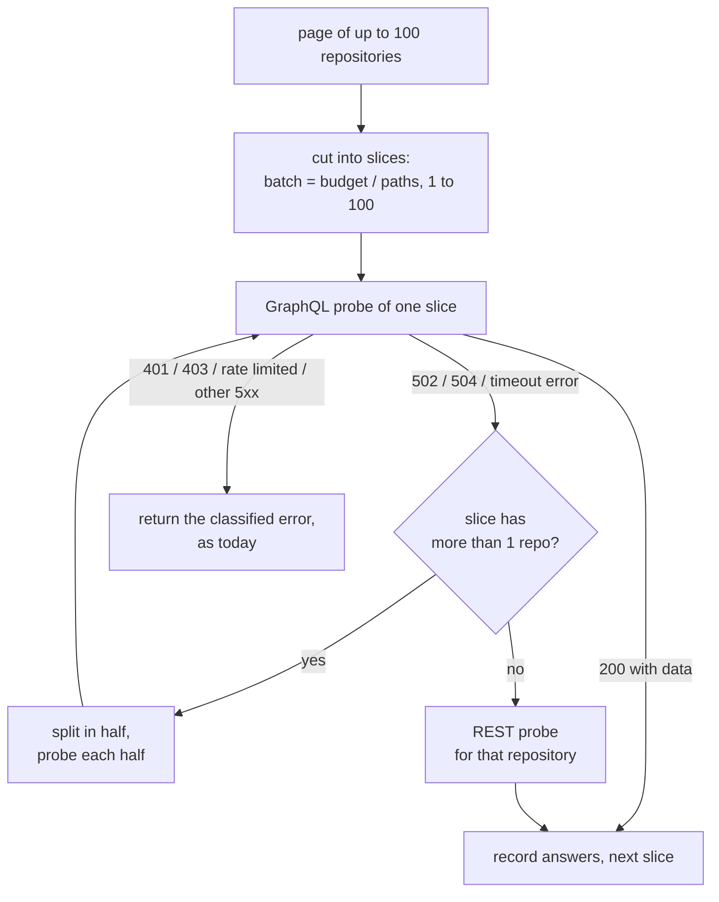

<!-- markdownlint-disable-file MD024 MD025 MD041 -->

# IMPL-0003: GraphQL probe lookup budget, timeout split and REST fallback (issue 14)

<!--toc:start-->
- [Objective](#objective)
- [Scope](#scope)
  - [In Scope](#in-scope)
  - [Out of Scope](#out-of-scope)
- [Findings (2026-10-15)](#findings-2026-10-15)
- [Implementation Phases](#implementation-phases)
  - [Phase 1: Record the decisions and the interim note](#phase-1-record-the-decisions-and-the-interim-note)
    - [Tasks](#tasks)
    - [Success Criteria](#success-criteria)
  - [Phase 2: GitHub's limits in the fake](#phase-2-githubs-limits-in-the-fake)
    - [Tasks](#tasks-1)
    - [Success Criteria](#success-criteria-1)
  - [Phase 3: Batch from a lookup budget](#phase-3-batch-from-a-lookup-budget)
    - [Tasks](#tasks-2)
    - [Success Criteria](#success-criteria-2)
  - [Phase 4: Split on timeout, REST at one repository](#phase-4-split-on-timeout-rest-at-one-repository)
    - [Tasks](#tasks-3)
    - [Success Criteria](#success-criteria-3)
  - [Phase 5: Activity wiring, heartbeat and metrics](#phase-5-activity-wiring-heartbeat-and-metrics)
    - [Tasks](#tasks-4)
    - [Success Criteria](#success-criteria-4)
  - [Phase 6: The RetryAfter fix](#phase-6-the-retryafter-fix)
    - [Tasks](#tasks-5)
    - [Success Criteria](#success-criteria-5)
  - [Phase 7: Documentation](#phase-7-documentation)
    - [Tasks](#tasks-6)
    - [Success Criteria](#success-criteria-6)
  - [Phase 8: PR, release and the fartlab check](#phase-8-pr-release-and-the-fartlab-check)
    - [Tasks](#tasks-7)
    - [Success Criteria](#success-criteria-7)
- [File Changes](#file-changes)
- [Testing Plan](#testing-plan)
- [Dependencies](#dependencies)
- [Open Questions](#open-questions)
  - [OQ1: Which branch carries the code?](#oq1-which-branch-carries-the-code)
  - [OQ2: Which release label?](#oq2-which-release-label)
  - [OQ3: What counts as a timeout?](#oq3-what-counts-as-a-timeout)
  - [OQ4: How does the GraphQL probe learn about repositories?](#oq4-how-does-the-graphql-probe-learn-about-repositories)
  - [OQ5: How are splits and fallbacks counted?](#oq5-how-are-splits-and-fallbacks-counted)
  - [OQ6: Does a fallback wait on the reserve?](#oq6-does-a-fallback-wait-on-the-reserve)
  - [OQ7: Does the discovery page size change?](#oq7-does-the-discovery-page-size-change)
  - [OQ8: Who changes fartlab's config?](#oq8-who-changes-fartlabs-config)
- [References](#references)
<!--toc:end-->

## Objective

Make the GraphQL config probe finish under GitHub's 10-second query limit
on any installation, and let a pass complete even when a query times out.
The INV-0002 decisions (option a for OQ1–OQ7) are:

- **Batch from a budget:** `batch = clamp(100 / len(paths), 1, 100)`
  repositories per query.
- **Split on timeout:** a query that times out is halved, down to one
  repository, which is then probed over REST.
- **The budget is a constant** (`probeLookups = 100`), and a split counter
  is the signal that it is wrong.
- **The default `config_paths` stays** Renovate's full list. The docs say
  how to shorten it.
- **Slices stay serial.**
- **`classifyErr`'s `RetryAfter` is fixed** here. Honouring `Retry-After`
  in discovery is a follow-up issue.
- **The interim docs note** ships before the fix.

**Implements:** issue #14 and INV-0002. It corrects DESIGN-0001
§ DiscoveryWorkflow and OQ3 (the batch, the cost estimate, the 100-id
cap).

## Scope

### In Scope

- `internal/platform/github`:
  - batch sizing;
  - timeout detection;
  - the split and the per-repository REST fallback;
  - a per-query hook;
  - `ProbeResult` counts for splits and fallbacks;
  - the `classifyErr` fix.
- `internal/activities`: the new `ProbeConfig` signature, a heartbeat
  after each query, and the two metrics.
- `internal/observability`: `boopd_discovery_probe_splits_total` and
  `boopd_discovery_probe_fallbacks_total`.
- `test/fakegithub`: a lookup limit that answers as GitHub does past
  10 s, the 100-id cap, and a timeout-shaped GraphQL error.
- Tests at every layer, e2e-first; docs; DESIGN-0001 corrections.

### Out of Scope

- **Honouring a secondary limit's `Retry-After` in discovery**
  (INV-0002 OQ6). This goes to a follow-up issue (Phase 6).
- **A configurable budget** (INV-0002 OQ3). It is added only if splits
  show at the default.
- **Concurrent slices** (INV-0002 OQ5).
- **Incremental probing by `pushed_at`** (DESIGN-0001 OQ3 c).
- **Workflow code.** Only activities change, so no Temporal versioning gate
  is needed: workflow histories never see the probe's shape.

## Findings (2026-10-15)

From INV-0002 and reading the code for this plan:

- **Measured cost:**
  - About 15–25 ms per `object(expression:)` lookup.
  - GitHub returns 502 with an empty body at 10.5 s.
  - Every query costs 1 point.
  - `nodes(ids:)` rejects more than 100 ids with `ARGUMENT_LIMIT`.
  - 100 lookups takes about 2 s.
- **The REST fallback needs repositories, not ids.** `ProbeConfig` takes
  node ids, but `probeREST` needs the slug and default branch. The
  activity has both (`discoverPage` builds the ids from
  `[]platform.Repository`), so the signature changes to take repositories
  (OQ4 a).
- **Splits can outlast the heartbeat.** `DiscoverInstallation`
  heartbeats once per page, with a 2-minute heartbeat timeout.
  - Today a page is one query, about 2–10 s.
  - With the budget, a page is up to 10 queries, about 20 s.
  - If every level of the split times out, one page could take
    10 slices × 4 levels × 10 s, well over 2 minutes.

  The probe needs a per-query hook, and the activity heartbeats from it
  with the current progress.
- **The fakes count queries:**
  - `TestDiscoverInstallation_GraphQL` expects 3 probe queries for 250
    repositories (one per page). With the 10 default paths it becomes
    25 + 25 + 5 = 55.
  - `TestProbeConfig_Batches` expects slices of 100.

  Both are rewritten around the rule.
- **The REST probe reports `Cost` 0** and the activity records it under
  `core`. A fallback inside a GraphQL pass spends core calls, which
  `ProbeResult.Queries` counts. The new fallback counter makes them
  visible without changing `ProbeCost`'s meaning.
- **A 200 can carry a timeout.** `probeBatch` already returns
  `ErrTransient` for a 200 with no `data`. GitHub can answer a timeout
  that way too ("Something went wrong while executing your query. This
  may be the result of a timeout…"), so that message must split as well
  (OQ3 a).

## Implementation Phases

Phases 2–6 are code and land on one branch (OQ1 a). Phase 1 is
documentation that ships now with PR #15.

### Phase 1: Record the decisions and the interim note

#### Tasks

- [x] 1.1 INV-0002: status Concluded; OQ1–OQ7 recorded as option a; the
  Tests section moves the 170-repository case to the activity tests, and
  the heartbeat finding is added.
- [x] 1.2 `docs/config.md`'s `probe` row: until this ships, use `rest`
  above about 40 repositories (issue #14, INV-0002).
- [x] 1.3 This document, with its open questions.

#### Success Criteria

- `markdownlint-cli2` and `go test ./internal/config/` (the reference
  completeness test) pass.
- PR #15 carries INV-0002, the note and this plan.

### Phase 2: GitHub's limits in the fake

Make `test/fakegithub` fail the way GitHub does, so every later phase is
tested against the real failure.

#### Tasks

- [x] 2.1 `Server.SetGraphQLLookupLimit(n int)`: a probe whose
  `len(ids) × len(expressions)` exceeds `n` answers **502 with an empty
  body**, as observed. Zero means no limit (the default, so existing tests
  are unchanged).
- [x] 2.2 `Server.SetGraphQLTimeoutShape(shape)`: choose whether an
  over-limit probe answers 502, 504, or 200 with `data: null` and
  GitHub's timeout message. Defaults to 502.
- [x] 2.3 Enforce the 100-id cap: more than 100 ids answers 200 with
  `errors[0].type = "ARGUMENT_LIMIT"` and GitHub's message, and no `data`.
- [x] 2.4 `Server.ProbeSizes() []int`: the ids per probe query, in order,
  for tests that assert the batch rule end to end. `ProbeQueries()` stays.
- [x] 2.5 `Server.ProbeTimeouts() int`: how many probes the limit
  rejected.
- [x] 2.6 Unit tests in `test/fakegithub` for each knob.

#### Success Criteria

- `go test ./test/fakegithub/...` passes.
- With a limit of 100, a 100 × 10 probe gets 502 and a 10 × 10 probe gets
  200.
- A 101-id probe gets `ARGUMENT_LIMIT`.
- All existing tests pass unchanged (limit 0).

### Phase 3: Batch from a lookup budget

#### Tasks

- [x] 3.1 `probe.go` constants:
  - `probeLookups = 100`, documented with INV-0002's measurement (about
    2 s, five times under the 10 s limit);
  - `maxProbeIDs = 100` replaces `probeBatch`, documented as GitHub's
    `nodes(ids:)` cap, not a design choice.
- [x] 3.2 `probeBatchSize(paths int) int` returns
  `clamp(probeLookups / paths, 1, maxProbeIDs)`.
- [x] 3.3 `ProbeConfig` cuts its input into `probeBatchSize(len(paths))`
  slices.
- [x] 3.4 Rewrite `TestProbeConfig_Batches` as a table over paths
  (1, 4, 10, 16) and repositories (1, 10, 100, 250). It asserts the
  slice sizes, `Queries` and summed `Cost`.
- [x] 3.5 The package doc in `client.go` ("100 node ids per query") and
  `ProbeConfig`'s doc comment describe the budget.

#### Success Criteria

- `go test ./internal/platform/github/...` passes.
- `probeBatchSize` gives 100, 25, 10 and 6 for 1, 4, 10 and 16 paths.
- Against the fake with a lookup limit of 100, a 250-repository probe at
  10 paths sends 25 queries, none rejected.

### Phase 4: Split on timeout, REST at one repository

#### Tasks

- [x] 4.1 `ProbeConfig(ctx, repos []platform.Repository, paths []string,
  onQuery func()) (*ProbeResult, error)` (OQ4 a).
  - It keys answers by `NodeID`, as today.
  - `onQuery` may be nil; it is called after every GraphQL query and
    after each REST fallback (one repository's REST calls).
  - Update the `InstallationAPI` interface in `internal/activities/github.go`
    and `fakeInstall`.
- [x] 4.2 A sentinel `errProbeTimeout`, returned by `probeBatch` for HTTP
  502 and 504 from `/graphql`, and for a 200 with no `data` whose error
  message contains "timeout" (OQ3 a). Every other response keeps today's
  classification.
- [x] 4.3 `prober.slice(ctx, repos)` (the call's state in a `prober`): on
  `errProbeTimeout` it splits the slice in half and recurses on each half.
  At one repository it calls `probeREST` for that repository and records
  its answer. Any other error returns immediately.
- [x] 4.4 `ProbeResult` gains `Splits int` (timed-out slices that were
  halved) and `Fallbacks int` (repositories probed over REST). `Queries`
  counts REST calls too, as `ProbeConfigREST` does.
- [x] 4.5 Log nothing in the platform package. The activity logs from
  the counts (Phase 5), as the package logs nothing today.
- [x] 4.6 Unit tests (`probe_test.go`, with the `graphqlServer` fake
  extended or `test/fakegithub`):
  - **Splits:** one slice of 10 at a limit of 50 splits into 5 + 5, both
    pass, `Splits = 1`.
  - **Fallback:** a limit below one repository's paths falls back to REST
    for every repository, and the answers match the GraphQL ones.
  - **Errors inside a split:**
    - a 401 inside a split fails the probe with `ErrUnauthorized`;
    - a rate limit inside a split returns `RateLimitedError`;
    - a REST 404 during fallback reads as absent, as in `probeREST`.
  - **Timeout shapes:** each one (502, 504, 200 with the timeout message)
    splits; a 200 with no `data` and any other message stays
    `ErrTransient`.
  - **The hook:** `onQuery` is called once per request.

#### Success Criteria

- `go test -race ./internal/platform/github/...` passes.
- A probe against the fake at any lookup limit returns the same `Configs`
  as one with no limit.
- Recursion depth is bounded by log₂(batch), asserted by counting queries
  at a limit of 1.

### Phase 5: Activity wiring, heartbeat and metrics

#### Tasks

- [x] 5.1 `discoverPage` passes `repos` and a hook that calls
  `activity.RecordHeartbeat(ctx, prog)` with the progress so far. A retry
  then resumes at the same page, as today; the hook only keeps the
  attempt alive.
- [x] 5.2 `Metrics` interface gains:
  - `ProbeSplits(installationID int64, n int)`, for
    `boopd_discovery_probe_splits_total{installation}`;
  - `ProbeFallbacks(installationID int64, n int)`, for
    `boopd_discovery_probe_fallbacks_total{installation}`.

  Implement both in `internal/observability/metrics.go` and the activity
  test fake (OQ5 a).
- [x] 5.3 When a page had splits, log at info with the installation, page,
  splits and fallbacks.
- [x] 5.4 Activity tests (`internal/activities/discovery_test.go`, Temporal
  test environment and `test/fakegithub`):
  - **Update** `TestDiscoverInstallation_GraphQL` to the batch rule:
    55 queries for 250 repositories at 10 paths, asserted with
    `ProbeSizes()`.
  - **New** `TestDiscoverInstallation_LargeInstallation`:
    - 170 repositories, a lookup limit of 100 and the default paths;
    - every configured repository is signalled;
    - `ProbeTimeouts() == 0`, and both new metrics read 0.
  - **New** `TestDiscoverInstallation_SplitsAndFallsBack`:
    - 170 repositories, a lookup limit of 9 (below one repository's 10
      paths);
    - every configured repository is still signalled;
    - the fallback metric is 170, and the summary matches the
      no-limit run.
  - **New** `TestDiscoverInstallation_HeartbeatsPerQuery`: the probe's
    hook (which heartbeats) runs once per query and outnumbers the pages.
    It counts hook calls through a wrapping client, because the SDK
    throttles heartbeats before the test listener sees them.
- [x] 5.5 Worker e2e (`test/e2e/worker_test.go`, k3d): a `workerOption`
  sets a lookup limit of 5 on the fake. Discovery still starts
  `repo/github/<id>` for the config repository through the REST fallback,
  and its first run completes. This reuses `TestWorker_DiscoveryRunRecheck`'s
  harness, as a subtest or a sibling test.

#### Success Criteria

- `just check` passes.
- `just e2e` passes, including the new worker scenario.
- `TestDiscoverInstallation_LargeInstallation` would fail on v0.3.0's
  probe: checked once by running it against `maxProbeIDs` batching, then
  reverted.

### Phase 6: The RetryAfter fix

#### Tasks

- [x] 6.1 `classifyErr`: for `*RateLimitError`, compute
  `RetryAfter = max(0, time.Until(rateErr.Rate.Reset.Time))`, rounded to
  seconds, and drop the absolute-epoch `int`.
- [x] 6.2 Extend `TestTypedRateLimitErrorClassifies`:
  - a reset 90 s ahead gives a `RetryAfter` between 85 and 90 s;
  - a reset in the past gives 0.
- [x] 6.3 Open a follow-up issue: "discovery: honour secondary-limit
  Retry-After". Return an `ApplicationError` with `NextRetryDelay` from
  `DiscoverInstallation` on `RateLimitedError`, and link INV-0002
  Observation 6. Opened as [#16](https://github.com/donaldgifford/boop/issues/16).

#### Success Criteria

- `go test ./internal/platform/github/...` passes.
- The error string for a primary limit shows a duration under an hour.
- The follow-up issue exists and is linked from this document.

### Phase 7: Documentation

#### Tasks

- [x] 7.1 `docs/config.md`:
  - **`probe` row:** replace the interim note with the budget: about
    100 lookups per query, so 100 / paths repositories. A query that
    times out is split, and single repositories fall back to REST.
  - **`config_paths` row:** every path adds one lookup per repository,
    and `["renovate.json5"]` cuts probe queries tenfold.
  - **The metrics paragraph** after the table names
    `boopd_discovery_probe_splits_total` and
    `boopd_discovery_probe_fallbacks_total`.
- [x] 7.2 DESIGN-0001, as an amendment note dated on landing:
  - § DiscoveryWorkflow: "one query per 100 repositories" becomes "one
    query per 100 / paths repositories, at most 100".
  - The cost estimate becomes about 1,500 points per pass for 15,000
    repositories at 10 paths.
  - "100 is a design choice" becomes "100 is GitHub's `nodes(ids:)`
    cap".
  - OQ3 a: the same correction.
- [x] 7.3 Go doc comments: `ProbeConfig`, `ProbeResult`,
  `probeBatchSize`, `errProbeTimeout`, `DiscoverInstallation` (the
  heartbeat per query).
- [x] 7.4 `examples/boopd.hcl`: a comment on `config_paths` with the
  tenfold note. `boopd config validate` still loads it.

#### Success Criteria

- `just lint` passes (markdownlint, the reference completeness test,
  `boopd config validate` on the example).
- No document still says the probe sends 100 repositories per query
  regardless of paths: `grep -rn "100 repositories" docs` shows only
  amended or historical lines.

### Phase 8: PR, release and the fartlab check

#### Tasks

- [x] 8.1 Conventional commits per phase:
  - `test(fakegithub): …`;
  - `fix(platform): …` for Phases 3, 4 and 6;
  - `feat(activities): …` for the metrics;
  - `docs: …`.

  Each is followed by `git cliff -o CHANGELOG.md` and a
  `chore: update changelog` commit.
- [ ] 8.2 One PR with `Closes #14` and the `patch` label (OQ2 a).
- [ ] 8.3 Iterate CI to green, including the E2E Tests job.
- [ ] 8.4 After the release, check it shipped: `helm show chart` and the
  image tag match the release, and the release notes list the fix.
- [ ] 8.5 **deferred - human required:** fartlab (OQ8 a).
  - Upgrade to the release.
  - Remove `probe = "rest"` (back to `graphql`), and set
    `config_paths = ["renovate.json5"]` in the homelab values.
  - Trigger discovery.
  - Confirm installation 170572643 completes with every configured
    repository onboarded, and `boopd_discovery_probe_splits_total` stays
    at 0.
- [ ] 8.6 Set this document's status to Completed and check its tasks
  off; mark DESIGN-0001's amendment as landed.

#### Success Criteria

- The PR is merged with all checks green, and issue #14 is closed by it.
- On fartlab, a GraphQL discovery pass over installation 170572643 ends
  with `Failed = 0` and no splits.

## File Changes

| File | Phase | Change |
| - | - | - |
| `docs/investigation/0002-…md`, `docs/config.md` | 1, 7 | decisions, interim note, then the final rows |
| `test/fakegithub/fakegithub.go` (+ test) | 2 | lookup limit, timeout shapes, 100-id cap, `ProbeSizes`, `ProbeTimeouts` |
| `internal/platform/github/probe.go` | 3, 4 | `probeLookups`, `maxProbeIDs`, `probeBatchSize`, `errProbeTimeout`, `probeSlice`, the signature, `Splits`/`Fallbacks` |
| `internal/platform/github/probe_test.go` | 3, 4 | the batch table, split, fallback, error and hook cases |
| `internal/platform/github/client.go`, `client_test.go` | 3, 6 | package doc; `RetryAfter` from `time.Until` |
| `internal/activities/github.go`, `discovery.go`, `metrics.go` | 5 | interface, hook and heartbeat, the two metrics, the split log |
| `internal/activities/discovery_test.go`, `fakes_test.go` | 5 | updated counts, three new tests, fake signature |
| `internal/observability/metrics.go` (+ test) | 5 | the two counters |
| `test/e2e/worker_test.go` | 5 | the fallback scenario |
| `docs/design/0001-…md` | 7 | amendment note |
| `examples/boopd.hcl` | 7 | `config_paths` comment |

## Testing Plan

E2E first, per IMPL-0001 OQ3:

- **The fake is the contract.** Phase 2 makes `test/fakegithub` time out
  where GitHub does, with the observed response shapes. Every later test
  runs against it, not a mock.
- **Activity tests carry the fleet.** The 170-repository cases run the
  real activity, client and fake in-process, with the Temporal test
  environment. A fleet that size in k3d would start 170 Renovate Jobs for
  no extra coverage.
- **The k3d worker e2e proves the path end to end:** discovery under a
  tight limit, the REST fallback, the signal, then a run.
- **Unit tests** cover what e2e can't reach cheaply: each timeout shape,
  errors inside a split, recursion depth, the batch table and
  `RetryAfter`.
- **Production check:** fartlab's pass over the real installation (8.5).
  INV-0002's script can also re-time the new batch against github.com if
  needed. It stays outside the repository.

## Dependencies

- No new Go modules.
- PR #15 (DESIGN-0002, INV-0002, this plan) merges first, or this branch
  is cut after it (OQ1 a).
- Phase 8.5 needs the homelab deploy and a human.

## Open Questions

**Decided 2026-10-15: option a for OQ1–OQ8.** The plan above is written
to them; the options are kept as the record.

### OQ1: Which branch carries the code?

- **a (recommended): a new `fix/issue-14` branch off `main` after PR #15
  merges.** The docs PR stays docs-only with `dont-release`, and the code
  PR gets its own release label and CI.
- **b: this branch (`docs/valkey-subchart`).** One PR, but it mixes the
  Valkey design with a released code fix, and its label would have to
  change from `dont-release`.
- **other:**

### OQ2: Which release label?

- **a (recommended): `patch`.** It is a bug fix. The two new metrics are
  additive and the config surface is unchanged.
- **b: `minor`.** It treats the new metrics and the fallback behaviour as
  features.
- **other:**

### OQ3: What counts as a timeout?

- **a (recommended): HTTP 502 or 504 from `/graphql`, or a 200 with no
  `data` whose error message contains "timeout".** These are the shapes
  GitHub uses for a query cut at 10 s. Any other 5xx stays `ErrTransient`
  and is retried whole.
- **b: any 5xx from `/graphql`.** Simpler. A real outage (500, 503) would
  then split down to REST for every repository, spending core calls
  during an incident.
- **c: 502 and 504 only.** It ignores the 200-with-timeout-error shape.
  That shape wasn't seen in INV-0002, but GitHub documents it.
- **other:**

### OQ4: How does the GraphQL probe learn about repositories?

- **a (recommended): `ProbeConfig` takes `[]platform.Repository`.** This
  matches `ProbeConfigREST`, and the activity already has the
  repositories. The REST fallback needs slug and default branch.
- **b: keep node ids and add a `map[nodeID]Repository` parameter for the
  fallback.** A smaller signature change, but the two arguments must
  agree, and nothing enforces it.
- **other:**

### OQ5: How are splits and fallbacks counted?

- **a (recommended): two counters,
  `boopd_discovery_probe_splits_total{installation}` and
  `boopd_discovery_probe_fallbacks_total{installation}`.** Each answers
  one question: is the budget too high, and how many core calls did
  GraphQL discovery spend.
- **b: one counter, `boopd_discovery_probe_events_total{installation,event}`,
  with `event` being `split` or `fallback`.** One series family, but it
  mixes units (slices and repositories).
- **c: no metrics; log only.** Less code, but no alert on a budget that
  is wrong.
- **other:**

### OQ6: Does a fallback wait on the reserve?

- **a (recommended): no.** Fallbacks use the client's limiter like every
  call, and the per-page `awaitReserve` already guards the page. A
  fallback is at most three core calls per repository, and only on
  timeouts.
- **b: check the core reserve before each fallback.** Strictest, but it
  reads `/rate_limit` per repository in the worst case. It also needs the
  activity's reserve logic inside the platform package, or a second hook.
- **other:**

### OQ7: Does the discovery page size change?

- **a (recommended): no, it stays 100.** Pages are the REST listing's
  unit and the heartbeat resume point. The probe slices within a page,
  and the per-query hook keeps the heartbeat alive.
- **b: page size = batch size.** A retry then resumes at a finer grain,
  but listing repositories costs up to ten times more REST calls, for no
  gain the hook doesn't already give.
- **other:**

### OQ8: Who changes fartlab's config?

- **a (recommended): you, in the homelab repository, after the release
  (8.5).** Switch `probe` back to `graphql` and set
  `config_paths = ["renovate.json5"]`. The deploy is human-run, as for
  IMPL-0001 7.10.
- **b: I open the homelab PR,** and you merge and deploy.
- **c: keep fartlab on `rest`.** It works at 170 repositories (about
  510 core calls per pass), but leaves the fix unproven in production.
- **other:**

## References

- Issue #14
- INV-0002: GraphQL config probe times out on large batches (the
  measurements and decisions)
- DESIGN-0001 § DiscoveryWorkflow and OQ3
- IMPL-0001 OQ3 (e2e-first testing)
- `internal/platform/github/probe.go`, `client.go`;
  `internal/activities/discovery.go`; `internal/workflows/options.go`
  (`discoverOptions`); `test/fakegithub/fakegithub.go`
- [GitHub GraphQL rate and query limits](https://docs.github.com/en/graphql/overview/rate-limits-and-query-limits-for-the-graphql-api)
