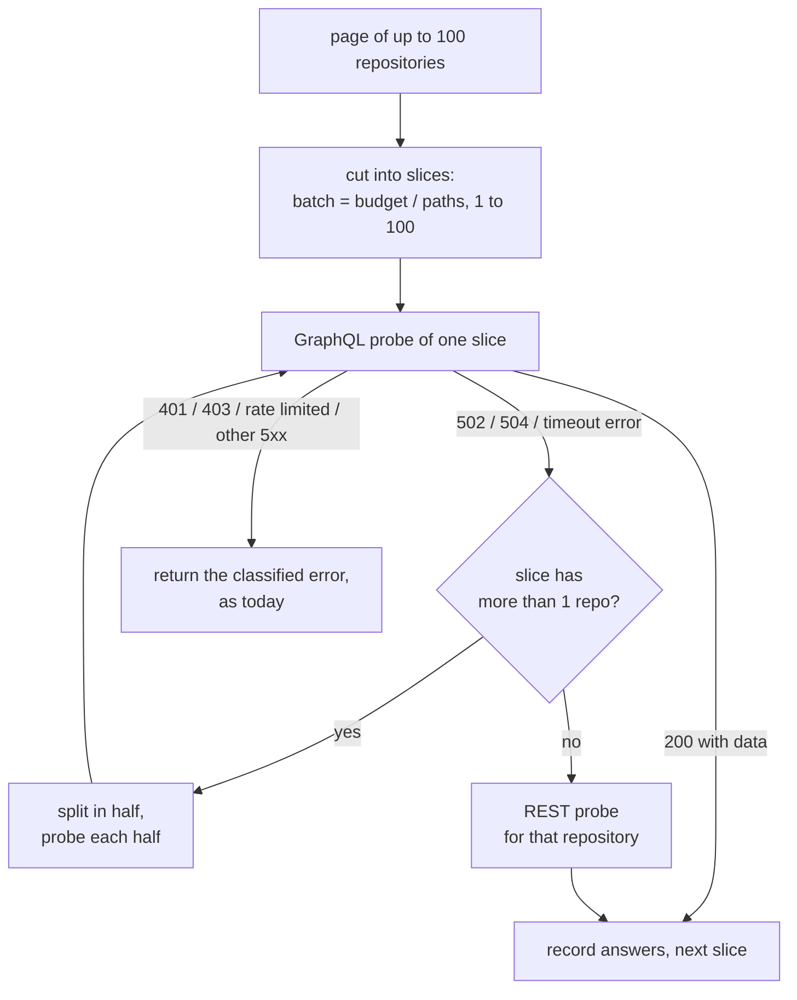

<!-- markdownlint-disable-file MD025 MD041 -->

# INV-0002: GraphQL config probe times out on large batches

<!--toc:start-->
- [Question](#question)
- [Hypothesis](#hypothesis)
- [Context](#context)
- [Approach](#approach)
- [Environment](#environment)
- [Findings](#findings)
  - [Observation 1: GitHub cuts the query at 10 seconds](#observation-1-github-cuts-the-query-at-10-seconds)
  - [Observation 2: time is linear in lookups, about 20 ms each](#observation-2-time-is-linear-in-lookups-about-20-ms-each)
  - [Observation 3: listing trees is slower, not faster](#observation-3-listing-trees-is-slower-not-faster)
  - [Observation 4: cost stays at 1 point; 100 ids is a hard cap](#observation-4-cost-stays-at-1-point-100-ids-is-a-hard-cap)
  - [Observation 5: one oversized page fails the whole installation](#observation-5-one-oversized-page-fails-the-whole-installation)
  - [Observation 6: incidental rate-limit bugs](#observation-6-incidental-rate-limit-bugs)
- [Conclusion](#conclusion)
- [Recommendation](#recommendation)
  - [Proposed probe](#proposed-probe)
  - [What it costs](#what-it-costs)
  - [Tests](#tests)
- [Open Questions](#open-questions)
  - [OQ1: How is the batch sized?](#oq1-how-is-the-batch-sized)
  - [OQ2: What happens when a slice times out?](#oq2-what-happens-when-a-slice-times-out)
  - [OQ3: Is the budget configurable?](#oq3-is-the-budget-configurable)
  - [OQ4: Does the default config_paths list shrink?](#oq4-does-the-default-config_paths-list-shrink)
  - [OQ5: Are slices probed concurrently?](#oq5-are-slices-probed-concurrently)
  - [OQ6: Do the rate-limit bugs ride along?](#oq6-do-the-rate-limit-bugs-ride-along)
  - [OQ7: What goes out before the fix?](#oq7-what-goes-out-before-the-fix)
- [References](#references)
<!--toc:end-->

## Question

Why does the GraphQL config probe return 502 on every attempt for a
~170-repository installation? And what batch shape keeps it reliably
under GitHub's limits without making discovery much more expensive?

## Hypothesis

From issue #14:

- Each `object(expression:)` is a git read on GitHub's side, so a query's
  time grows with **batch × paths**.
- `probeBatch = 100` with the default paths exceeds GitHub's GraphQL time
  limit.
- The failure is classed transient, so Temporal retries the identical
  query until the activity gives up.

A smaller batch, sized from the path count, should fix it at a modest
point cost.

## Context

**Triggered by:** issue #14.

On fartlab (homelab IMPL-0012), boopd v0.3.0's first discovery of
installation 170572643 failed on all three attempts:

```text
DiscoverInstallation: discover installation 170572643: probe: platform:
transient error: POST https://api.github.com/graphql: 502  []
```

`discovery.probe = "rest"` is the running workaround. DESIGN-0001 OQ3
chose one GraphQL query per 100 repositories. It noted that 100 "is a
design choice, not a documented limit" and that the spike would measure
the cost. This is that measurement.

The code (`internal/platform/github/probe.go`):

- `ProbeConfig` cuts node ids into slices of `probeBatch = 100`.
- Each slice is one query, with one aliased
  `c<i>: object(expression: $e<i>) { ... on Blob { byteSize text } }` per
  path.
- `DiscoverInstallation` calls it once per page of 100 repositories
  (`discoverPageSize = 100`), so in practice every page is one query.
- An HTTP 5xx is classified `ErrTransient` (`classifyErr`).

## Approach

1. Read the probe, the discovery activity, its retry options and the error
   classification.
2. Reproduce against github.com with the same query shape. I used the
   author's own 205 repositories and a user token (`gh auth token`), a
   proxy for the installation's ~170.
3. Vary repositories per query (1 to 100) and paths per query (1, 4, 10),
   recording HTTP status, wall time and `rateLimit.cost`.
4. Try alternative shapes:
   - the same fields without `text`;
   - one `Tree` listing of `HEAD:` and `HEAD:.github` per repository (the
     REST fallback's approach);
   - 101 ids, to find the hard cap.
5. Derive a batch rule and its point and time cost per pass.

The script lives outside the repository. It spent about 100 points of the
user's GraphQL budget (4,962 down to 4,897).

## Environment

| Component | Version / Value |
| --------- | --------------- |
| boopd | v0.3.0 (`probeBatch = 100`, `discoverPageSize = 100`) |
| Endpoint | `https://api.github.com/graphql`, user token, 2026-10-15 |
| Repositories | 205 owned by `donaldgifford`, sorted by name, ids 0–99 and 105–204 |
| Default `config_paths` | 10 names (`platform.DefaultConfigPaths`) |
| Activity retry | `DiscoverInstallation`: 3 attempts, 30 s initial, ×2, heartbeat 2 m, resumes at the last heartbeat's page |

## Findings

### Observation 1: GitHub cuts the query at 10 seconds

Every 502 arrived at **10.5–10.8 s** wall time, with an empty body. That
is GitHub's documented 10-second processing limit for an API request. A
query either finishes under it or fails whole: there is no partial
`data`.

The issue saw 15–45 s per attempt. The difference is likely the worker's
path to GitHub (limiter wait, connection setup, network). It is not a
longer server limit.

### Observation 2: time is linear in lookups, about 20 ms each

| Repos × paths | Lookups | Status | Time | ms per lookup |
| - | - | - | - | - |
| 1 × 10 | 10 | 200 | 0.5 s | (overhead about 0.3 s) |
| 10 × 10 | 100 | 200 | 1.7 s, 2.1 s | 17–21 |
| 25 × 4 | 100 | 200 | 2.1 s | 21 |
| 20 × 10 | 200 | 200 | 4.3 s | 21 |
| 25 × 10 | 250 | 200 | 3.6 s | 14 |
| 50 × 4 | 200 | 200 | 3.3 s | 16 |
| 50 × 10 | 500 | 200 | 7.7 s | 15 |
| 100 × 4 | 400 | 200, **502**, 200 | 9.5 s, 10.6 s, 8.3 s | 21–24 |
| 100 × 4, no `text` | 400 | 200 | 8.8 s | 22 |
| 100 × 10 (today's default) | 1,000 | **502** | 10.6 s | — |

- **The hypothesis holds.** Time is close to linear in repositories ×
  paths, at about 15–25 ms per lookup.
- **Today's default always fails.** It is 1,000 lookups, about 20 s of
  work against a 10 s limit.
- **Four paths sit on the edge.** 400 lookups is about 8–10 s, so the same
  query passed twice and failed once. The issue's 4-path workaround
  failing three times fits.
- **`text` costs nothing measurable.** Absent paths, the common case, cost
  as much as present ones.
- **100 lookups per query takes about 2 s**, five times under the limit.
  Slow fileservers and big repositories have room to vary.

### Observation 3: listing trees is slower, not faster

The REST fallback lists the root and `.github` once per repository,
instead of asking for each path. In GraphQL that would be two lookups per
repository, regardless of the path count. It is worse:

| Shape | Lookups | Status | Time | ms per lookup |
| - | - | - | - | - |
| `HEAD:` and `HEAD:.github` trees, `entries { name type }`, 100 repos | 200 | 502, 502 | 10.5 s, 10.8 s | — |
| the same, 50 repos | 100 | 200 | 8.5 s | 85 |
| `HEAD:` tree, `entries { name }`, 50 repos | 50 | 200 | 4.6 s | 92 |

A tree listing costs about four times a path lookup. It would beat
per-path lookups only with more than about eight paths per directory, and
the default list has six root paths and three in `.github`. Ruled out.

### Observation 4: cost stays at 1 point; 100 ids is a hard cap

- **Every successful query cost 1 point,** from 1 × 10 to 100 × 4.
  `nodes(ids:)` is scored as DESIGN-0001 guessed.
- **Smaller batches mean more queries, and so more points.** Each query
  costs at least 1 point.
- **101 ids is rejected** with `ARGUMENT_LIMIT`: "You may not provide more
  than 100 node ids". So 100 is a hard cap after all, not only a design
  choice. Any batch rule must clamp to it.

### Observation 5: one oversized page fails the whole installation

`DiscoverInstallation` (`internal/activities/discovery.go`):

- **A failed probe stops the pass.** `discoverPage` returns the error, and
  `DiscoverPages` stops at that page. Later pages are never probed.
- **The retry is identical.** The retry resumes at the last heartbeat's
  page, which is the same failing page, with the same query.
- **Classification can't help.** A deterministic timeout is
  indistinguishable from a GitHub blip, because both are 502 and
  `ErrTransient`. Three attempts later, `DiscoveryWorkflow` counts the
  installation in `Failed`, and no repository on that page or after is
  onboarded.
- **On fartlab, that was everything.** Page 1 was the first query, so
  nothing was onboarded.

### Observation 6: incidental rate-limit bugs

These were found while reading `classifyErr` (`internal/platform/github/client.go`).
They are not the cause of #14.

- **A wrong `RetryAfter` on primary rate limits.** For a
  `*RateLimitError`, `retry = max(0, int(rateErr.Rate.Reset.Unix()))`
  puts the reset's **absolute epoch seconds** into `RetryAfter`, about 56
  years. The comment says "duration until reset".

  Nothing reads `RetryAfter` today beyond the error string, so the only
  effect is a misleading message. Any future consumer would sleep
  forever.
- **Secondary limits are not honoured.** A probe that trips one becomes a
  `RateLimitedError` that wraps `ErrTransient`. The activity's fixed
  30 s × 2 back-off applies, and GitHub's `Retry-After` is ignored.

## Conclusion

**Answer:** Confirmed. The probe fails because one query carries 100
repositories × 10 paths = 1,000 `object(expression:)` lookups. At about
20 ms each that is about 20 s, against GitHub's hard 10 s limit. It
fails the same way every attempt, so the retries can't recover. Even 4
paths (400 lookups, about 9 s) sits on the limit.

The query costs 1 point at any size up to the 100-id cap, so smaller
batches cost points only through the number of queries.

Two constraints govern the fix:

- a lookup budget of about **100 per query**, about 2 s measured;
- the **100-id** cap.

Listing trees instead is about four times slower per lookup and is ruled
out.

## Recommendation

### Proposed probe



1. **Size the batch from the path count** (OQ1 a). The rule is
   `batch = clamp(probeLookups / len(paths), 1, 100)`, with
   `probeLookups = 100`. With the default 10 paths that is 10 repositories
   per query; with 4 paths, 25; with 1 path, 100. `probeBatch` becomes the
   100-id cap, named for what it is.
2. **Split on timeout** (OQ2 a). Only a timeout response from `/graphql`
   triggers a split: HTTP 502 or 504, or a GraphQL error whose message
   says the query timed out. The slice is halved and each half retried,
   down to one repository; that one is then probed over REST
   (`probeREST`, at most three core calls).
   - The depth is bounded at log₂(batch), so at most 4 levels for 10
     repositories.
   - Everything else is classified as today, so auth and rate limits still
     stop the pass.
   - Each split is logged at info and counted in a new
     `boopd_discovery_probe_splits_total`, so a budget set too high is
     visible.
3. **Keep the per-page heartbeat and resume as they are.** With the split
   in place, a page fails only on a non-timeout error, and retrying that
   is correct.
4. **Docs:** `docs/config.md`'s `probe` row gets the lookup budget, and
   the note that fewer `config_paths` mean fewer queries. Until the fix
   ships, the row says large installations should use `rest` (OQ7 a).
5. **Fix `classifyErr`'s `RetryAfter`** (`time.Until(reset)`) in the same
   change (OQ6 a).

### What it costs

Points and wall time per discovery pass, at 1 point and about 2 s per
query, serial:

| Installation | Paths | Batch | Queries per pass | Points per pass | Probe time |
| - | - | - | - | - | - |
| 170 repos (fartlab) | 10 | 10 | 17 | 17 | about 35 s |
| 170 repos | 1 (`renovate.json5`) | 100 | 2 | 2 | about 4 s |
| 1,000 repos | 10 | 10 | 100 | 100 | about 3.5 min |
| 15,000 repos | 10 | 10 | 1,500 | 1,500 | about 50 min |
| 15,000 repos | 4 | 25 | 600 | 600 | about 20 min |

DESIGN-0001 estimated 150 points per pass for 15,000 repositories. The
real figure with the default list is ten times that. It is still well
inside 5,000 points an hour at the 6 h default cadence (about 250 points
an hour averaged), and inside the 3 h `DiscoverStartToClose`.

For comparison, REST for 15,000 repositories is up to 45,000 core calls,
against a 12,500-an-hour budget. GraphQL stays the default.

### Tests

These follow the e2e-first rule (IMPL-0001 OQ3):

- **`test/fakegithub` gets a timeout knob.** `SetGraphQLLookupLimit(n)`
  answers 502 to any probe whose ids × expressions exceeds `n`, as GitHub
  does past 10 s. It also enforces the 100-id cap with GitHub's
  `ARGUMENT_LIMIT` error.
- **The worker e2e:**
  - discovery of a 170-repository fake installation with a lookup limit
    of 100 onboards every repository with a config;
  - the split counter stays at 0 with the default budget;
  - with the limit lowered below the budget, the pass still completes
    through splits, and the REST fallback is hit for single repositories.
- **Unit tests** (`probe_test.go`):
  - the batch rule at 1, 4, 10 and 16 paths;
  - the split recursion stops at one repository;
  - a 401 inside a split still fails the pass;
  - `classifyErr`'s `RetryAfter` is a duration.

## Open Questions

### OQ1: How is the batch sized?

- **a (recommended): from a lookup budget, `batch = clamp(100 / paths, 1,
  100)`.** It tracks the measured cost model, and stays about 2 s per
  query whatever `config_paths` holds.
- **b: a fixed smaller batch, e.g. 25.** Simpler, but 25 × 10 = 250
  lookups (3.6 s measured) and 25 × 16 = 400 (the failing edge). It is
  only safe for short path lists.
- **c: adaptive.** Start at the budget rule and grow or shrink from
  measured query time. It squeezes out queries, but adds state and is
  hard to test. The gain is a few hundred points on very large
  installations.
- **other:**

### OQ2: What happens when a slice times out?

- **a (recommended): halve and retry, down to one repository, then REST
  for that one.** The pass always completes, and the split counter shows
  when the budget is wrong.
- **b: no split; rely on the budget, and return a permanent error on a
  timeout.** The failure becomes loud instead of retried, but one slow
  repository fails the whole installation.
- **c: halve, but fail the pass at one repository instead of using REST.**
  There is no second probe path to maintain, but a single pathological
  repository (an enormous root tree) still blocks discovery.
- **other:**

### OQ3: Is the budget configurable?

- **a (recommended): not now.** It is a constant (`probeLookups = 100`)
  with the split counter as the signal. It becomes `discovery.probe_lookups`
  only if a real installation shows splits at the default. The measured
  headroom is 5×.
- **b: `discovery { probe_lookups = 100 }` per App now,** validated to
  1–1,000 and documented in `docs/config.md`. Operators can tune it, but
  it is one more knob whose right value comes from the same measurement.
- **c: expose the batch size directly (`probe_batch`),** as the issue
  suggested. More intuitive, but it hides the paths factor, which is what
  actually overruns the limit.
- **other:**

### OQ4: Does the default config_paths list shrink?

repo-guardian writes `renovate.json5`, so in practice one path is ever
present. With one path, the batch is back to 100 and the fartlab pass is
2 queries.

- **a (recommended): keep Renovate's full list as the default (the
  decision in CLAUDE.md and DESIGN-0001 OQ3).** Document that setting
  `config_paths = ["renovate.json5"]` cuts probe queries tenfold, and set
  it in the homelab's values.
- **b: default to `renovate.json5` only.** Cheapest, but it reverses a
  recorded decision. Repositories with another file name would be
  silently skipped.
- **other:**

### OQ5: Are slices probed concurrently?

- **a (recommended): no, stay serial.** About 2 s per query keeps even
  15,000 repositories under an hour. GitHub's secondary limits penalise
  concurrent GraphQL bursts, and installations already run in parallel.
- **b: two to four slices in flight per page.** Faster passes on very
  large installations. It adds a concurrency knob and risks secondary
  limits for little gain at today's scale.
- **other:**

### OQ6: Do the rate-limit bugs ride along?

- **a (recommended): yes, fix `RetryAfter` (`time.Until(reset)`, never
  negative) in the same PR.** It is one line plus a test, in the same
  file family. Leave honouring `Retry-After` in discovery to a follow-up
  issue.
- **b: both, now.** Honouring `Retry-After` means returning a Temporal
  `ApplicationError` with `NextRetryDelay` from `DiscoverInstallation`.
  That is a separate behaviour change, with its own test.
- **c: neither; separate issues.** The smallest PR.
- **other:**

### OQ7: What goes out before the fix?

- **a (recommended): a docs-only note now.** `docs/config.md`'s `probe` row
  says installations above about 40 repositories (400 lookups at 10 paths)
  should use `rest` until the batch fix ships. fartlab keeps `rest`.
- **b: nothing; ship the fix directly.** It is small, and fartlab already
  runs the workaround.
- **other:**

## References

- Issue #14: discovery GraphQL probe 502s with a ~170-repository
  installation
- DESIGN-0001 § DiscoveryWorkflow and OQ3 (one query per 100
  repositories, the cost estimate, the REST fallback)
- `internal/platform/github/probe.go` (`probeBatch`, `probeQuery`,
  `ProbeConfig`, `probeREST`), `client.go` (`classifyErr`)
- `internal/activities/discovery.go` (`DiscoverInstallation`,
  `discoverPage`), `internal/workflows/options.go` (`discoverOptions`)
- [GitHub GraphQL rate and query limits](https://docs.github.com/en/graphql/overview/rate-limits-and-query-limits-for-the-graphql-api)
  (point cost, node limits, timeouts, secondary limits)
