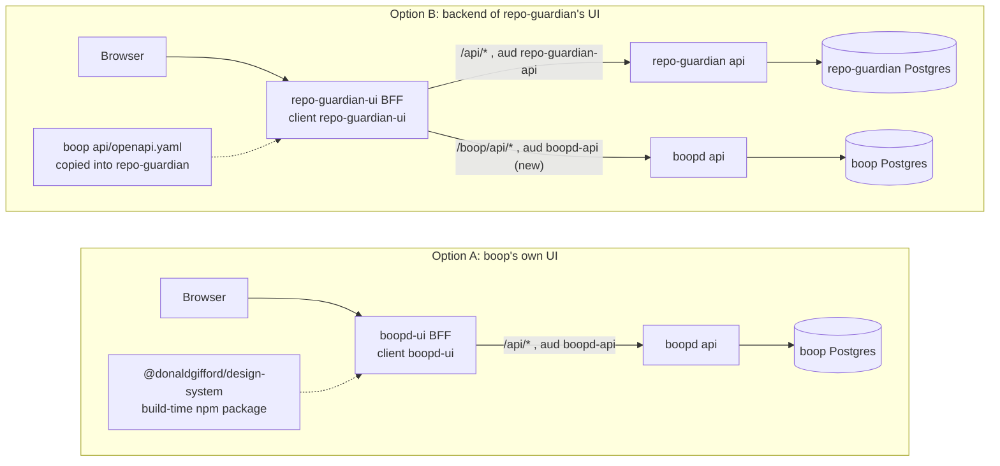
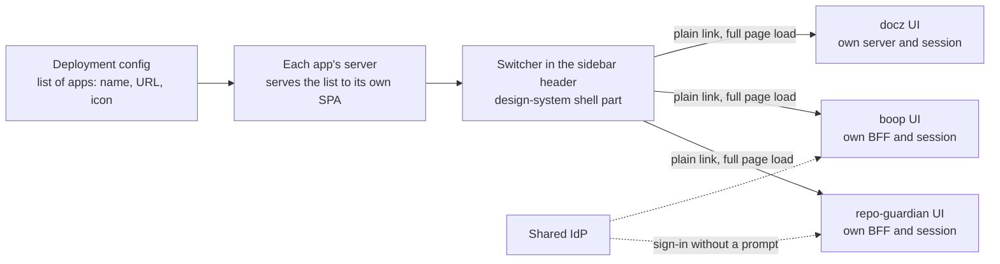

<!-- markdownlint-disable-file MD024 MD025 MD041 -->

# INV-0005: boop UI: its own app on the design system, or a backend of repo-guardian's UI

<!--toc:start-->
<!-- markdownlint-capture -->
<!-- markdownlint-disable MD013 -->
- [Question](#question)
- [Hypothesis](#hypothesis)
- [Context](#context)
- [Approach](#approach)
- [Environment](#environment)
- [Findings](#findings)
  - [1. What the design system provides](#1-what-the-design-system-provides)
  - [2. What the design system leaves to the app](#2-what-the-design-system-leaves-to-the-app)
  - [3. What DESIGN-0004 and IMPL-0005 say that is now out of date](#3-what-design-0004-and-impl-0005-say-that-is-now-out-of-date)
  - [4. What option B requires](#4-what-option-b-requires)
  - [5. What option B gains](#5-what-option-b-gains)
  - [6. Comparison](#6-comparison)
  - [7. repo-guardian as the example: tools and versions](#7-repo-guardian-as-the-example-tools-and-versions)
  - [8. Adding components as boop needs them](#8-adding-components-as-boop-needs-them)
  - [9. An app switcher for boop, repo-guardian and docz](#9-an-app-switcher-for-boop-repo-guardian-and-docz)
- [Conclusion](#conclusion)
- [Recommendation](#recommendation)
- [Open Questions](#open-questions)
- [Resolved Questions](#resolved-questions)
- [References](#references)
<!-- markdownlint-restore -->
<!--toc:end-->

<!--docz:question:start-->
## Question

boop needs a management UI (DESIGN-0004). Now that
`@donaldgifford/design-system` exists and repo-guardian's UI runs on it,
which of these should boop build?

- **Option A:** boop's own UI (`boopd-ui`), built on the design system
  package.
- **Option B:** no boop UI. boop's API becomes a second backend of
  repo-guardian's UI, which gains boop's pages.

<!--docz:question:end-->

<!--docz:hypothesis:start-->
## Hypothesis

Option A. The design system removes most of what DESIGN-0004 planned to
copy (tokens, primitives, blocks, shell chrome), so a separate UI is now
cheap. Option B would save the BFF and the app shell, but it would tie
boop to repo-guardian's login, release train and deployment, which
DESIGN-0004 ruled out.

<!--docz:hypothesis:end-->

<!--docz:context:start-->
## Context

**Triggered by:** DESIGN-0004 § Independence from repo-guardian, IMPL-0005
Phase 11, and the release of `@donaldgifford/design-system` 0.3.x.

DESIGN-0004 (Draft, 2026-10-18) decided "copy, never depend" (its OQ2):
boop copies repo-guardian v2's UI code and owns it. It deferred two
things:

- **A shared design system:** "One will exist later, as its own project,
  and both apps will consume its components instead of copying each
  other."
- **A combined UI:** "a third app, built on the shared design system",
  listed as a non-goal.

Since then:

- The design system shipped. Version 0.3.2 is on GitHub Packages, and its
  RFC-0001 is Accepted.
- repo-guardian adopted it (its DESIGN-0039, Implemented; IMPL-0037,
  Completed; PR 255 merged). The primitives that IMPL-0005 Phase 11 plans
  to copy from repo-guardian `a72faf9` no longer exist on its `main`.
- Nothing of DESIGN-0004 is built in boop yet. There is no `ui/`, no
  `api/`, no `internal/api` and no `internal/store`. IMPL-0005 is still
  Draft.

So the UI plan can change at no cost, and its copy source is out of date
either way. This document checks which direction to take before Phase 11
starts.

**Decided 2026-11-21:** option A, and built from the design system
instead of copied from repo-guardian. repo-guardian is the worked
example for how to use the package and for which tools and versions to
use. Components that boop needs and the package lacks are added to the
design system as the work goes. Findings 7 to 9, the conclusion and the
recommendation are written to this decision and to the answers under
[Resolved Questions](#resolved-questions).

<!--docz:context:end-->

<!--docz:approach:start-->
## Approach

This is a desk review of the three repositories. Nothing was built or
run.

1. Read DESIGN-0004 and IMPL-0005 for what the UI needs and what they
   decided about sharing.
2. Read the design system (`README.md`, RFC-0001, `package.json`
   exports, `src/components`) for what it provides and what it leaves to
   an app.
3. Read repo-guardian's `ui/` after adoption (`server/proxy.ts`,
   `server/config.ts`, `web/src/router.tsx`, `components/shell/nav.ts`,
   `api/client.ts`, DESIGN-0039) for what is still local, and for what a
   second backend would have to change.
4. List the work and the coupling of each option and compare them.
5. After the decision: read repo-guardian's `mise.toml`,
   `ui/package.json`, `ui/tsconfig.json`, `ui/Dockerfile` and `ui/.npmrc`
   for the toolchain to match, and the design system's RFC-0001 for how a
   component gets into the package.

<!--docz:approach:end-->

<!--docz:environment:start-->
## Environment

| Component | Version / Value |
| --------- | --------------- |
| boop | `main` @ `7d5c50d` |
| repo-guardian | `main` @ `cc97e3f` (2026-11-18); `ui/` pins the design system at 0.3.2 |
| design-system | `main` @ `064bb78`, `@donaldgifford/design-system` 0.3.2 |
| DESIGN-0004, IMPL-0005 | Draft |

<!--docz:environment:end-->

<!--docz:findings:start-->
## Findings

### 1. What the design system provides

The package ships source (no build step) under subpath exports:

| Layer | Count | Examples |
| --- | --- | --- |
| Tokens and styles | `tokens.css`, `tokens.json`, `globals.css` | light and dark themes, fonts, the Tailwind v4 `@theme` map |
| Primitives (`components/*`) | 29 | `button`, `dialog`, `sheet`, `tabs`, `sidebar`, `command`, `table` |
| Blocks (`blocks/*`) | 29 | `data-table`, `kpi`, `stat-strip`, `trend-chart`, `stacked-bars`, `bar-buckets`, `bar-list`, `meter`, `timeline`, `filter-chip`, `page-header` |
| Shell (`shell/*`) | 6 | `top-bar`, `sidebar`, `detail-sheet`, `detail-panel`, `route-error`, `page-skeleton` |
| Lib and hooks | 13 | `problem` (RFC 9457), `errors`, `list-params`, `csv`, `time`, `chart-scale` |

The blocks cover DESIGN-0004's pages by name:

| DESIGN-0004 element | Block |
| --- | --- |
| Estate KPI strip | `kpi`, `stat-strip` |
| Open PRs over the range | `trend-chart` |
| PR age buckets | `bar-buckets` |
| Runs by outcome | `stacked-bars` |
| Top pending packages, PRs by ecosystem | `bar-list` |
| Installation budget use | `meter` |
| PR, run, event and delivery lists | `data-table`, `filter-chip`, `load-more` |
| The 470px detail drawer | `detail-sheet`, `detail-panel` |
| Repository timeline | `timeline` |
| Page title, subtitle, controls | `page-header` |

This match is by name and Storybook role. The props were not checked
against each page, so gaps are likely. repo-guardian's migration found
some and filed them upstream (design-system issue 11, fixed in 0.2.0).

### 2. What the design system leaves to the app

Its RFC-0001 says: "Nothing in the package imports app code, fetches
data or knows about routing." After adoption, repo-guardian's `ui/` still
owns:

| Part | Where in repo-guardian | Size (non-test) |
| --- | --- | --- |
| BFF: OIDC login, sealed session cookie, `/api/*` proxy, static files, health | `ui/server/` | about 1,100 lines |
| Shell composition: nav data, sidebar, top bar, command palette, breadcrumbs, scope and range controls | `ui/web/src/components/shell`, `components/page` | about 700 lines |
| Router, query client, API client, generated types | `web/src/router.tsx`, `web/src/api/` | small |
| Domain views, badges and state-to-tone mapping | `web/src/views`, `components/badges.tsx` | the rest |
| Harness: mock OIDC issuer, Playwright stack, `check-api`, `check-dist` | `ui/server/testing`, `ui/e2e`, `ui/scripts` | — |
| Image and chart | `ui/Dockerfile`, chart `ui:` values | — |

Under option A, boop still needs all of these. The third and fourth
rows are boop's own pages either way. The first, second, fifth and sixth
rows are generic. IMPL-0005 OQ6 planned to copy them with a provenance
header per file; under the 2026-11-21 decision they are written in boop
with repo-guardian's as the example (finding 7, OQ6).

### 3. What DESIGN-0004 and IMPL-0005 say that is now out of date

These parts describe the pre-adoption repo-guardian UI:

| Document | Says | Now |
| --- | --- | --- |
| DESIGN-0004 non-goals | a shared design system is "not designed here"; it will exist later | it exists; boop consumes it |
| DESIGN-0004 § Independence | boop copies "the primitives, the shell, the tokens" | these come from the package; the BFF and harness are written in boop, with repo-guardian's as the example |
| DESIGN-0004 § Visual design | a hex token table (`panel`, `panel-2`, `ok`, `warn`, `bad`) | the package's tokens: OKLCH values with shadcn semantic names (`card`, `info`, `pending`, `running`, `approved`, `ignored`, `destructive`). repo-guardian's DESIGN-0039 removed every old name |
| DESIGN-0004 § The UI | "Radix-based primitives", "inline SVG icons" | Base UI primitives (design-system ADR-0003) and Tabler icons |
| DESIGN-0004 § Visual design, Shell | a 40px top bar over a 220px sidebar; a drawer below 900px | a full-height collapsible sidebar beside the content; a sheet below 768px |
| DESIGN-0004 non-goals | dark only | the package has light and dark; offering light is the app's choice (OQ3) |
| IMPL-0005 Phase 11.1 | copy `web/` shell, primitives, `index.css` tokens, fonts and icons from `a72faf9` | `components/ui` and the `@theme` block were deleted from repo-guardian's `main`; nothing is copied, and the post-adoption tree is the example |

Option A also adds install wiring that IMPL-0005 does not have. GitHub
Packages needs a token even for a public package, so boop needs:

- an `.npmrc` with the `@donaldgifford` registry;
- `NPM_TOKEN` in CI (`GITHUB_TOKEN` with `packages: read`);
- a build secret for the `boopd-ui` image;
- a Renovate rule for the package (repo-guardian has all four).

The dependency is on the design system, not on repo-guardian, so it does
not break DESIGN-0004's rule against depending on repo-guardian.

### 4. What option B requires

Each item below comes from repo-guardian's code at `cc97e3f`.

- **A second upstream and a path namespace.** The BFF has one
  `API_UPSTREAM`. `mountProxy` forwards `/api/*` to that origin with the
  same path. Both APIs define `/api/v1/me`, `/repositories`,
  `/repositories/{id}`, `/repositories/{id}/events`, `/status` and
  `/openapi.yaml`, so boop needs its own mount (for example
  `/boop/api/*`), its own public-path set and its own write allowlist
  (the recheck POST beside the evaluate POST).
- **A token that boop's API accepts.** The session holds one access
  token. repo-guardian's API checks one audience (`repo-guardian-api`),
  and DESIGN-0004's API checks `boopd-api`. Option B needs one of:
  - the IdP putting both audiences in `repo-guardian-ui`'s token;
  - a token exchange in the BFF;
  - boop accepting repo-guardian's audience.

  Each one couples the two apps in the IdP.
- **Two authorisation models in one shell.** repo-guardian maps groups to
  orgs. boop maps groups to owners and adds an `operators` list. `Shell`
  asks repo-guardian's `/me` first and renders `AccessView` for a caller
  with no visible org, so a boop-only user is locked out until the shell
  is reworked around two `/me` answers.
- **boop's contract inside repo-guardian's repository.** `gen:api` reads
  `../api/openapi.yaml`. boop's types need boop's spec copied into
  repo-guardian, with no drift gate across repositories. boop's pages,
  tests and screenshots would live there too.
- **Two scope conventions.** The router retains `org` and `days` across
  pages. DESIGN-0004 uses `owner` and a `1d|7d|30d|90d` range.
- **Release coupling.** `repo-guardian-ui` is tagged with repo-guardian's
  chart `appVersion`. A change to a boop page needs a repo-guardian
  release, and a new boop endpoint has to ship before the repo-guardian
  release that uses it.
- **Deployment coupling.** Seeing boop's UI would require deploying
  repo-guardian's UI, API and Postgres. A boop install without
  repo-guardian has no UI.
- **Test coupling.** repo-guardian's Playwright stack seeds one Postgres
  behind the real API. It would also need boop's API, its event-log seed
  and a Temporal for recheck.
- **Reversed decisions.** Option B undoes DESIGN-0004's OQ2 and four of
  its non-goals (no runtime calls, no links, no shared image or chart, no
  combined UI). repo-guardian points the same way: DESIGN-0039 removed
  its reserved `app-switcher` slot and notes that the sidebar header "is
  where a portal's switcher would attach", so it too expects a combined
  view to be a separate app.

### 5. What option B gains

- One URL, one login and one navigation for both products.
- No second BFF, shell composition, image or chart `ui:` block to
  maintain (finding 2: about 1,800 lines plus the harness).
- A repository page could show compliance and Renovate state together.
  Whether the two APIs use the same repository id was not checked.

Most of the first gain exists under option A already. Both BFFs are
clients of the same IdP, so the second login is a redirect without a
prompt. The third gain needs a view over both APIs, which is the combined
UI that DESIGN-0004 assigns to a third app.

### 6. Comparison

| | A: own UI on the design system | B: backend of repo-guardian's UI |
| --- | --- | --- |
| New code in boop | BFF, harness, shell composition, pages | none in boop; pages land in repo-guardian |
| New code in repo-guardian | none | second proxy mount, token handling, shell rework for two `/me`, boop pages and tests |
| Build dependency | `@donaldgifford/design-system` (npm) | boop's OpenAPI spec copied into repo-guardian |
| Runtime dependency | none between the apps | repo-guardian's BFF calls boop's API |
| Release | `boopd-ui` in lockstep with `boopd` | boop pages ship on repo-guardian's train |
| Deploy boop alone | yes | no UI |
| Design consistency | from the package | from the package |
| Decisions to reverse | none; three stale sections to amend | DESIGN-0004 OQ2 and four non-goals |
| Path to a combined view | a later portal app over both APIs | repo-guardian's UI becomes the portal |

### 7. repo-guardian as the example: tools and versions

boop's `ui/` starts empty and is built on the package. repo-guardian's
`ui/` shows how an app uses it, so boop matches its layout and
toolchain. At `cc97e3f`:

| Tool | repo-guardian `ui/` | Notes |
| --- | --- | --- |
| Runtime, package manager, test runner | Bun 1.3.14 | pinned in `mise.toml`; images `oven/bun:1.3.14` (build) and `oven/bun:1.3.14-distroless` (run) |
| Node | none | nothing in `ui/` needs Node; the design system's own repository pins Node 24.14.0 for changesets and Storybook only |
| Language | TypeScript `^5.9` | `strict`, `noUncheckedIndexedAccess`, `exactOptionalPropertyTypes`, `verbatimModuleSyntax`, `moduleResolution: Bundler` |
| UI | React `^19.3.0`, React DOM `^19.3.0` | peer dependencies of the package |
| Build | Vite `^8.3.1`, `@vitejs/plugin-react` `^6.1.1` | the package ships source, so boop's Vite compiles it |
| Styles | Tailwind `^4.3.3` through `@tailwindcss/vite` | the app imports the package's `globals.css` once |
| Design system | `@donaldgifford/design-system` 0.3.2, exact, a devDependency | its own Renovate pull request, never grouped or automerged |
| Routing, data | TanStack Router `^1.170.39`, TanStack Query `^5.103.2` | code-based routes |
| API client | `openapi-typescript` `^7.13.0`, `openapi-fetch` `^0.17.0` | types generated from `api/openapi.yaml`, drift-gated |
| Icons | `@tabler/icons-react` `^3.49.0` | the package's blocks take a Tabler icon type |
| BFF | Hono `^4.13.9`, `openid-client` `^6.8.8`, `jose` `^6.2.12` | |
| Lint | ESLint `^10.11.0`, `typescript-eslint` `^8.70.1`, `eslint-plugin-react-hooks` `^7.1.1` | the design system itself uses Biome |
| Unit tests | `bun test`, happy-dom `^21`, Testing Library | the DOM is registered in a preload before Base UI is imported |
| End to end | Playwright `^1.63.0`, `@axe-core/playwright` `^4.14.0` | screenshots render in a pinned Playwright image |

Layout to match: `ui/server` (BFF), `ui/web` (SPA), `ui/scripts`
(`check-api`, `check-dist`, `check-tokens`), `ui/e2e`, one
`ui/package.json`.

Three things to carry over that are easy to miss:

- **The compiler flags matter.** The package ships source, so boop's
  `tsc` checks it under boop's flags. repo-guardian's flags are known to
  pass (the package's 0.1.1 fixed `exactOptionalPropertyTypes`).
- **The two repositories do not pin the same versions.** The design
  system develops on Bun 1.4.4 and TypeScript 7.0.2. boop follows
  repo-guardian, the consumer, and Renovate moves the pins from there.
- **Base UI differs from Radix** in ways that compile and then fail
  quietly (`onClick` on menu items, `render` in place of `asChild`). The
  package's README lists them.

What is left without an example in the package is the BFF. It is
security code (OIDC, the sealed cookie, the proxy's header and method
rules) with about 1,100 lines of tests beside it in repo-guardian. boop
writes its own with the same libraries and file layout, and ports those
tests as the behaviour to meet (OQ6).

### 8. Adding components as boop needs them

The package's RFC-0001 § How a component gets in says:

- "It is already used by a running app. Nothing is built from a mockup."
- "It is needed for an app to delete a local copy."
- "It is not named after, or shaped around, one app's domain."

The first two rules were written for apps that already had local copies.
boop has none, so adding a component to the package as boop needs it
does not meet them as written. The third rule still applies: a
dashboard-item list or a purl badge stays in boop, and a generic block
(a new chart shape, a table feature) goes to the package.

boop adds components to the package first (OQ7): each is built in the
design system against a local link from boop, released, then pinned in
boop. RFC-0001's entry rules need a line that allows this.

Nothing specific to boop goes into the package. What boop needs falls
into three groups. The props of the blocks below were read for this; no
page was built.

**Covered by the package as it is:**

| Need | Block | Checked |
| --- | --- | --- |
| Keyset-cursor lists (pull requests, runs, events, deliveries) | `DataTable` with `manual` and no `total`, plus `LoadMore` | the props document this use |
| Repository and global audit timeline | `Timeline` (`actor`, `verb`, `object`, `detail`, `when`, `tags`, `tone`) | a cause fits `detail` or `tags`; a schedule or webhook is the actor |
| KPI strip | `Kpi` (`hint`, `tone`), `StatStrip` | |
| One series over time (open PRs, waiting, merged) | `TrendChart` | one series per chart |
| PR age buckets, top packages, ecosystems | `BarBuckets`, `BarList` | `BarList` folds past 8 rows |
| Budget use | `Meter` | thresholds at 70 and 90 |
| Detail drawer | `DetailPanel`, `DetailSheet` | |
| Status page components | `List`, `ListRow`, `Dot` | |
| Local and UTC times | `Time`, `TimeZoneToggle`, `TimeZoneProvider` | |
| Badges for boop's states | `Badge` variants `success`, `warning`, `destructive`, `info`, `pending`, `approved`, `ignored`, `running` | boop keeps the state-to-variant table |

**Generic, and missing or local to repo-guardian today:**

| Need | State today | Candidate for the package |
| --- | --- | --- |
| Runs by outcome over the range (stacked by day or hour) | `TrendChart` draws one series; `StackedBars` stacks rows by category, with no time axis | a stacked bars-over-time block. This is the one new block the page list needs |
| Range control (`1d`, `7d`, `30d`, `90d`) and other segmented controls | repo-guardian keeps `SegmentedTabs` local (77 lines) because it binds to the router | the unbound segmented control; the router binding stays in each app |
| Owner scope popover and filter popovers | repo-guardian keeps `OptionRows` local (33 lines): heading, item with a detail column, separator | yes; boop's owner scope needs the same rows |
| A row of filter chips with popovers | the package has one `FilterChip`; repo-guardian's `FilterChips` bar (176 lines) is tied to its own filters | the generic bar, if it can be split from the filter model |
| A card with a title, a stats strip and a flush table | repo-guardian keeps `Panel` local (50 lines) over `Card` | undecided; the package kept `Card` plain on purpose |
| One-line loading and empty text inside a panel | repo-guardian keeps `Loading` and `Empty` local (15 lines) | yes |
| Breadcrumbs from the route, command palette | local in repo-guardian (141 and 146 lines); both need the app's routes | no; boop writes its own on the package's `Breadcrumb` and `CommandDialog` |
| App switcher | not built anywhere (finding 9) | yes |

repo-guardian kept the middle rows local when it was the only consumer
(its DESIGN-0039 § 5). boop is a second app that needs the same things,
and under the no-copy decision boop would otherwise write them again.
Moving one into the package also lets repo-guardian delete its copy,
which is what RFC-0001's second rule asks for.

**boop's own, staying in boop:**

- the update row (package, from → to, update type, purl);
- dashboard-item sections and their "waiting since";
- pull request, run, delivery and repository state badges (the mapping
  to variants);
- the run cause (schedule, webhook, recheck) and the Recheck button;
- the pages themselves.

A missing prop or variant on an existing block is an issue and a pull
request on the design system, as repo-guardian's migration did (issue
11, released in 0.2.0).

### 9. An app switcher for boop, repo-guardian and docz

OQ4 was answered **b**: a configured external link is enough to start,
and an app switcher that lists docz, boop and repo-guardian, when
enabled, should be looked into. What exists today:

- **The package's shell already has the place for it.** `ShellSidebar`
  takes a `header`, documented as "the app switcher, a
  `ShellSidebarIdentity` in a menu", after shadcn's sidebar-07.
  repo-guardian puts its plain identity there, and its DESIGN-0039 notes
  that the header "is where a portal's switcher would attach".
- **No switcher component exists** in the package or in any app.
- **The three apps are built differently.** repo-guardian and boop have
  a Hono BFF and a session each. docz's UI does not use the package yet
  (RFC-0001 lists it as the second adopter), has a top bar and no
  sidebar, and leaves sign-in to docz-api.

A switcher that fits those facts is a list of links, not a portal:

- **The component** is a shell part in the design system: the current
  app's identity as a menu button, and a menu of the other apps (mark,
  name, subtitle). It takes the list as props and knows nothing about
  any app.
- **The list is configuration.** Each deployment names the apps and
  their URLs, and each app's server passes the list to its SPA, the way
  repo-guardian's BFF passes `docs_url` through `/ui/config`. An empty
  list leaves the plain identity, as today.
- **Each entry is a plain link** to another origin. There is no shared
  session, no call between the apps and no shared code beyond the
  package, so no app depends on another. Apps on the same IdP sign in
  without a prompt.
- **Open points:**
  - docz needs the package and either a sidebar or a top-bar form of the
    switcher;
  - whether each app has a fixed mark and name in the package or the
    configuration carries them;
  - whether an entry is shown to a user with no access to that app.

This changes DESIGN-0004, which rules out links and an app switcher.
The first step (OQ4 **b**) is one configured external nav entry in
boop's sidebar. The switcher is a design-system component used by three
apps, so it is designed in the design system's repository (OQ8).

<!--docz:findings:end-->

<!--docz:conclusion:start-->
## Conclusion

**Answer:** Yes to option A, no to option B. boop builds its own
`boopd-ui` on `@donaldgifford/design-system`.

The hypothesis holds. The design system provides the look and the
components that DESIGN-0004 planned to copy. Option B would give a single
URL, but it couples the two products in the IdP, the proxy, the release
train, the deployment and the tests, and it puts boop's pages in another
repository.

As decided on 2026-11-21:

- boop's `ui/` is built on the package and starts empty. Nothing is
  copied from repo-guardian, so IMPL-0005 OQ6 (provenance headers and
  `ui/COPIED.md`) no longer applies. That includes the BFF: boop writes
  its own and ports repo-guardian's server tests (OQ6).
- repo-guardian's `ui/` is the example for how to use the package and
  for the toolchain (finding 7).
- A generic component that boop needs and the package lacks is built in
  the design system first (OQ7). Finding 8 lists the candidates: one new
  chart block, a few small controls that repo-guardian keeps local, and
  the app switcher. Nothing specific to boop goes into the package.
- boop's UI is dark only at first (OQ3). It may carry one configured
  external link, and an app switcher is a follow-up (OQ4, finding 9).

Option A also keeps a combined view possible. Both APIs follow the same
conventions (OpenAPI 3.1, RFC 9457 problems, keyset cursors, OIDC bearer
tokens), and both UIs use the same components. A portal over both stays a
separate app, as DESIGN-0004 says.

This conclusion comes from reading code and documents. The fit of the
blocks to boop's pages (finding 1) is not proven until the pages are
built.

<!--docz:conclusion:end-->

<!--docz:recommendation:start-->
## Recommendation

1. **Amend DESIGN-0004** (still Draft):
   - drop the "shared design system" non-goal, and keep the "combined
     UI" one;
   - replace § Independence's "copy, never depend" rules for the UI:
     the UI is built on the package, repo-guardian is an example to read,
     and there is still no dependency on repo-guardian;
   - replace § Visual design's token table and shell description with
     the package's tokens and shell, and keep boop's state-to-tone
     table;
   - update the stack row and § The UI to finding 7's table (Base UI,
     Tabler icons, the pinned versions);
   - replace the "no links, no app switcher" rule with OQ4's answer: an
     optional configured external nav entry now, and the switcher of
     finding 9 later.
2. **Rewrite IMPL-0005 Phases 11 and 12:**
   - Phase 11 scaffolds `ui/` from nothing: Bun 1.3.14 in `mise.toml`,
     `ui/package.json` and `tsconfig.json` to finding 7, the install
     wiring (`.npmrc`, `NPM_TOKEN` in CI and the image build, the
     Renovate rule), the package's `globals.css`, the shell composed from
     the package's parts, and the BFF written in boop with
     repo-guardian's server tests ported (OQ6);
   - drop the copy tasks, the provenance headers, `ui/COPIED.md` and the
     `grep -r repo-guardian ui/` criterion;
   - Phase 12 gains a task per page to list component gaps and build
     them in the design system first (OQ7), starting from finding 8's
     table.
3. **In the design system:**
   - amend RFC-0001 § How a component gets in, so that a component an
     app is building against counts;
   - open issues for finding 8's candidates, the stacked bars-over-time
     block first.
4. **Design the app switcher** in the design system, as an investigation
   or RFC there (OQ8). Not started.
5. **Leave option B closed.** If a combined view is wanted later, open an
   investigation for the portal as its own app.

Steps 1 and 2 were done on 2026-11-21 as amendments in place, each with
a dated note naming this investigation (OQ5). Step 3 is not started; it
is work in the design system's repository.

<!--docz:recommendation:end-->

## Open Questions

None open. The answered questions are listed under
[Resolved Questions](#resolved-questions).

## Resolved Questions

| OQ | Question | Decision | Answered |
| - | - | - | - |
| 1 | Which UI does boop build? | **a**: its own `boopd-ui` on `@donaldgifford/design-system`. Not a backend of repo-guardian's UI | 2026-11-21 |
| 2 | How does boop take the design system? | **a**: as the published package, the way repo-guardian does. Nothing is copied from repo-guardian; it is the example for usage, tools and versions | 2026-11-21 |
| 3 | Light theme? | **a**: dark only at first, as repo-guardian's UI; light is a later toggle | 2026-11-21 |
| 4 | Do the UIs link to each other? | **b** to start: an optional external nav entry set by configuration. An app switcher listing docz, boop and repo-guardian, when enabled, is looked into next (finding 9, OQ8) | 2026-11-21 |
| 5 | Where do the DESIGN-0004 and IMPL-0005 changes go? | **a**: amended in place with a dated note naming this investigation | 2026-11-21 |
| 6 | How does boop get its BFF? | **a**: written in boop with repo-guardian's libraries and file layout, with repo-guardian's server tests ported as the behaviour to meet | 2026-11-21 |
| 7 | Where is a new generic component built first? | **a**: in the design system, developed against boop through a local link, released, then pinned. RFC-0001's entry rules are amended. Finding 8 lists the candidates | 2026-11-21 |
| 8 | Where is the app switcher designed? | **a**: in the design system, as an investigation or RFC there. The component lives in the package, and each app takes a small change to pass the configured list | 2026-11-21 |

<!--docz:references:start-->
## References

- [DESIGN-0004](../design/0004-boopd-api-and-management-ui-event-store-pr-inventory-and-estate.md)
  (API and management UI)
- [IMPL-0005](../impl/0005-event-store-api-and-management-ui.md)
  (Phases 11 and 12, OQ6)
- [ADR-0006](../adr/0006-postgres-product-store-written-by-activities.md),
  [ADR-0007](../adr/0007-share-code-through-x-after-the-spike.md)
- [design-system](https://github.com/donaldgifford/design-system) @
  `064bb78`: `README.md`, RFC-0001 (shared design system and component
  library), ADR-0003 (Tailwind v4, shadcn and Base UI), ADR-0004
  (tokens), INV-0001,
  [Storybook](https://donaldgifford.github.io/design-system/)
- [repo-guardian](https://github.com/donaldgifford/repo-guardian) @
  `cc97e3f`:
  - DESIGN-0039 (adopting the design system), IMPL-0037, INV-0025;
  - DESIGN-0027 (read-only API, business UI and status page);
  - `ui/server/proxy.ts`, `ui/server/config.ts`, `ui/web/src/router.tsx`,
    `ui/web/src/components/shell/nav.ts`, `ui/web/src/api/client.ts`,
    `api/openapi.yaml`;
  - `mise.toml`, `ui/package.json`, `ui/tsconfig.json`, `ui/Dockerfile`,
    `ui/.npmrc`, `ui/README.md` (the toolchain in finding 7)

<!--docz:references:end-->
