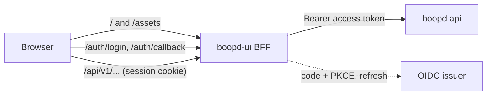

# UI

`boopd-ui` is boop's management UI: the estate, Renovate's pull
requests, what is waiting on a human, packages, repositories, runs and
events, plus a public status page. It is a Bun process, a BFF
(backend-for-frontend) that signs users in, holds the session and
proxies `/api` to [`boopd api`](api.md), and it serves the React SPA.

- The design is [DESIGN-0004 § The UI](design/0004-boopd-api-and-management-ui-event-store-pr-inventory-and-estate.md).
- The code is in [`ui/`](../ui/README.md).

<!--toc:start-->
- [What you get](#what-you-get)
- [1. Set up the identity provider](#1-set-up-the-identity-provider)
- [2. Create the UI's Secret](#2-create-the-uis-secret)
- [3. Turn on the UI in the chart](#3-turn-on-the-ui-in-the-chart)
- [4. Verify](#4-verify)
- [Sessions and key rotation](#sessions-and-key-rotation)
- [Pages](#pages)
- [The status page](#the-status-page)
- [Security](#security)
- [Rollback](#rollback)
<!--toc:end-->

## What you get



- **The browser never holds a token.** It holds a sealed session
  cookie. The BFF adds the user's access token to each `/api` request
  it forwards, and refreshes the token near expiry.
- **The BFF keeps no state**, so replicas need no shared store.
- **One upstream.** `API_UPSTREAM` is the API Service. Nothing in a
  request chooses where the proxy forwards.

## 1. Set up the identity provider

The UI signs in through the confidential client `boopd-ui` (the
authorization code flow with PKCE). Its access tokens must carry the
API's audience. [api.md § 1](api.md#1-set-up-the-identity-provider)
sets up both clients, the audience mapper and the groups mapper.

For the UI specifically:

- **Redirect URI.** `https://<ui host>/auth/callback`.
- **Post-logout redirect URI.** `https://<ui host>/`. Sign-out ends the
  IdP session when the issuer advertises `end_session_endpoint`.
- **Refresh tokens.** The default scopes include `offline_access`. Keep
  refresh tokens on for the client, or sessions end when the first
  access token expires.
- **Issuers without an audience mapper** take one as an authorize
  parameter: `ui.oidc.authorizationParams: {audience: boopd-api}`.

## 2. Create the UI's Secret

```sh
kubectl -n boopd create secret generic boopd-ui \
  --from-literal=client-secret='<boopd-ui client secret>' \
  --from-literal=session-keys="$(openssl rand -base64 48)"
```

- **`client-secret`** is the `boopd-ui` client's secret.
- **`session-keys`** is a comma-separated list, newest first, of
  secrets of 32 bytes or more. The first seals sessions, and any of
  them opens one (see
  [Sessions and key rotation](#sessions-and-key-rotation)).

## 3. Turn on the UI in the chart

The UI needs the API, which needs the store:

```yaml
api:
  enabled: true
  # ...
ui:
  enabled: true
  publicURL: https://boop.example.com      # the origin; https
  existingSecret: boopd-ui
  oidc:
    issuer: https://keycloak.example/realms/fartlab
    clientId: boopd-ui
  # sessionTTL: 8h
  links:
    - {label: Grafana, url: https://grafana.example.com/d/boopd}
  ingress:
    enabled: true
    className: tailscale
    hosts: [{host: boop.example.com}]
    tls: [{hosts: [boop.example.com]}]
```

- **`publicURL`** is the UI's origin, with no path. The redirect URI is
  built from it. It must be https, because the session cookie is
  `Secure`; http is allowed only on `localhost` (the e2e).
- **Routes.** `ui.ingress` or `ui.httpRoute` routes `/` to the UI.
  `/api` goes to the UI too, which proxies it, so the API needs no
  route of its own for the browser.
- **The UI's pod** has no ServiceAccount token, no volumes and a
  read-only root filesystem. Its secrets arrive as env from
  `ui.existingSecret`.
- **A private CA.** For an IdP under one, add `NODE_EXTRA_CA_CERTS`
  through `ui.extraEnv`, with the CA in `ui.extraVolumes` and
  `ui.extraVolumeMounts`.
- **Network policy.** With `networkPolicies.enabled`, the UI takes
  ingress from `ui.networkPolicy.from` (the ingress controller or
  gateway). It reaches only DNS, the API pods and the IdP
  (`ui.networkPolicy.idp`, port 443 by default).

## 4. Verify

1. Open `publicURL`. You are sent to the IdP and back to the estate.
2. **"No owners visible"** means the token's groups map to no owner in
   the API's authz file. Check the groups mapper and
   [the authz file](api.md#2-write-the-authz-file).
3. **A 401 loop** means the access token lacks the API's audience.
   Check the audience mapper.
4. As an operator, open a repository and press **Recheck**. The
   repository's timeline shows `action.recheck` with your name, and the
   run follows.

## Sessions and key rotation

- **The cookie.** A session is a JWE (`dir`, `A256GCM`) in a `__Host-`
  cookie, chunked when it outgrows one. It is `HttpOnly`, `Secure`,
  `SameSite=Lax` and `Path=/`, and it holds the tokens and the
  session's absolute end.
- **Lifetime.** `UI_SESSION_TTL` (`ui.sessionTTL`, default `8h`) bounds
  every session. Refreshing the access token never extends it, so a
  user signs in again at least that often.
- **A failed refresh signs the user out.** This happens when the IdP
  revoked the session or the user was disabled.
- **Sign-out** revokes the refresh token when the issuer has a
  revocation endpoint, then ends the IdP session.

To rotate the session keys without signing anyone out:

1. Prepend a new key: `session-keys=<new>,<old>`. Roll the UI pods.
   New sessions seal under the new key, and existing ones still open
   under the old.
2. After `UI_SESSION_TTL` has passed, drop the old key and roll again.

To sign everyone out at once, replace the list with a single new key.

## Pages

Every page reads the API with the caller's scope, so two users can see
different numbers. Lists refresh every 30 s, events every 15 s, and a
repository with a run in progress every 5 s.

| Page | Path | What |
| - | - | - |
| Estate | `/` | Fleet numbers and their series over a range: repositories, open PRs, waiting items, runs, spend. |
| Pull requests | `/pulls` | Renovate's open PRs, oldest first, with filters as chips; a drawer shows a PR's updates and timeline. |
| Waiting | `/waiting` | Dependency Dashboard items waiting on a human, by section, with links to each dashboard. |
| Packages | `/packages`, `/packages/<purl>` | Packages by purl; a package shows who depends on it and the proposed updates. |
| Repositories | `/repositories`, `/repositories/<id>` | Repositories by slug; a repository has tabs for its timeline, runs, PRs, waiting items, dependencies and config, and operators get **Recheck**. |
| Runs | `/runs` | Runs across the fleet with outcome, duration and rate-limit spend. |
| Events | `/events` | The event log. |
| Deliveries | `/deliveries` | Webhook deliveries and GitHub's view of them (owners `"*"` only; others see why). |
| Status | `/status` | The public status page. |

The owner scope and the time range stay with you as you move between
pages, and they live in the URL, so a link shares the view.

## The status page

`/status` needs no sign-in. It shows aggregates only, with no owner or
repository names:

- an overall state and the boopd version;
- each component's state and age: the API, ingest, the workers,
  Temporal, Postgres, discovery, deliveries and the GitHub budget;
- the fleet's totals: repositories and open PRs.

With `boopd.api.statusPublic: false`, the API wants a token for it, and
the page then works only for signed-in users.

## Security

- **CSP.** `default-src 'self'; connect-src 'self'; frame-ancestors
  'none'; script-src 'self'`. The build is checked for `data:` URLs and
  third-party font URLs (`check:dist`), so the policy needs no
  exceptions.
- **The proxy is read-only except one action.** It forwards GET and
  HEAD. The single POST it forwards is
  `/api/v1/repositories/{id}/recheck`, and only from the UI's own
  `Origin`, which refuses cross-site requests. The API still checks the
  operator group.
- **Tokens stay server-side.** They live in the sealed cookie, which
  only the BFF can open, and never reach the page's JavaScript.
- **Authorization is the API's.** The UI hides **Recheck** from
  non-operators as a courtesy; the API is what refuses them.

## Rollback

Set `ui.enabled: false`. The UI holds no state; signed-in users get a
404 from the route, and the API is unaffected.
