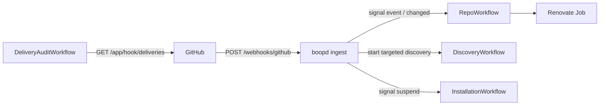

# Webhooks

`boopd ingest` receives the GitHub App's webhook deliveries and turns
each one into a Temporal signal, so a ticked Dependency Dashboard box or
a pushed config file runs Renovate within seconds instead of at the next
cadence or discovery pass. This guide enables it on a running boopd.
The design is [DESIGN-0003](design/0003-webhook-ingest-ingest-role-repoworkflow-event-and-changed.md);
the config reference is [config.md](config.md).

<!--toc:start-->
- [What you get](#what-you-get)
- [1. Create the webhook secret](#1-create-the-webhook-secret)
- [2. Turn on ingest in the chart](#2-turn-on-ingest-in-the-chart)
- [3. Expose the webhook path](#3-expose-the-webhook-path)
- [4. Set up the App webhook](#4-set-up-the-app-webhook)
- [5. Verify](#5-verify)
- [What is routed](#what-is-routed)
- [What is recorded](#what-is-recorded)
- [Lost and failed deliveries](#lost-and-failed-deliveries)
- [Rollback](#rollback)
<!--toc:end-->

## What you get



- **Checkbox clicks run at once.** A ticked box on the dashboard or a PR
  runs after the settle time (30 s by default).
- **PR closed or merged by a person:** a run, at most once per
  `min_interval` (5 min by default).
- **Config pushes onboard and offboard.** A push to the default branch
  that adds, changes or removes a Renovate config file checks the
  repository and onboards, refreshes or offboards it.
- **Repository and installation changes apply now:** renames, transfers,
  archives, default-branch changes, repositories added to or removed
  from the installation, suspend and uninstall.

Nothing else changes. The cadence, the absence check and the discovery
Schedule keep running, so a lost delivery costs only the latency you
have without webhooks.

Ingest is stateless and talks only to Temporal. It holds the webhook
secret and the Temporal client credentials; it has no App key, no
ServiceAccount token and no egress to GitHub.

## 1. Create the webhook secret

Generate a random secret and store it in a Secret in the release
namespace:

```sh
secret="$(openssl rand -hex 32)"
kubectl -n boopd create secret generic boop-bot-webhook --from-literal=secret="$secret"
```

Keep `$secret` for step 4. Only the ingest pods mount this Secret.

## 2. Turn on ingest in the chart

Name the Secret in the App's `webhook` block and enable the role:

```yaml
boopd:
  apps:
    boop-bot:
      # ... appId, privateKeySecretRef, ...
      webhook:
        secretRef: {name: boop-bot-webhook, key: secret}
        # bot: boop-bot[bot]   # default "<app name>[bot]"
  # Optional; these are the defaults.
  ingest:
    path: /webhooks/github
    settle: 30s
    minInterval: 5m
    auditEvery: 15m

ingest:
  enabled: true
```

This renders a `<release>-ingest` Deployment (two replicas), its
ServiceAccount with no token, a Service on port 8080 and a
PodDisruptionBudget. The render fails if `ingest.enabled` is set and no
App has a `webhook` block.

`ingest` shares the worker's `temporal.*` settings. To give it its own
OIDC client (for example `boopd-ingest` in Keycloak), set
`ingest.temporalOidc.clientId` and `ingest.temporalOidc.existingSecret`
(a Secret with key `client-secret`).

With `networkPolicies.enabled`, the ingest pods also get a
NetworkPolicy:

- ingress on the webhook port from `ingest.networkPolicy.from` (your
  ingress controller or gateway) only;
- ingress on the metrics port from `ingest.networkPolicy.metricsFrom`
  (Prometheus) only;
- egress to DNS and `ingest.networkPolicy.temporal` (TCP 7233 by
  default) only.

An empty `from` admits nothing, so set it before you expose the route.
With `temporal.auth.oidc`, ingest fetches its own token: add an
egress rule for the token endpoint (Keycloak's port, for example 8080)
to `ingest.networkPolicy.temporal`, or Temporal calls fail with 403.

The worker also starts a `delivery-audit/<app>` Schedule for each App
with a `webhook` block (see [Lost and failed deliveries](#lost-and-failed-deliveries)).

## 3. Expose the webhook path

GitHub must reach `https://<host><ingest.path>`. The chart routes only
that path: never `/healthz`, `/readyz` or metrics. Use one of the two
routes per host; the render fails if both claim the same host.

An Ingress:

```yaml
ingest:
  ingress:
    enabled: true
    className: tailscale        # or nginx, traefik, ...
    hosts:
      - host: boop-hooks.example.com
    tls:
      - hosts: [boop-hooks.example.com]
```

A Gateway API `HTTPRoute`:

```yaml
ingest:
  httpRoute:
    enabled: true
    parentRefs:
      - {name: public-gateway, namespace: gateway-system, sectionName: https}
    hostnames: [boop-hooks.example.com]
```

**Tailscale Funnel.** With the Tailscale operator, use
`className: tailscale` and the annotation
`tailscale.com/funnel: "true"` under `ingest.ingress.annotations`. The
host is the node's tailnet name (`<name>.<tailnet>.ts.net`), and Funnel
makes only that Ingress public.

## 4. Set up the App webhook

In the App's settings (**Settings → Developer settings → GitHub Apps →
boop-bot → General**):

1. Tick **Webhook → Active**.
2. **Webhook URL:** `https://boop-hooks.example.com/webhooks/github`.
3. **Webhook secret:** the `$secret` from step 1.
4. Save.

Then under **Permissions & events → Subscribe to events**, tick
**Issues**, **Pull request**, **Push** and **Repository**. GitHub always
sends `installation` and `installation_repositories`. No new permissions
are needed.

## 5. Verify

- **Ping.** Saving the webhook sends a `ping`. Under **Advanced →
  Recent deliveries** it shows `200`. A `401` means the secret differs;
  a `400` means the delivery's App ID matches no App with a `webhook`
  block; a connection error means the route is not reachable.
- **Logs.** Every delivery is one `delivery` log line from ingest, with
  `delivery_id`, `event`, `outcome` and `status`.
- **A tick.** Tick a box on a Dependency Dashboard. Within about a
  minute the worker logs `run-scheduled` with `reason=dashboard`, then
  the run.
- **Metrics.** `boopd_ingest_deliveries_total{outcome="routed"}` on the
  ingest pods' metrics port goes up.

## What is routed

The first matching row wins. "The bot" is the App's `webhook.bot`.

| Event | When | What boopd does |
| --- | --- | --- |
| any | the sender is the bot | nothing: boopd's own write |
| `issues` | `edited` on an issue the bot opened | run soon (dashboard), skipping `min_interval` |
| `pull_request` | `edited` on a PR the bot opened | run soon (PR checkbox), skipping `min_interval` |
| `pull_request` | `closed` on a PR the bot opened | run, at most once per `min_interval` |
| `push` | to the default branch, touching a `renovate.config_paths` file, or at GitHub's 2048-commit cap | check the repository, then onboard, refresh or offboard it |
| `repository` | `renamed`, `transferred`, `archived`, `unarchived`, `deleted`, `edited` with a default-branch change | check the repository, then refresh or offboard it |
| `installation_repositories` | `added` | discover that installation |
| `installation_repositories` | `removed` | check each removed repository |
| `installation` | `created`, `new_permissions_accepted` | discover that installation |
| `installation` | `suspend`, `unsuspend` | pause or resume runs; `unsuspend` also discovers |
| `installation` | `deleted` | offboard each listed repository |
| anything else | | nothing |

A run an event asks for waits `settle` and merges with later events, so
a burst gives one run. An event for a repository boopd has not
onboarded is ignored, except the config push, which onboards it after
checking it really has a config file.

Ingest answers `202` once the signals are sent, `200` to `ping`, `401`
on a bad signature, `400` on an unknown App or a body that does not
decode, `413` above 25 MiB, and `503` when Temporal does not answer
within 5 s.

## What is recorded

Every delivery is recorded, including ignored ones and the bot's own,
with its `delivery_id`, App, installation, repository, event, action,
sender, subject (issue or PR number, or the push's ref), outcome, status
and the Temporal actions taken. A rejected delivery keeps only its
headers: an unverified body is never stored. Today the record is the
`delivery` log line and `boopd_ingest_deliveries_total{app, event,
outcome}`; DESIGN-0004's store replaces the log line.

Outcomes: `routed` (a signal took effect), `ignored` (nothing to do, or
the repository is not onboarded), `own` (the bot's own write),
`rejected` (bad signature, unknown App, too large) and `failed`
(Temporal unreachable; GitHub got a 503).

## Lost and failed deliveries

GitHub keeps every delivery for 3 days under **Advanced → Recent
deliveries**, where you can redeliver one. boopd never replays on its
own: the cadence and the discovery Schedule still cover a lost event.

The `delivery-audit/<app>` Schedule reads that list with the App JWT
every `ingest.auditEvery` (15 min) and counts, per App and event:

- `boopd_ingest_deliveries_failed_total`: deliveries whose last attempt
  was not 2xx (ingest answered 503, or GitHub could not connect);
- `boopd_ingest_deliveries_missed_total`: deliveries GitHub has and
  ingest never recorded. It stays at 0 until DESIGN-0004's store holds
  ingest's records to compare against.

Both are worker metrics. With `prometheusRule.enabled` and ingest on,
two alerts fire:

- `BoopdIngestFailing`: ingest answered 503 in the last 15 minutes;
- `BoopdDeliveriesLost`: the audit found failed or missed deliveries in
  the last hour.

The worker log names each failed delivery at warn, with its GUID, so
you can find and redeliver it.

## Rollback

Untick **Webhook → Active** in the App settings, or set
`ingest.enabled: false`. Workflows then behave as they do without
webhooks, and any run an event already scheduled still happens. The
delivery audit keeps reading while the App has a `webhook` block;
remove the block to stop it.
